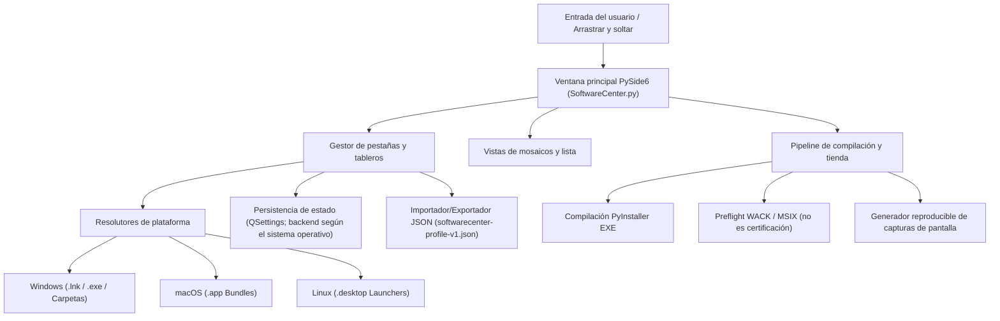
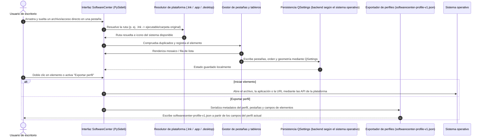

# SoftwareCenter

[](https://www.python.org/)
[](NOTICE)
[](https://docs.pytest.org/)
[](https://github.com/file-bricks/SoftwareCenter)
[](SECURITY.md)
[](SECURITY.md)
[](LICENSE)
[](https://doc.qt.io/qtforpython-6/)
[](https://github.com/file-bricks)
[](https://github.com/open-bricks)
[](llms.txt)

[English](README.md) · [Deutsch](README_de.md) · [Español](README.es.md) · [简体中文](README_zh.md) · [日本語](README_ja.md) · [Русский](README_ru.md)

Un organizador de escritorio ligero y multiplataforma para gestionar accesos directos de software mediante categorización basada en pestañas.

> [!NOTE]
> **Integración de IA / LLM e índice legible por máquinas:** SoftwareCenter proporciona metadatos estructurados en [`llms.txt`](llms.txt) y admite migraciones de perfiles a través de JSON versionado (`softwarecenter-profile-v1.json`).


## Navegación rápida

- [Referencia rápida](#referencia-rápida)
- [Características](#características)
- [Personas objetivo y descubribilidad](#personas-objetivo-y-descubribilidad)
- [Capacidades y límites de SoftwareCenter](#matriz-comparativa-frente-a-alternativas)
- [Arquitectura del sistema](#arquitectura-del-sistema)
- [Flujo del ciclo de vida](#flujo-del-ciclo-de-vida)
- [Capacidades centrales y límites de evidencia](#capacidades-centrales-e-invariantes-de-seguridad)
- [Ecosistema hermano y productos relacionados](#ecosistema-hermano-y-productos-relacionados)
- [Contexto de descubrimiento](#contexto-de-descubrimiento)
- [Requisitos](#requisitos)
- [Instalación](#instalación)
- [Ejecución](#ejecución)
- [Uso](#uso)
- [Compilar ejecutable](#compilar-ejecutable)
- [Controles de calidad](#controles-de-calidad)
- [Mantenimiento desatendido del catálogo](#mantenimiento-desatendido-del-catálogo)
- [Formato de intercambio](#formato-de-intercambio)
- [LaunchBoards](#launchboards)
- [Límites de producto hermano](#límites-de-producto-hermano)
- [Activos de Windows Store](#activos-de-windows-store)
- [Pila tecnológica](#pila-tecnológica)
- [Política de seguridad](#política-de-seguridad)
- [Licencias de terceros y gobernanza](#licencias-de-terceros-y-gobernanza)
- [Licencia](#licencia)
- [Responsabilidad](#responsabilidad)

## Referencia rápida

| Atributo | Detalles |
|---|---|
| **Pila tecnológica** | Python 3.10+ / PySide6 (Qt) / QSettings |
| **Licencia** | Código del proyecto: MIT; PySide6 y las demás dependencias tienen condiciones propias (véase [THIRD_PARTY_LICENSES.md](THIRD_PARTY_LICENSES.md)) |
| **Formato de intercambio** | `softwarecenter-profile-v1.json` (ver [EXPORTFORMAT.md](EXPORTFORMAT.md)) |
| **Última verificación** | 2026-09-23 (local: suite completa pytest, pruebas de plataforma, compileall, Ruff, auditoría de dependencias, integración con menús contextuales, atribución NOTICE, blindaje CI) |

## Características

- **Organización por pestañas** - Agrupa programas en pestañas renombrables y reorganizables
- **Arrastrar y soltar** - Añade archivos y accesos directos arrastrándolos a la ventana
- **Dos modos de vista** - Mosaicos (iconos grandes) y vista de lista compacta
- **Guardado automático** - Las pestañas, los contenidos y la geometría de ventana se guardan automáticamente
- **Menú contextual** - Clic derecho para abrir, editar notas o eliminar accesos directos
- **Multiplataforma** - Compatible de forma nativa con Windows, macOS y Linux
- **Iconos nativos** - Extracción y visualización automática de iconos de aplicaciones del sistema
- **Resolución de accesos directos en Windows** - Los archivos `.lnk` se resuelven al destino ejecutable o carpeta original
- **Paquetes de aplicaciones macOS** - Arrastra y suelta paquetes `.app` directamente en el organizador
- **Lanzadores de escritorio Linux** - Las entradas `.desktop` muestran su nombre real y se ejecutan mediante su comando nativo
- **Exportación e importación de perfiles** - Formato versionado `softwarecenter-profile-v1.json` para copias de seguridad y migraciones
- **Selección múltiple** - Eliminación masiva de accesos directos seleccionados
- **Funcionamiento local** - El código del organizador no implementa cuentas, telemetría ni sincronización con la nube. Las URL HTTP(S) y los programas se abren mediante la plataforma y pueden usar la red.

## Personas objetivo y descubribilidad

SoftwareCenter está diseñado para resolver cuellos de botella de flujo de trabajo específicos para cuatro perfiles de usuario:

| Persona | Perfil y responsabilidades clave | Punto de fricción principal | Solución de SoftwareCenter |
|---|---|---|---|
| **Persona 1: Usuarios avanzados de escritorio y curadores** | Usuarios que gestionan decenas de herramientas, carpetas de trabajo y utilidades a diario. | Escritorio de Windows saturado, lentitud de búsqueda en el Menú Inicio, falta de agrupación personalizada. | Tableros basados en pestañas rápidas, organización de archivos por arrastrar y soltar, cambio instantáneo. |
| **Persona 2: Desarrolladores de software y DevOps** | Ingenieros que gestionan toolchains, lanzadores de CLI, entornos virtuales y aplicaciones portátiles. | Mezcla de herramientas de desarrollo en el menú de inicio general; lanzadores pesados con consumo de RAM. | SoftwareCenter y LaunchBoards tienen identidades de producto separadas; en Windows, los lanzamientos de archivos solicitan el directorio de destino como directorio de trabajo cuando es posible. No es un gestor de entornos de proyecto; el comportamiento depende del sistema y de la aplicación objetivo. |
| **Persona 3: Usuarios de varias estaciones de trabajo** | Usuarios que trasladan perfiles manualmente entre varios equipos. | Las rutas absolutas pueden no existir en otro dispositivo; las etiquetas y notas opcionales pueden revelar detalles privados. | Exportación/importación versionada con `softwarecenter-profile-v1.json`; revise rutas y notas antes de compartirlo. Tras la confirmación, la importación sustituye el perfil actual; no se copian los archivos de destino. |
| **Persona 4: Usuarios preocupados por la privacidad** | Personas que prefieren ajustes del organizador guardados localmente y sin funciones integradas de cuenta o telemetría. | Las rutas y notas guardadas pueden revelar detalles locales; las URL abiertas y los programas ejecutados pueden comunicarse por la red. | El código revisado del organizador no implementa cuentas, telemetría ni sincronización con la nube. No garantiza confidencialidad, cero salida de red de los procesos iniciados ni los privilegios de los programas objetivo. |

### Términos de búsqueda destacados

- `SoftwareCenter lanzador de aplicaciones de escritorio Python`
- `gestor de accesos directos PySide6 local`
- `organizador de escritorio por pestañas sin nube`
- `lanzador portátil de programas sin telemetría`
- `SoftwareCenter vs LaunchBoards cambio de perfil`
- `organizador de programas de escritorio de código abierto`

<a id="matriz-comparativa-frente-a-alternativas"></a>
## Capacidades y límites de SoftwareCenter

| Capacidad | Comportamiento implementado | Límite |
|---|---|---|
| **Organización por pestañas** | Agrupa entradas de rutas en pestañas con nombre y vistas de mosaico o lista. | Las pestañas organizan referencias; no son entornos de ejecución por proyecto. |
| **Rutas locales y URL** | El arrastrar y soltar puede registrar rutas locales compatibles y URL HTTP(S). | Las entradas apuntan a destinos; el organizador no copia su contenido. |
| **Tratamiento de destinos según plataforma** | En Windows, la resolución de `.lnk` acepta destinos `.exe` o carpetas existentes; macOS abre paquetes de apps mediante `open`; Linux lee nombre, icono y `Exec` de entradas `.desktop`. | La resolución y el lanzamiento dependen del sistema. Linux ejecuta `Exec` como comando; no es un entorno aislado para scripts. |
| **Directorio de trabajo** | En Windows, los lanzamientos de archivos solicitan la carpeta del destino como directorio de trabajo cuando es posible. | Los fallbacks pueden omitirlo; no se garantiza el CWD del proceso padre ni un directorio de trabajo común a todas las plataformas. |
| **Ajustes locales** | Qt `QSettings` guarda pestañas, entradas, vistas y estado de ventana en el espacio de ajustes del producto. | Qt y el sistema operativo proporcionan el almacenamiento; no se garantiza escritura atómica ni descriptores de seguridad. |
| **Exportación de perfiles** | `softwarecenter-profile-v1.json` incluye metadatos del perfil, pestañas, vistas y entradas con `label`, `path`, `kind` y `notes` opcionales. | Las rutas, etiquetas y notas pueden revelar detalles locales; no se copian los archivos de destino. |
| **Importación de perfiles** | El importador comprueba el formato y la versión, normaliza las entradas y pide confirmación antes de sustituir el perfil. | Tras confirmar, la importación sustituye el perfil actual; no combina perfiles ni garantiza que no se pierdan datos en general. |
| **Identidades de producto** | SoftwareCenter y LaunchBoards comparten implementación, pero tienen espacios de ajustes, endpoints de instancia única e identidades de Store separados. | Separa dos productos; no ofrece perfiles seleccionables por usuario dentro de SoftwareCenter. |
| **Límite de red** | El código revisado del organizador no implementa cuentas, telemetría ni sincronización con la nube. | Abrir URL HTTP(S) o destinos externos puede usar la red; no se garantiza cero salida de red para la aplicación ni para los procesos iniciados. |
| **Alcance de las verificaciones** | Las pruebas del repositorio cubren contratos concretos; CI ejecuta la matriz de versiones de Python en Ubuntu y trabajos smoke separados para Linux/macOS. | Esto no demuestra CI en un runner Windows, certificación WACK, publicación en Store ni seguridad universal en tiempo de ejecución. |

## Arquitectura del sistema



## Flujo del ciclo de vida



<a id="capacidades-centrales-e-invariantes-de-seguridad"></a>
## Capacidades centrales y límites de evidencia

| Tema | Evidencia en código y pruebas revisados | Alcance y límite |
|---|---|---|
| **Red del organizador** | El código revisado no implementa cuentas, telemetría ni sincronización con la nube; `open_file` delega las URL HTTP(S) a Qt o al navegador del sistema. | Revisar el código no mide la actividad de red en ejecución de SoftwareCenter, del navegador ni de los procesos iniciados. |
| **Contexto de lanzamiento** | La apertura de archivos y URL se delega a las API de la plataforma; en Windows, el código solicita el directorio de destino como directorio de trabajo cuando está disponible. | El código y las pruebas revisados no verifican descriptores de seguridad de procesos ni imponen privilegios a procesos secundarios. |
| **Eliminación de entradas** | La interfaz quita entradas de la lista y del estado del perfil guardado sin borrar los archivos referenciados. | Esto no describe los destinos que abra o modifique un programa externo. |
| **Resolución por plataforma** | La búsqueda de destinos Windows `.lnk` usa COM con una alternativa en PowerShell; se parsea `Exec` de Linux `.desktop` y después se ejecuta. | Estos controladores no aíslan el comportamiento del destino; pueden ejecutar comandos configurados o programas externos. |
| **Persistencia QSettings** | `save_settings` escribe pestañas, entradas, vistas, geometría e idioma mediante Qt `QSettings`. | El código no afirma que las escrituras sean transaccionales o resistentes a fallos. |
| **Datos del perfil** | `softwarecenter-profile-v1.json` incluye campos del perfil y entradas con `label`, `path`, `kind` y `notes` opcionales; la importación sustituye el perfil actual tras confirmación. | Los valores pueden revelar detalles locales; las pruebas cubren casos de prueba y una operación de exportación e importación de ida y vuelta, pero no demuestran la detección ni la eliminación de secretos arbitrarios. Véase `tests/test_export_contract.py`. |
| **Separación de productos** | `scripts/verify_product_boundaries.py` y las pruebas de producto comprueban espacios de ajustes y endpoints de instancia única separados para SoftwareCenter y LaunchBoards. | Es separación entre productos, no perfiles de usuario o de proyecto. Véase `PRODUCT_BOUNDARIES.md` y `tests/test_product_boundaries.py`. |
| **Alcance de CI y las versiones** | CI ejecuta la matriz de versiones de Python en Ubuntu y trabajos smoke independientes para Linux/macOS. | Esto no implica CI en un runner Windows, certificación WACK, publicación en Store ni seguridad universal en tiempo de ejecución. Véase `CI_CONTRACT.md`. |

## Ecosistema hermano y productos relacionados

SoftwareCenter forma parte de la colección de herramientas de escritorio **file-bricks** y de la iniciativa de código abierto **open-bricks**:

| Proyecto | Ecosistema | Enfoque principal | Integración / Sinergia |
|---|---|---|---|
| [`ProFiler`](https://github.com/file-bricks/ProFiler) | `file-bricks` | Inspección de documentos y medios | Aplicación complementaria para perfilado forense de documentos |
| [`ExplorerPro`](https://github.com/file-bricks/ExplorerPro) | `file-bricks` | Explorador de archivos multipestaña | Gestión avanzada de archivos de doble panel para accesos directos de SoftwareCenter |
| [`CloudLockFixer`](https://github.com/file-bricks/CloudLockFixer) | `file-bricks` | Desbloqueo y reparación de bloqueos de nube | Desbloquea marcadores de posición de OneDrive referenciados en accesos directos |
| [`knowledgedigest`](https://github.com/file-bricks/knowledgedigest) | `file-bricks` | Base de conocimiento Markdown | Organizador de notas y síntesis para flujos de trabajo de investigación |
| [`FormularErstellen`](https://github.com/doc-bricks/FormularErstellen) | `doc-bricks` | Creación de plantillas y formularios | Generador de documentos de escritorio ejecutable mediante SoftwareCenter |
| [`USR_PDFunlock`](https://github.com/doc-bricks/USR_PDFunlock) | `doc-bricks` | Desbloqueo y gestión de PDF | Utilidad local no destructiva para documentos PDF |
| [`safe-start-for-codex`](https://github.com/dev-bricks/safe-start-for-codex) | `dev-bricks` | Control de inicio para automatizaciones | Protege las estaciones de trabajo de picos de carga durante el arranque |
| [`MethodenAnalyser`](https://github.com/dev-bricks/MethodenAnalyser) | `dev-bricks` | Analizador AST de código fuente | Análisis estático para módulos y aplicaciones de escritorio en Python |
| [`connectors`](https://github.com/ellmos-ai/connectors) | `ellmos-ai` | Puente de comunicación para agentes | Adaptadores de mensajería y transporte sin dependencias |
| [`open-bricks`](https://github.com/open-bricks) | `open-bricks` | Paraguas de código abierto de escritorio | Estándares, gobernanza y empaquetado común |

## Contexto de descubrimiento

SoftwareCenter se identifica principalmente como un **lanzador de aplicaciones local-first en PySide6** o un **organizador de accesos directos de escritorio**. Se sitúa entre el menú Inicio de Windows, las carpetas de accesos directos y los sistemas completos de inventario: inicia lo que ya está instalado en el equipo, agrupa accesos directos en pestañas y exporta/importa perfiles portátiles.

Frases de búsqueda útiles:

- `SoftwareCenter PySide6 desktop organizer`
- `local-first app launcher Python PySide6`
- `desktop shortcut organizer with tabs`
- `softwarecenter-profile-v1.json`
- `organizador de escritorio local con exportación de perfiles`

No es Microsoft Configuration Manager Software Center, ni una tienda de aplicaciones, ni un gestor de paquetes de red, ni un portal de despliegue remoto.

## Requisitos

- Python 3.10+
- PySide6

## Instalación

```bash
pip install -r requirements.txt
```

## Ejecución

```bash
python SoftwareCenter.py
```

En Windows, también puede utilizar `START.bat` o el ejecutable precompilado `SoftwareCenter.exe` desde [Releases](https://github.com/file-bricks/SoftwareCenter/releases).

## Uso

| Acción | Instrucciones |
|--------|-------------|
| Añadir programas | Arrastre archivos, carpetas, accesos directos, paquetes `.app` en macOS o lanzadores `.desktop` en Linux a la ventana; los archivos `.lnk` de Windows se resuelven automáticamente a su destino original |
| Organizar pestañas | Barra de herramientas > "Nueva pestaña", doble clic para renombrar |
| Cambiar vista | Barra de herramientas > Mosaicos / Lista |
| Ejecutar programas | Doble clic o clic derecho > Abrir/Iniciar |
| Eliminar accesos directos | Clic derecho > Eliminar (elimina solo el acceso directo, no el archivo original) |
| Exportar perfil | `Archivo > Exportar perfil` o el botón en la barra de herramientas |
| Importar perfil | `Archivo > Importar perfil` o el botón en la barra de herramientas; sustituye el perfil actual |

## Compilar ejecutable

```bash
pip install pyinstaller
python -m PyInstaller --noconfirm --clean SoftwareCenter.spec
```

El archivo ejecutable se generará en `dist/SoftwareCenter.exe`. En Windows, `build_exe.bat` también lo copia a la raíz del proyecto para su uso local.

## Controles de calidad

```bash
python -m compileall -q SoftwareCenter.py manage_translations.py translator.py
python -m json.tool locales/translations.json
python -m json.tool store_package.json
python -m pytest -q
python tests/macos_platform_smoke.py
python tests/linux_platform_smoke.py
python scripts/verify_product_boundaries.py
```

El flujo de trabajo automatizado y su límite web opcional explícito están documentados en [CI_CONTRACT.md](CI_CONTRACT.md).

## Mantenimiento desatendido del catálogo

El reconciliador opcional de catálogo se proporciona como código de tiempo de ejecución Plan-D en `scripts/softwarecenter_sync.py`. Los archivos sincronizados de catálogo y registro son entradas explícitas de la CLI; el comando opera en modo solo lectura salvo que se especifique `--apply`. Los procedimientos de comprobación, lectura nativa y reversión están documentados en [RUNTIME_DAILY_CARE.md](RUNTIME_DAILY_CARE.md).

## Formato de intercambio

Los perfiles se pueden exportar como `softwarecenter-profile-v1.json` e importar posteriormente. El formato incluye metadatos del perfil, pestañas, modos de vista y entradas con `label`, `path`, `kind` y notas opcionales. La aplicación no copia los archivos locales referenciados, pero las rutas, etiquetas y notas pueden contener datos sensibles; la aplicación no detecta ni elimina automáticamente los secretos que puedan contener. Tras la confirmación, la importación sustituye el perfil actual. Las rutas inexistentes permanecen visibles como referencias. Consulte [EXPORTFORMAT.md](EXPORTFORMAT.md) para más detalles.

## LaunchBoards


[LaunchBoards](https://github.com/file-bricks/SoftwareCenter) es el producto hermano de
SoftwareCenter: misma base de código, pero con marca e identidad propias, orientado a
tableros de trabajo intercambiables en lugar de un lanzador general de accesos directos.
Comparte este repositorio y el mismo proceso de publicación — no existe un árbol de
código independiente para LaunchBoards.

## Límites de producto hermano

LaunchBoards comparte la implementación pero dispone de su propio espacio de nombres en QSettings, punto final de instancia única, icono, ejecutable, identidad en la Store y ciclo de versiones. Las comprobaciones estáticas reproducibles y de procesos paralelos aislados se documentan en [PRODUCT_BOUNDARIES.md](PRODUCT_BOUNDARIES.md).

## Activos de Windows Store

La vía de Windows Store incluye un generador reproducible de capturas de pantalla para la interfaz actual. Ejecute `python generate_store_screenshots.py` para regenerar las capturas de Store y `summary.json` en `README/screenshots/store/`.

## Pila tecnológica

| Componente | Tecnología |
|-----------|-----------|
| Lenguaje | Python 3.10+ |
| Framework de interfaz | PySide6 (Qt para Python) |
| Almacenamiento | QSettings (Registro de Windows / INI) |
| Tamaño del código | No se fija un recuento de líneas |

## Política de seguridad

[SECURITY.md](SECURITY.md) describe las versiones compatibles, los canales para comunicar vulnerabilidades, una primera respuesta declarada dentro de 48 horas y un plazo de clasificación de 5 días laborables. Las afirmaciones de la política no equivalen a una verificación en tiempo de ejecución.

## Licencias de terceros y gobernanza

La licencia MIT del repositorio se aplica al código fuente del proyecto. Las dependencias tienen condiciones propias; [THIRD_PARTY_LICENSES.md](THIRD_PARTY_LICENSES.md) recoge metadatos de componentes, pero no garantiza que todas las licencias sean permisivas ni la conformidad de cualquier paquete.

- **Atribución:** [NOTICE](NOTICE) (Atribución canónica de código abierto Lukas Geiger, organizaciones file-bricks y open-bricks).
- **PySide6 y shiboken6:** El inventario recoge términos LGPL-3.0-only; consulte el [texto LGPL-3.0](https://www.gnu.org/licenses/lgpl-3.0.html) y los [metadatos del componente](THIRD_PARTY_LICENSES.md). La licencia MIT del proyecto no se aplica de forma general a estas dependencias.
- **Biblioteca estándar de Python:** [PSF-2.0](https://docs.python.org/3/license.html). Esta licencia no indica si el organizador o los programas que inicia funcionan sin conexión.
- **PyInstaller:** [GPL-2.0-or-later con PyInstaller-exception](https://pyinstaller.org/en/stable/license.html) es una herramienta de compilación; para un paquete distribuido, consulte la licencia upstream y los avisos de distribución en vez de asumir una exención general.
- **Límite de verificación:** Las pruebas cubren contratos concretos de código y documentación; no establecen garantías universales de tiempo de ejecución.

## Licencia

[MIT](LICENSE)

**Nota:** MIT es la licencia del código fuente del proyecto en este repositorio. La aplicación utiliza [PySide6](https://doc.qt.io/qtforpython-6/), que tiene condiciones de licencia propias; véase [THIRD_PARTY_LICENSES.md](THIRD_PARTY_LICENSES.md).

---

## Responsabilidad

Este proyecto es una contribución de código abierto no remunerada. La responsabilidad se limita a dolo y negligencia grave (§ 521 del Código Civil Alemán). Su uso es bajo su propia responsabilidad. Sin garantía ni compromiso de mantenimiento asumido.
