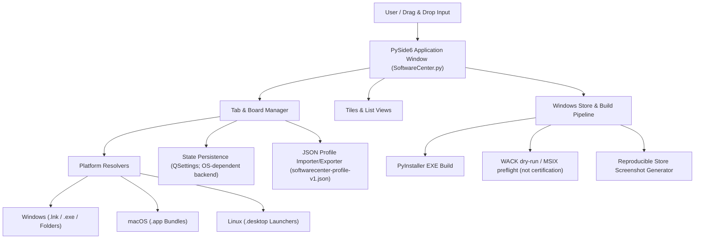
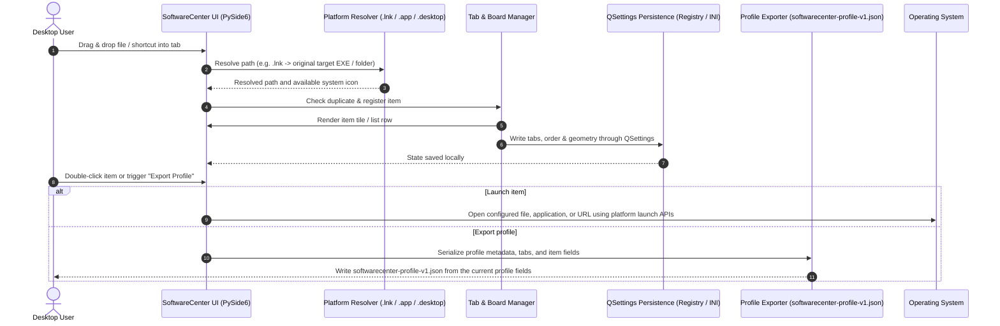

# SoftwareCenter

[](https://www.python.org/)
[](NOTICE)
[](https://docs.pytest.org/)
[](https://github.com/file-bricks/SoftwareCenter)
[](SECURITY.md)
[](SECURITY.md)
[](LICENSE)
[](https://doc.qt.io/qtforpython-6/)
[](https://github.com/file-bricks)
[](https://github.com/open-bricks)
[](llms.txt)

[English](README.md) · [Deutsch](README_de.md) · [Español](README.es.md) · [简体中文](README_zh.md) · [日本語](README_ja.md) · [Русский](README_ru.md) · [Français](README_fr.md) · [हिन्दी](README_hi.md) · [العربية](README_ar.md)

A lightweight, cross-platform desktop organizer for managing software shortcuts with tab-based categorization.

> [!NOTE]
> **LLM / AI Integration & Machine-Readable Index:** SoftwareCenter provides structured machine-readable metadata in [`llms.txt`](llms.txt) and supports profile migrations via versioned JSON (`softwarecenter-profile-v1.json`).


## Quick Navigation

- [Quick Reference](#quick-reference)
- [Features](#features)
- [Target Personas & Discoverability](#target-personas--discoverability)
- [SoftwareCenter Capabilities & Boundaries](#comparative-matrix-vs-alternatives)
- [System Architecture](#system-architecture)
- [Lifecycle Sequence Flow](#lifecycle-sequence-flow)
- [Core Capabilities & Evidence Boundaries](#core-capabilities--safety-invariants)
- [Sibling Ecosystem & Sister Products](#sibling-ecosystem--sister-products)
- [Discovery Context](#discovery-context)
- [Requirements](#requirements)
- [Installation](#installation)
- [Run](#run)
- [Usage](#usage)
- [Build Executable](#build-executable)
- [Quality Checks](#quality-checks)
- [Headless Launcher Catalog Care](#headless-launcher-catalog-care)
- [Exchange Format](#exchange-format)
- [LaunchBoards](#launchboards)
- [Sister-product boundary](#sister-product-boundary)
- [Windows Store Assets](#windows-store-assets)
- [Tech Stack](#tech-stack)
- [Security Policy](#security-policy)
- [Third-Party Licenses & Governance](#third-party-licenses--governance)
- [License](#license)
- [Liability](#liability)

## Quick Reference

| Attribute | Details |
|---|---|
| **Tech Stack** | Python 3.10+ / PySide6 (Qt) / QSettings |
| **License** | Project code: MIT; PySide6 and other dependencies have separate terms (see [THIRD_PARTY_LICENSES.md](THIRD_PARTY_LICENSES.md)) |
| **Exchange Format** | `softwarecenter-profile-v1.json` (see [EXPORTFORMAT.md](EXPORTFORMAT.md)) |
| **Last Checked** | 2026-09-23 (local: full pytest suite, platform smokes, compileall, Ruff, dependency audit, file manager context menu integration, NOTICE attribution, CI lifecycle hardening; WACK remains dry-run only) |

## Features

- **Tab Organization** - Group programs, documents, and folders into renamable, movable boards
- **Drag & Drop & Universal Organizer** - Drop any apps, scripts, documents, folders, or shortcuts directly onto boards; acts as an independent organization layer over the filesystem
- **Empty-Board Guidance** - Helpful placeholder guidance on empty boards showing supported drop targets
- **Two View Modes** - Tiles (large icons) and list
- **Auto Save** - Tabs, contents, and window position are persisted
- **Context Menu** - Right-click to open or remove
- **Cross-Platform** - Windows, macOS, and Linux
- **Native Icons** - Automatic display of system application icons
- **Windows Shortcut Resolution** - Dropped `.lnk` files pointing to `.exe` or folder targets are stored as the original target
- **macOS App Bundles** - Drag and drop `.app` applications directly into the organizer
- **Linux Desktop Launchers** - `.desktop` entries show their app name and launch via their desktop command
- **Profile Export/Import** - Versioned `softwarecenter-profile-v1.json` format for migrations and backups
- **Multi-Selection** - Delete multiple entries at once
- **Local-first operation** - The organizer code has no account, telemetry, or cloud-sync feature; HTTP(S) URLs and launched programs are opened through the platform and may use the network

## Target Personas & Discoverability

SoftwareCenter is designed to address specific workflow bottlenecks across four distinct user personas:

| Persona | Core Profile & Responsibilities | Key Pain Point | SoftwareCenter Solution |
|---|---|---|---|
| **Persona 1: Desktop Power Users & Curators** | Power users running dozens of tools, workspace folders, and utilities daily. | Cluttered Windows desktop, slow Start Menu search latency, lack of persistent custom grouping. | Fast tab-based boards, drag-and-drop file organization, custom notes, and instant switching. |
| **Persona 2: Solo Developers & DevOps Engineers** | Developers managing toolchains, CLI wrappers, portable apps, and virtual environments. | Mixing dev tools into consumer start menus; heavy launcher daemons consuming memory. | SoftwareCenter and LaunchBoards have separate app identities; Windows file launches request the target directory as working directory where supported. This is not a project-environment manager, and target behavior remains OS- and app-dependent. |
| **Persona 3: Multi-PC Workstation Operators** | Users who manually move profiles between workstations. | Absolute paths may not resolve on another device; labels and optional notes may contain private details. | Versioned `softwarecenter-profile-v1.json` export/import; review paths and notes before sharing. Import replaces the current profile after confirmation; target files are not copied. |
| **Persona 4: Privacy-Conscious Users** | People who prefer locally stored organizer settings and no in-app account or telemetry feature. | Saved paths and notes can reveal local details; opening a URL or launched program can communicate over the network. | The inspected organizer code has no account, telemetry, or cloud-sync feature. It does not guarantee confidentiality, zero egress for launched processes, or the privilege behavior of target programs. |

### High-Intent Search Phrases

- `SoftwareCenter Python desktop launcher`
- `PySide6 desktop shortcut manager`
- `local-first desktop organizer python`
- `portable shortcut launcher without cloud account`
- `SoftwareCenter vs LaunchBoards profile switcher`
- `privacy friendly Windows app launcher with tabs`

<a id="comparative-matrix-vs-alternatives"></a>
## SoftwareCenter Capabilities & Boundaries

| Capability | Implemented behavior | Boundary |
|---|---|---|
| **Tab organization** | Groups path entries into named tabs, with tile and list views. | Tabs organize references; they are not per-project execution environments. |
| **Local paths and URLs** | Drag-and-drop can register supported local paths and HTTP(S) URLs. | Entries point to targets; the organizer does not copy their contents. |
| **Platform target handling** | Windows `.lnk` resolution accepts existing `.exe` or folder targets; macOS app bundles use `open`; Linux `.desktop` entries are parsed for name, icon, and `Exec`. | Resolution and launch are OS-specific. Linux `Exec` is launched as a command; this is not a script sandbox. |
| **Working directory** | Windows file launches use `_startfile_in_dir` to request the target file's containing folder as working directory where supported. | Fallbacks may omit an explicit working directory; no parent CWD or cross-platform working-directory guarantee is made. |
| **Local settings** | Qt `QSettings` stores tabs, entries, views, and window state in the product's settings namespace. | Qt and the OS provide the storage backend; no atomic-write or security-descriptor guarantee is claimed. |
| **Profile export** | `softwarecenter-profile-v1.json` carries profile metadata, tabs, views, and entries with `label`, `path`, `kind`, and optional `notes`. | Paths, labels, and notes may reveal local details; target files are not copied. |
| **Profile import** | The importer checks the format/version, normalizes entries, and requests confirmation. | Confirming import replaces the current profile; it is not a merge or a general no-data-loss guarantee. |
| **Product identities** | SoftwareCenter and LaunchBoards share implementation but have separate settings namespaces, single-instance endpoints, and Store identities. | This separates two products; it does not provide user-selectable profiles within SoftwareCenter. |
| **Network boundary** | The inspected organizer source has no account, telemetry, or cloud-sync implementation. | It opens HTTP(S) URLs and launches external targets, which may use the network; no whole-application or launched-process zero-egress guarantee is claimed. |
| **Verification scope** | Repository tests cover named contracts; CI runs the Python version matrix on Ubuntu and separate Linux/macOS smoke jobs. | These checks do not establish behavior on every host, certify WACK/Store submission, or prove universal security properties. |

## System Architecture



## Lifecycle Sequence Flow



<a id="core-capabilities--safety-invariants"></a>
## Core Capabilities & Evidence Boundaries

| Topic | Evidence in inspected code/tests | Scope and limit |
|---|---|---|
| **Organizer network behavior** | The app code has no account, telemetry, or cloud-sync client; `open_file` delegates HTTP(S) URLs to Qt or the platform browser. | Source inspection is not a runtime egress test for SoftwareCenter, the browser, or launched processes. |
| **Launch context** | File and URL launches are delegated to platform APIs; Windows launch code requests a target working directory when available. | The reviewed code and tests do not verify process security descriptors or enforce child-process privileges. |
| **Entry removal** | The UI removes entries from its list and saved profile state without deleting referenced files. | This says nothing about targets opened or modified by an external program. |
| **Platform resolution** | Windows `.lnk` lookup uses COM with a PowerShell fallback; Linux `.desktop` `Exec` data is parsed and then launched. | These handlers do not sandbox target behavior; launching can run configured commands or external programs. |
| **QSettings persistence** | `save_settings` writes tab, entry, view, geometry, and language values through Qt `QSettings`. | The code does not claim an atomic transaction or crash-proof write. |
| **Profile data** | `softwarecenter-profile-v1.json` includes profile fields and entry `label`, `path`, `kind`, and optional `notes`; import replaces the current profile after confirmation. | Values can expose local details; tests cover fixtures and a round trip, not arbitrary secret scrubbing. See `tests/test_export_contract.py`. |
| **Sibling product separation** | `scripts/verify_product_boundaries.py` and the product-boundary tests check separate settings namespaces and single-instance endpoints for SoftwareCenter and LaunchBoards. | This is product separation, not multi-user or per-project profiles. See `PRODUCT_BOUNDARIES.md` and `tests/test_product_boundaries.py`. |
| **CI and release scope** | CI has the Python-version regression matrix on Ubuntu and separate Linux/macOS smoke jobs. | This does not imply Windows-host CI, WACK certification, Store publication, or universal runtime security. See `CI_CONTRACT.md`. |

## Sibling Ecosystem & Sister Products

SoftwareCenter is part of the broader **file-bricks** desktop tools collection and the umbrella **open-bricks** open-source initiative:

| Project | Ecosystem | Primary Focus | Integration / Synergy |
|---|---|---|---|
| [`ProFiler`](https://github.com/file-bricks/ProFiler) | `file-bricks` | Document & media inspection | Companion app for file sorting and forensic document profiling |
| [`ExplorerPro`](https://github.com/file-bricks/ExplorerPro) | `file-bricks` | Multi-tab filesystem explorer | Complementary dual-pane file management for SoftwareCenter shortcuts |
| [`CloudLockFixer`](https://github.com/file-bricks/CloudLockFixer) | `file-bricks` | Cloud lock unlock & repair | Unlocks frozen sync placeholders and OneDrive files referenced by shortcuts |
| [`knowledgedigest`](https://github.com/file-bricks/knowledgedigest) | `file-bricks` | Markdown & document knowledge base | Local-first document digest organizer for research workflows |
| [`FormularErstellen`](https://github.com/doc-bricks/FormularErstellen) | `doc-bricks` | Form creation & templating | Desktop document generator launchable via SoftwareCenter tiles |
| [`USR_PDFunlock`](https://github.com/doc-bricks/USR_PDFunlock) | `doc-bricks` | PDF password & unlock tool | Non-destructive local PDF unlocking utility |
| [`safe-start-for-codex`](https://github.com/dev-bricks/safe-start-for-codex) | `dev-bricks` | Automation startup gate | Protects desktop workstation environments from startup surges |
| [`MethodenAnalyser`](https://github.com/dev-bricks/MethodenAnalyser) | `dev-bricks` | AST source code analyzer | Static analysis for Python desktop tools and modules |
| [`connectors`](https://github.com/ellmos-ai/connectors) | `ellmos-ai` | Agent communication bridge | Zero-dependency messaging and transport adapters |
| [`open-bricks`](https://github.com/open-bricks) | `open-bricks` | Desktop open-source umbrella | Standards, governance, and packaging umbrella |

## Discovery Context

SoftwareCenter is easiest to find as a **local-first PySide6 app launcher** or **desktop shortcut organizer**. It sits between the Windows Start menu, desktop shortcut folders, and full software inventory systems: it launches what is already on your machine, groups shortcuts into tabs, and exports/imports portable profiles.

Useful search phrases:

- `SoftwareCenter PySide6 desktop organizer`
- `local-first app launcher Python PySide6`
- `desktop shortcut organizer with tabs`
- `softwarecenter-profile-v1.json`
- `local-first desktop organizer with profile export`

It is not Microsoft Configuration Manager Software Center, an app store, a package manager, or a remote deployment portal.

## Requirements

- Python 3.10+
- PySide6

## Installation

```bash
pip install -r requirements.txt
```

## Run

```bash
python SoftwareCenter.py
```

On Windows, you can also use `START.bat` or the prebuilt `SoftwareCenter.exe` from the [Releases](https://github.com/file-bricks/SoftwareCenter/releases).

## Usage

| Action | Instructions |
|--------|-------------|
| Add programs | Drag files, folders, shortcuts, `.app` bundles on macOS, or `.desktop` launchers on Linux into the window; Windows `.lnk` files pointing to `.exe` files or folders are resolved to the original target |
| Organize tabs | Toolbar > "New Tab", double-click to rename |
| Switch view | Toolbar > Tiles / List |
| Launch programs | Double-click or right-click > Open/Start |
| Remove entries | Right-click > Delete (removes shortcut only) |
| Export profile | `File > Export Profile` or the toolbar action |
| Import profile | `File > Import Profile` or the toolbar action; replaces the current profile |

## Build Executable

```bash
pip install pyinstaller
python -m PyInstaller --noconfirm --clean SoftwareCenter.spec
```

The EXE will be in `dist/SoftwareCenter.exe`. On Windows, `build_exe.bat` also copies it to the project root for local use.

## Quality Checks

```bash
python -m compileall -q SoftwareCenter.py manage_translations.py translator.py
python -m json.tool locales/translations.json
python -m json.tool store_package.json
python -m pytest -q
python tests/macos_platform_smoke.py
python tests/linux_platform_smoke.py
python scripts/verify_product_boundaries.py
```

The hosted workflow and its explicit optional-web boundary are documented in
[CI_CONTRACT.md](CI_CONTRACT.md).

GitHub Actions runs these smoke checks. The macOS smoke validates `.app` import, `open` launching, QSettings persistence, and profile export on `macos-latest`; the Linux smoke covers `.desktop` import, `Exec`/`xdg-open` launching, QSettings persistence, and profile export on `ubuntu-latest`. Build artifacts and local task/test files are ignored and should not be committed.

For the Windows Store path, `python scripts/run_windows_wack.py --dry-run` checks the local MSIX/AppCert paths and prints the reproducible WACK command. The real certification run should be executed from an elevated PowerShell against a fresh signed MSIX before submission.
`python generate_store_screenshots.py` creates the reproducible Store screenshot set under `README/screenshots/store/`.

## Headless Launcher Catalog Care

The optional catalog reconciler is provided as Plan-D runtime code in
`scripts/softwarecenter_sync.py`. Synchronized catalog and registry files are
explicit CLI inputs; the command is read-only unless `--apply` is supplied.
The pinned-runtime scheduler payload, apply gates, native readback, and rollback
procedure are documented in [RUNTIME_DAILY_CARE.md](RUNTIME_DAILY_CARE.md).

## Exchange Format

Profiles can be exported as `softwarecenter-profile-v1.json` and imported again later. The format carries profile metadata, tabs, view modes, and entries with `label`, `path`, `kind`, and optional `notes`. The app does not copy referenced local files, but paths, labels, and notes can contain sensitive details; the format is not a secret-scrubbing boundary. After confirmation, import replaces the current profile. Missing paths remain visible as references. See [EXPORTFORMAT.md](EXPORTFORMAT.md) for details.

## LaunchBoards


[LaunchBoards](https://github.com/file-bricks/SoftwareCenter) is the sister product of
SoftwareCenter: same codebase, own branding and identity, framed around switchable
workspace boards instead of a general shortcut launcher. It shares this repository and
release pipeline — there is no separate LaunchBoards source tree to maintain.

## Sister-product boundary

LaunchBoards shares the implementation but has its own QSettings namespace,
single-instance endpoint, icon, executable, Store identity, and release path.
The reproducible static, isolated parallel-process, and artifact checks are
documented in [PRODUCT_BOUNDARIES.md](PRODUCT_BOUNDARIES.md).

## Windows Store Assets

The Windows Store track now includes a reproducible screenshot generator for the
current desktop UI. Run `python generate_store_screenshots.py` to refresh
`README/screenshots/store/` with four generated Store screenshots and `summary.json`.

## Tech Stack

| Component | Technology |
|-----------|-----------|
| Language | Python 3.10+ |
| GUI Framework | PySide6 (Qt for Python) |
| Storage | QSettings (Windows Registry / INI) |
| Code Size | See current repository files; no fixed line-count claim |

## Security Policy

The repository's [SECURITY.md](SECURITY.md) describes supported versions, vulnerability-reporting channels, a stated 48-hour initial-response window, and a 5-business-day triage window. Its policy statements should not be read as runtime verification.

## Third-Party Licenses & Governance

The repository's MIT license applies to project source code. Third-party dependencies have their own terms; [THIRD_PARTY_LICENSES.md](THIRD_PARTY_LICENSES.md) records the component metadata but is not a blanket permissive-license or package-compliance guarantee.

- **Attribution:** [NOTICE](NOTICE) (copyright attribution for Lukas Geiger and the file-bricks / open-bricks organizations).
- **PySide6 & shiboken6:** The inventory records LGPL-3.0-only terms; see the [LGPL-3.0 text](https://www.gnu.org/licenses/lgpl-3.0.html) and [component metadata](THIRD_PARTY_LICENSES.md). The project MIT license does not apply as a blanket license to these dependencies.
- **Python Standard Library:** [PSF-2.0](https://docs.python.org/3/license.html). This license does not imply that the organizer or programs it launches operate offline.
- **PyInstaller:** [GPL-2.0-or-later with PyInstaller-exception](https://pyinstaller.org/en/stable/license.html) is build tooling; review the upstream license and distribution notices for a packaged build rather than inferring a blanket exemption.
- **Verification boundary:** Tests cover named code and documentation contracts; they do not establish universal runtime guarantees.

## License

[MIT](LICENSE)

**Note:** MIT is the repository's project-source license. The application uses [PySide6](https://doc.qt.io/qtforpython-6/), which has separate dependency licensing terms; see [THIRD_PARTY_LICENSES.md](THIRD_PARTY_LICENSES.md).

---

## Liability

This project is an unpaid open-source donation. Liability is limited to intent and gross negligence (§ 521 German Civil Code). Use at your own risk. No warranty, no maintenance guarantee, no fitness-for-purpose assumed.
