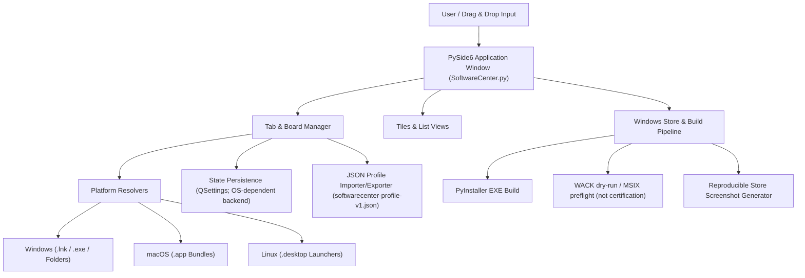
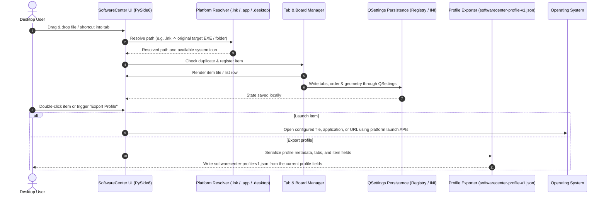

# SoftwareCenter

[](https://www.python.org/)
[](NOTICE)
[](https://docs.pytest.org/)
[](https://github.com/file-bricks/SoftwareCenter)
[](SECURITY.md)
[](SECURITY.md)
[](LICENSE)
[](https://doc.qt.io/qtforpython-6/)
[](https://github.com/file-bricks)
[](https://github.com/open-bricks)
[](llms.txt)

[English](README.md) · [Deutsch](README_de.md) · [Español](README.es.md) · [简体中文](README_zh.md) · [日本語](README_ja.md) · [Русский](README_ru.md) · [Français](README_fr.md) · [हिन्दी](README_hi.md) · [العربية](README_ar.md)

منظّم سطح مكتب خفيف ومتعدد المنصات لإدارة اختصارات البرامج باستخدام تصنيف قائم على علامات التبويب.

> [!NOTE]
> **تكامل LLM / AI وفهرس قابل للقراءة آليًا:** يوفّر SoftwareCenter بيانات وصفية منظّمة وقابلة للقراءة آليًا في [`llms.txt`](llms.txt)، ويدعم ترحيل الملفات الشخصية عبر JSON ذي إصدار (`softwarecenter-profile-v1.json`).


## تنقّل سريع

- [مرجع سريع](#quick-reference)
- [الميزات](#features)
- [الفئات المستهدفة وسهولة الاكتشاف](#target-personas--discoverability)
- [إمكانات SoftwareCenter وحدوده](#comparative-matrix-vs-alternatives)
- [بنية النظام](#system-architecture)
- [تسلسل دورة الحياة](#lifecycle-sequence-flow)
- [الإمكانات الأساسية وحدود الأدلة](#core-capabilities--safety-invariants)
- [النظام البيئي الشقيق والمنتجات المرتبطة](#sibling-ecosystem--sister-products)
- [سياق الاكتشاف](#discovery-context)
- [المتطلبات](#requirements)
- [التثبيت](#installation)
- [التشغيل](#run)
- [الاستخدام](#usage)
- [إنشاء الملف التنفيذي](#build-executable)
- [فحوص الجودة](#quality-checks)
- [صيانة فهرس المشغّلات دون واجهة رسومية](#headless-launcher-catalog-care)
- [تنسيق التبادل](#exchange-format)
- [LaunchBoards](#launchboards)
- [حدود المنتج الشقيق](#sister-product-boundary)
- [موارد Windows Store](#windows-store-assets)
- [المكدس التقني](#tech-stack)
- [سياسة الأمان](#security-policy)
- [تراخيص الأطراف الثالثة والحوكمة](#third-party-licenses--governance)
- [الترخيص](#license)
- [المسؤولية](#liability)

<a id="quick-reference"></a>
## مرجع سريع

| الخاصية | التفاصيل |
|---|---|
| **المكدس التقني** | Python 3.10+ / PySide6 (Qt) / QSettings |
| **الترخيص** | شفرة المشروع: MIT؛ لـ PySide6 والتبعيات الأخرى شروط منفصلة (راجع [THIRD_PARTY_LICENSES.md](THIRD_PARTY_LICENSES.md)) |
| **تنسيق التبادل** | `softwarecenter-profile-v1.json` (راجع [EXPORTFORMAT.md](EXPORTFORMAT.md)) |
| **آخر فحص** | 2026-09-23 (محليًا: مجموعة pytest كاملة، اختبارات smoke للمنصات، compileall، Ruff، تدقيق التبعيات، تكامل قائمة السياق لمدير الملفات، إسناد NOTICE، وتعزيز دورة حياة CI؛ ما يزال WACK في وضع dry-run فقط) |

<a id="features"></a>
## الميزات

- **التنظيم بعلامات تبويب** — جمّع البرامج والمستندات والمجلدات في لوحات يمكن إعادة تسميتها ونقلها
- **السحب والإفلات ومنظّم شامل** — أسقط التطبيقات والبرامج النصية والمستندات والمجلدات والاختصارات مباشرة على اللوحات؛ يعمل كطبقة تنظيم مستقلة فوق نظام الملفات
- **إرشادات اللوحة الفارغة** — تعرض مساحة إرشادية على اللوحات الفارغة أنواع العناصر التي يمكن إسقاطها
- **طريقتا عرض** — مربعات بأيقونات كبيرة وقائمة
- **الحفظ التلقائي** — تُحفَظ علامات التبويب ومحتوياتها وموضع النافذة
- **قائمة السياق** — افتح عنصرًا أو أزله بالنقر بزر الفأرة الأيمن
- **متعدد المنصات** — Windows وmacOS وLinux
- **أيقونات أصلية** — عرض تلقائي لأيقونات تطبيقات النظام
- **حل اختصارات Windows** — تُحفَظ ملفات `.lnk` المسقطة التي تشير إلى `.exe` أو مجلد بوصفها الهدف الأصلي
- **حزم تطبيقات macOS** — اسحب تطبيقات `.app` وأفلتها مباشرة في المنظّم
- **مشغّلات Linux لسطح المكتب** — تعرض إدخالات `.desktop` اسم التطبيق وتشغّله باستخدام أمر سطح المكتب الخاص بها
- **تصدير/استيراد الملفات الشخصية** — تنسيق `softwarecenter-profile-v1.json` ذي الإصدار للترحيل والنسخ الاحتياطي
- **تحديد متعدد** — احذف عدة إدخالات دفعة واحدة
- **العمل مع تفضيل المحلي** — لا تتضمن شفرة المنظّم ميزة حساب أو قياس عن بُعد أو مزامنة سحابية؛ تُفتح عناوين HTTP(S) والبرامج التي يجري تشغيلها عبر المنصة وقد تستخدم الشبكة

<a id="target-personas--discoverability"></a>
## الفئات المستهدفة وسهولة الاكتشاف

صُمّم SoftwareCenter لمعالجة عوائق محددة في سير العمل لدى أربع فئات مختلفة من المستخدمين:

| الفئة | الملف الشخصي والمسؤوليات الأساسية | المشكلة الرئيسية | حل SoftwareCenter |
|---|---|---|---|
| **الفئة 1: مستخدمو سطح المكتب المتقدمون ومنظّمو الأدوات** | يستخدمون يوميًا عشرات الأدوات ومجلدات مساحات العمل والأدوات المساعدة. | فوضى سطح مكتب Windows، وبطء البحث في قائمة Start، وغياب التجميع المخصص الدائم. | لوحات سريعة بعلامات تبويب، وتنظيم الملفات بالسحب والإفلات، وملاحظات مخصصة، والتبديل الفوري. |
| **الفئة 2: المطورون المستقلون ومهندسو DevOps** | يديرون سلاسل الأدوات وأغلفة CLI والتطبيقات المحمولة والبيئات الافتراضية. | اختلاط أدوات التطوير بقوائم Start للمستخدمين العاديين؛ وخدمات المشغّل الثقيلة التي تستهلك الذاكرة. | لكل من SoftwareCenter وLaunchBoards هوية تطبيق منفصلة؛ وعند تشغيل الملفات في Windows يُطلب مجلد الهدف بوصفه دليل العمل حيثما كان ذلك مدعومًا. هذا ليس مديرًا لبيئات المشاريع، ويظل سلوك الهدف معتمدًا على نظام التشغيل والتطبيق. |
| **الفئة 3: مستخدمون يعملون على عدة حواسيب** | ينقلون الملفات الشخصية يدويًا بين محطات العمل. | قد لا تعمل المسارات المطلقة على جهاز آخر؛ وقد تتضمن التسميات والملاحظات الاختيارية تفاصيل خاصة. | تصدير/استيراد بإصدار عبر `softwarecenter-profile-v1.json`؛ راجع المسارات والملاحظات قبل المشاركة. بعد التأكيد، يستبدل الاستيراد الملف الشخصي الحالي؛ ولا تُنسخ الملفات المستهدفة. |
| **الفئة 4: مستخدمون مهتمون بالخصوصية** | يفضّلون تخزين إعدادات المنظّم محليًا وعدم وجود ميزة حساب أو قياس عن بُعد داخل التطبيق. | قد تكشف المسارات والملاحظات المحفوظة تفاصيل محلية؛ وقد يؤدي فتح عنوان URL أو تشغيل برنامج إلى اتصال بالشبكة. | لا تتضمن شفرة المنظّم التي جرى فحصها ميزة حساب أو قياس عن بُعد أو مزامنة سحابية. ولا يضمن ذلك السرية أو انعدام الاتصالات الصادرة من العمليات التي يجري تشغيلها أو سلوك الامتيازات للبرامج المستهدفة. |

### عبارات بحث ذات نية واضحة

- `SoftwareCenter Python desktop launcher`
- `PySide6 desktop shortcut manager`
- `local-first desktop organizer python`
- `portable shortcut launcher without cloud account`
- `SoftwareCenter vs LaunchBoards profile switcher`
- `privacy friendly Windows app launcher with tabs`

<a id="comparative-matrix-vs-alternatives"></a>
## إمكانات SoftwareCenter وحدوده

| الإمكانية | السلوك المطبّق | الحد |
|---|---|---|
| **التنظيم بعلامات تبويب** | يجمع إدخالات المسارات في علامات تبويب مسماة، مع عرض المربعات والقائمة. | تنظّم علامات التبويب المراجع؛ وليست بيئات تنفيذ لكل مشروع. |
| **المسارات المحلية وعناوين URL** | يمكن للسحب والإفلات تسجيل المسارات المحلية المدعومة وعناوين HTTP(S). | تشير الإدخالات إلى أهداف؛ ولا ينسخ المنظّم محتوياتها. |
| **معالجة الأهداف حسب المنصة** | يقبل حل `.lnk` في Windows أهداف `.exe` أو مجلدات موجودة؛ وتُفتح حزم تطبيقات macOS عبر `open`؛ وتُحلّل إدخالات `.desktop` في Linux لاستخراج الاسم والأيقونة و`Exec`. | يختلف الحل والتشغيل حسب نظام التشغيل. ويُشغّل `Exec` في Linux كأمر؛ وهذا ليس عزلًا للبرامج النصية. |
| **دليل العمل** | تستخدم عمليات تشغيل الملفات في Windows الرمز `_startfile_in_dir` لطلب مجلد الملف المستهدف بوصفه دليل العمل متى كان ذلك مدعومًا. | قد لا تحدد مسارات التشغيل الاحتياطية دليل عمل صريحًا؛ ولا يوجد ضمان لدليل العمل الخاص بالعملية الأم أو لسلوك موحّد عبر المنصات. |
| **الإعدادات المحلية** | يخزن Qt `QSettings` علامات التبويب والإدخالات وطرق العرض وحالة النافذة ضمن مساحة أسماء إعدادات المنتج. | يوفّر Qt ونظام التشغيل الواجهة الخلفية للتخزين؛ ولا يُدّعى وجود ضمان للكتابة الذرية أو واصف الأمان. |
| **تصدير الملف الشخصي** | يتضمن `softwarecenter-profile-v1.json` بيانات الملف الشخصي الوصفية وعلامات التبويب وطرق العرض والإدخالات ذات `label` و`path` و`kind` و`notes` الاختيارية. | قد تكشف المسارات والتسميات والملاحظات تفاصيل محلية؛ ولا تُنسخ الملفات المستهدفة. |
| **استيراد الملف الشخصي** | يتحقق المستورد من التنسيق/الإصدار، ويطبّع الإدخالات، ويطلب التأكيد. | عند تأكيد الاستيراد يُستبدل الملف الشخصي الحالي؛ ولا يحدث دمج، ولا يوجد ضمان عام بعدم فقدان البيانات. |
| **هويات المنتجات** | يشترك SoftwareCenter وLaunchBoards في التنفيذ، لكن لكل منهما مساحة أسماء إعدادات ونقاط نهاية للمثيل الواحد وهويات Store منفصلة. | يفصل ذلك بين منتجين؛ ولا يوفر ملفات شخصية قابلة للاختيار من المستخدم داخل SoftwareCenter. |
| **حدود الشبكة** | لا يتضمن مصدر المنظّم الذي جرى فحصه تنفيذًا للحساب أو القياس عن بُعد أو المزامنة السحابية. | يفتح عناوين HTTP(S) ويشغّل أهدافًا خارجية قد تستخدم الشبكة؛ ولا يوجد ضمان بانعدام الاتصالات الصادرة عن التطبيق ككل أو العمليات التي يشغّلها. |
| **نطاق التحقق** | تغطي اختبارات المستودع عقودًا مسماة؛ وتشغّل CI مصفوفة إصدارات Python على Ubuntu واختبارات smoke منفصلة لـ Linux وmacOS. | لا تثبت هذه الفحوص السلوك على كل مضيف، ولا تصادق على WACK أو إرسال Store، ولا تثبت خصائص أمان عامة. |

<a id="system-architecture"></a>
## بنية النظام



<a id="lifecycle-sequence-flow"></a>
## تسلسل دورة الحياة



<a id="core-capabilities--safety-invariants"></a>
## الإمكانات الأساسية وحدود الأدلة

| الموضوع | الأدلة في الشفرة والاختبارات التي جرى فحصها | النطاق والحدود |
|---|---|---|
| **سلوك المنظّم على الشبكة** | لا تتضمن شفرة التطبيق عميلًا للحساب أو القياس عن بُعد أو المزامنة السحابية؛ ويفوّض `open_file` عناوين HTTP(S) إلى Qt أو متصفح المنصة. | لا يشكّل فحص المصدر اختبارًا للاتصالات الصادرة وقت التشغيل من SoftwareCenter أو المتصفح أو العمليات التي يجري تشغيلها. |
| **سياق التشغيل** | تُفوّض عمليات تشغيل الملفات وعناوين URL إلى واجهات المنصة؛ وتطلب شفرة التشغيل في Windows دليل عمل للهدف متى توفر ذلك. | لا تتحقق الشفرة والاختبارات التي روجعت من واصفات أمان العمليات ولا تفرض امتيازات العمليات الفرعية. |
| **إزالة الإدخالات** | تزيل الواجهة الإدخالات من قائمتها ومن حالة الملف الشخصي المحفوظة دون حذف الملفات المشار إليها. | لا يصف ذلك ما قد يفعله برنامج خارجي بالأهداف التي يفتحها أو يعدّلها. |
| **الحل حسب المنصة** | يستخدم البحث عن هدف `.lnk` في Windows واجهة COM مع بديل PowerShell؛ وتُحلّل بيانات `Exec` في `.desktop` على Linux ثم تُشغّل. | لا تعزل هذه المعالجات سلوك الأهداف؛ فقد يؤدي التشغيل إلى تنفيذ أوامر مضبوطة أو برامج خارجية. |
| **استمرارية QSettings** | تكتب `save_settings` قيم علامات التبويب والإدخالات وطرق العرض وأبعاد النافذة واللغة عبر Qt `QSettings`. | لا تدّعي الشفرة معاملة ذرية أو كتابة مقاومة للأعطال. |
| **بيانات الملف الشخصي** | يتضمن `softwarecenter-profile-v1.json` حقول الملف الشخصي وإدخالات `label` و`path` و`kind` و`notes` الاختيارية؛ ويستبدل الاستيراد الملف الحالي بعد التأكيد. | قد تكشف القيم تفاصيل محلية؛ وتغطي الاختبارات بيانات fixtures وذهابًا وإيابًا، لا إزالة الأسرار من البيانات عمومًا. راجع `tests/test_export_contract.py`. |
| **فصل المنتجات الشقيقة** | يتحقق `scripts/verify_product_boundaries.py` واختبارات حدود المنتجات من فصل مساحات أسماء الإعدادات ونقاط نهاية المثيل الواحد بين SoftwareCenter وLaunchBoards. | هذا فصل بين المنتجات، لا ملفات شخصية متعددة المستخدمين أو خاصة بكل مشروع. راجع `PRODUCT_BOUNDARIES.md` و`tests/test_product_boundaries.py`. |
| **نطاق CI والإصدار** | تتضمن CI مصفوفة انحدار لإصدارات Python على Ubuntu واختبارات smoke منفصلة لـ Linux وmacOS. | لا يعني ذلك وجود CI على مضيف Windows أو اعتماد WACK أو نشر Store أو أمان شامل وقت التشغيل. راجع `CI_CONTRACT.md`. |

<a id="sibling-ecosystem--sister-products"></a>
## النظام البيئي الشقيق والمنتجات المرتبطة

ينتمي SoftwareCenter إلى مجموعة أدوات سطح المكتب الأوسع **file-bricks** وإلى مبادرة المصدر المفتوح الجامعة **open-bricks**:

| المشروع | النظام البيئي | التركيز الأساسي | التكامل / أوجه التكامل |
|---|---|---|---|
| [`ProFiler`](https://github.com/file-bricks/ProFiler) | `file-bricks` | فحص المستندات والوسائط | تطبيق مكمل لفرز الملفات وتحليل المستندات جنائيًا |
| [`ExplorerPro`](https://github.com/file-bricks/ExplorerPro) | `file-bricks` | مستكشف ملفات متعدد التبويبات | إدارة ملفات تكميلية بلوحتين لاختصارات SoftwareCenter |
| [`CloudLockFixer`](https://github.com/file-bricks/CloudLockFixer) | `file-bricks` | فتح أقفال السحابة وإصلاحها | يفتح عناصر المزامنة النائبة المتجمدة وملفات OneDrive المشار إليها بالاختصارات |
| [`knowledgedigest`](https://github.com/file-bricks/knowledgedigest) | `file-bricks` | قاعدة معرفة Markdown ومستندات | منظّم محلي لملخصات المستندات ضمن سير عمل البحث |
| [`FormularErstellen`](https://github.com/doc-bricks/FormularErstellen) | `doc-bricks` | إنشاء النماذج والقوالب | منشئ مستندات لسطح المكتب يمكن تشغيله عبر مربعات SoftwareCenter |
| [`USR_PDFunlock`](https://github.com/doc-bricks/USR_PDFunlock) | `doc-bricks` | أداة كلمات مرور PDF وفتحه | أداة محلية لفتح PDF دون تغيير الملف الأصلي |
| [`safe-start-for-codex`](https://github.com/dev-bricks/safe-start-for-codex) | `dev-bricks` | بوابة بدء الأتمتة | تحمي بيئات محطات عمل سطح المكتب من طفرات بدء التشغيل |
| [`MethodenAnalyser`](https://github.com/dev-bricks/MethodenAnalyser) | `dev-bricks` | محلل شفرة مصدر AST | تحليل ساكن لأدوات ووحدات سطح المكتب المكتوبة بـ Python |
| [`connectors`](https://github.com/ellmos-ai/connectors) | `ellmos-ai` | جسر اتصال الوكلاء | موائمات مراسلة ونقل بلا تبعيات |
| [`open-bricks`](https://github.com/open-bricks) | `open-bricks` | مظلة منتجات سطح المكتب مفتوحة المصدر | مظلة للمعايير والحوكمة والتغليف |

<a id="discovery-context"></a>
## سياق الاكتشاف

يسهل العثور على SoftwareCenter بوصفه **local-first PySide6 app launcher** أو **desktop shortcut organizer**. ويقع بين قائمة Start في Windows ومجلدات اختصارات سطح المكتب وأنظمة جرد البرامج الكاملة: فهو يشغّل ما هو موجود أصلًا على جهازك، ويجمع الاختصارات في علامات تبويب، ويصدّر الملفات الشخصية المحمولة ويستوردها.

عبارات بحث مفيدة:

- `SoftwareCenter PySide6 desktop organizer`
- `local-first app launcher Python PySide6`
- `desktop shortcut organizer with tabs`
- `softwarecenter-profile-v1.json`
- `local-first desktop organizer with profile export`

هذا ليس Microsoft Configuration Manager Software Center، ولا متجر تطبيقات أو مدير حزم أو بوابة نشر عن بُعد.

<a id="requirements"></a>
## المتطلبات

- Python 3.10+
- PySide6

<a id="installation"></a>
## التثبيت

```bash
pip install -r requirements.txt
```

<a id="run"></a>
## التشغيل

```bash
python SoftwareCenter.py
```

في Windows يمكنك أيضًا استخدام `START.bat` أو النسخة المسبقة البناء `SoftwareCenter.exe` من [Releases](https://github.com/file-bricks/SoftwareCenter/releases).

<a id="usage"></a>
## الاستخدام

| الإجراء | التعليمات |
|--------|-------------|
| إضافة البرامج | اسحب الملفات والمجلدات والاختصارات وحزم `.app` على macOS أو مشغّلات `.desktop` على Linux إلى النافذة؛ وتُحل ملفات Windows `.lnk` التي تشير إلى ملفات `.exe` أو مجلدات إلى الهدف الأصلي |
| تنظيم علامات التبويب | Toolbar > "New Tab"، وانقر نقرًا مزدوجًا لإعادة التسمية |
| تبديل طريقة العرض | Toolbar > Tiles / List |
| تشغيل البرامج | انقر نقرًا مزدوجًا أو انقر بالزر الأيمن > Open/Start |
| إزالة الإدخالات | انقر بالزر الأيمن > Delete (يزيل الاختصار فقط) |
| تصدير الملف الشخصي | `File > Export Profile` أو إجراء شريط الأدوات |
| استيراد الملف الشخصي | `File > Import Profile` أو إجراء شريط الأدوات؛ ويستبدل الملف الشخصي الحالي |

<a id="build-executable"></a>
## إنشاء الملف التنفيذي

```bash
pip install pyinstaller
python -m PyInstaller --noconfirm --clean SoftwareCenter.spec
```

سيكون ملف EXE في `dist/SoftwareCenter.exe`. وفي Windows ينسخه `build_exe.bat` أيضًا إلى جذر المشروع للاستخدام المحلي.

<a id="quality-checks"></a>
## فحوص الجودة

```bash
python -m compileall -q SoftwareCenter.py manage_translations.py translator.py
python -m json.tool locales/translations.json
python -m json.tool store_package.json
python -m pytest -q
python tests/macos_platform_smoke.py
python tests/linux_platform_smoke.py
python scripts/verify_product_boundaries.py
```

تُوثّق [CI_CONTRACT.md](CI_CONTRACT.md) سير العمل المستضاف والحد الصريح لجزء الويب الاختياري.

تشغّل GitHub Actions اختبارات smoke هذه. يتحقق اختبار macOS على `macos-latest` من استيراد `.app` والتشغيل عبر `open` واستمرارية QSettings وتصدير الملف الشخصي؛ ويغطي اختبار Linux على `ubuntu-latest` استيراد `.desktop` والتشغيل عبر `Exec`/`xdg-open` واستمرارية QSettings وتصدير الملف الشخصي. تُتجاهل مخرجات البناء وملفات المهام والاختبارات المحلية، وينبغي عدم إيداعها.

لمسار Windows Store، يفحص `python scripts/run_windows_wack.py --dry-run` مسارات MSIX/AppCert المحلية ويطبع أمر WACK القابل لإعادة الإنتاج. ينبغي إجراء تشغيل الاعتماد الفعلي من PowerShell مرتفع الصلاحيات على MSIX حديث التوقيع قبل الإرسال.
ينشئ `python generate_store_screenshots.py` مجموعة لقطات Store القابلة لإعادة الإنتاج ضمن `README/screenshots/store/`.

<a id="headless-launcher-catalog-care"></a>
## صيانة فهرس المشغّلات دون واجهة رسومية

تتوفر أداة مواءمة الفهرس الاختيارية كشفرة تشغيل من Plan-D في `scripts/softwarecenter_sync.py`. ملفات الفهرس والسجل المتزامنة مدخلات CLI صريحة؛ والأمر للقراءة فقط ما لم يُمرر `--apply`. وتُوثّق حمولة المجدول ذات runtime المثبّتة وبوابات التطبيق والقراءة الراجعة الأصلية وإجراء التراجع في [RUNTIME_DAILY_CARE.md](RUNTIME_DAILY_CARE.md).

<a id="exchange-format"></a>
## تنسيق التبادل

يمكن تصدير الملفات الشخصية بصيغة `softwarecenter-profile-v1.json` ثم استيرادها لاحقًا. يتضمن التنسيق بيانات الملف الشخصي الوصفية وعلامات التبويب وأوضاع العرض والإدخالات ذات `label` و`path` و`kind` و`notes` الاختيارية. لا ينسخ التطبيق الملفات المحلية المشار إليها، لكن المسارات والتسميات والملاحظات قد تحتوي على تفاصيل حساسة؛ ولا يضمن هذا التنسيق إزالة الأسرار من البيانات. بعد التأكيد، يستبدل الاستيراد الملف الشخصي الحالي. وتظل المسارات المفقودة ظاهرة كمراجع. راجع [EXPORTFORMAT.md](EXPORTFORMAT.md) للتفاصيل.

<a id="launchboards"></a>
## LaunchBoards


[LaunchBoards](https://github.com/file-bricks/SoftwareCenter) هو المنتج الشقيق لـ SoftwareCenter: يشترك معه في قاعدة الشفرة، وله علامة وهوية خاصتان، ويركز على لوحات مساحة العمل القابلة للتبديل بدلًا من مشغّل اختصارات عام. ويشترك مع هذا المستودع وخط الإصدار — فلا توجد شجرة مصدر منفصلة لـ LaunchBoards تحتاج إلى صيانة.

<a id="sister-product-boundary"></a>
## حدود المنتج الشقيق

يشترك LaunchBoards في التنفيذ، لكن له مساحة أسماء QSettings ونقطة نهاية للمثيل الواحد وأيقونة وملفًا تنفيذيًا وهوية Store ومسار إصدار خاصًا به. وتُوثّق [PRODUCT_BOUNDARIES.md](PRODUCT_BOUNDARIES.md) الفحوص الساكنة القابلة لإعادة الإنتاج، وفحوص العمليات المتوازية المعزولة، وفحوص الملفات الناتجة.

<a id="windows-store-assets"></a>
## موارد Windows Store

يتضمن مسار Windows Store الآن مولّدًا قابلًا لإعادة الإنتاج للقطات واجهة سطح المكتب الحالية. شغّل `python generate_store_screenshots.py` لتحديث `README/screenshots/store/` بأربع لقطات Store مولّدة و`summary.json`.

<a id="tech-stack"></a>
## المكدس التقني

| المكوّن | التقنية |
|-----------|-----------|
| اللغة | Python 3.10+ |
| إطار الواجهة الرسومية | PySide6 (Qt for Python) |
| التخزين | QSettings (Windows Registry / INI) |
| حجم الشفرة | راجع ملفات المستودع الحالية؛ لا يوجد ادعاء بعدد ثابت من الأسطر |

<a id="security-policy"></a>
## سياسة الأمان

تصف [SECURITY.md](SECURITY.md) في المستودع الإصدارات المدعومة وقنوات الإبلاغ عن الثغرات ونافذة استجابة أولية معلنة مدتها 48 ساعة ونافذة تقييم أولي للثغرات مدتها 5 أيام عمل. ولا ينبغي فهم بيانات السياسة هذه على أنها تحقق وقت التشغيل.

<a id="third-party-licenses--governance"></a>
## تراخيص الأطراف الثالثة والحوكمة

ينطبق ترخيص MIT للمستودع على شفرة مصدر المشروع. وللتبعيات التابعة لأطراف ثالثة شروطها الخاصة؛ ويسجل [THIRD_PARTY_LICENSES.md](THIRD_PARTY_LICENSES.md) بيانات المكونات الوصفية، لكنه ليس ضمانًا شاملًا لتراخيص متساهلة أو امتثال الحزم.

- **الإسناد:** [NOTICE](NOTICE) (إسناد حقوق النشر إلى Lukas Geiger ومنظمتي file-bricks / open-bricks).
- **PySide6 وshiboken6:** يسجل الجرد شروط LGPL-3.0-only؛ راجع [نص LGPL-3.0](https://www.gnu.org/licenses/lgpl-3.0.html) و[بيانات المكونات الوصفية](THIRD_PARTY_LICENSES.md). ولا ينطبق ترخيص MIT للمشروع على هذه التبعيات بوصفه ترخيصًا شاملًا.
- **مكتبة Python القياسية:** [PSF-2.0](https://docs.python.org/3/license.html). لا يعني هذا الترخيص أن المنظّم أو البرامج التي يشغّلها تعمل دون اتصال.
- **PyInstaller:** [GPL-2.0-or-later with PyInstaller-exception](https://pyinstaller.org/en/stable/license.html) هو ترخيص لأداة بناء؛ راجع الترخيص upstream وإشعارات التوزيع للبناء المعبأ بدل افتراض وجود إعفاء شامل.
- **حدود التحقق:** تغطي الاختبارات عقودًا مسماة في الشفرة والوثائق؛ ولا تثبت ضمانات عامة وقت التشغيل.

<a id="license"></a>
## الترخيص

[MIT](LICENSE)

**ملاحظة:** MIT هو ترخيص شفرة مصدر المشروع في المستودع. يستخدم التطبيق [PySide6](https://doc.qt.io/qtforpython-6/)، وله شروط ترخيص تبعية منفصلة؛ راجع [THIRD_PARTY_LICENSES.md](THIRD_PARTY_LICENSES.md).

---

<a id="liability"></a>
## المسؤولية

هذا المشروع مساهمة مفتوحة المصدر مقدمة دون مقابل. تقتصر المسؤولية على القصد والإهمال الجسيم (§ 521 من القانون المدني الألماني). استخدمه على مسؤوليتك الخاصة. ولا يُفترض وجود ضمان أو التزام بالصيانة أو ملاءمة لغرض معين.
