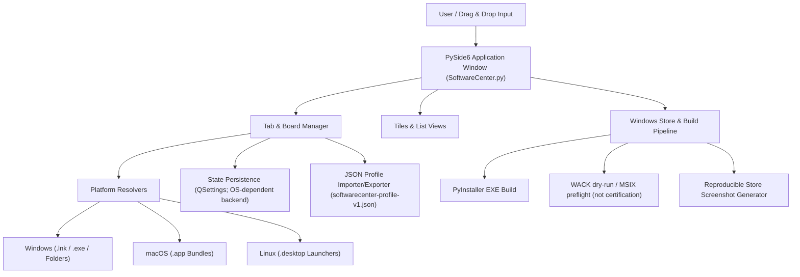
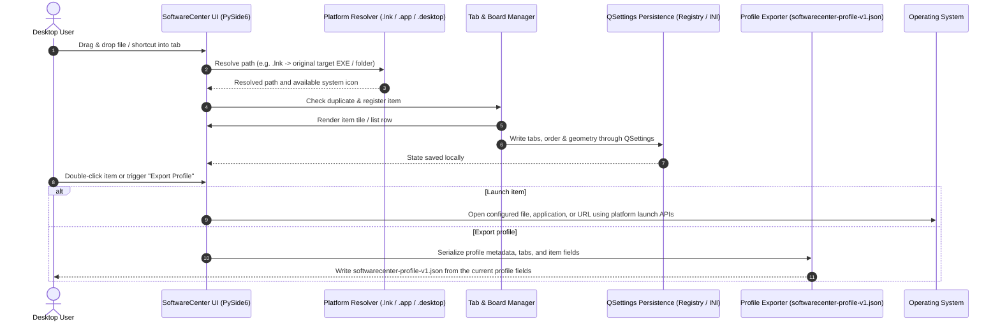

# SoftwareCenter

[](https://www.python.org/)
[](NOTICE)
[](https://docs.pytest.org/)
[](https://github.com/file-bricks/SoftwareCenter)
[](SECURITY.md)
[](SECURITY.md)
[](LICENSE)
[](https://doc.qt.io/qtforpython-6/)
[](https://github.com/file-bricks)
[](https://github.com/open-bricks)
[](llms.txt)

[English](README.md) · [Deutsch](README_de.md) · [Español](README.es.md) · [简体中文](README_zh.md) · [日本語](README_ja.md) · [Русский](README_ru.md) · [Français](README_fr.md) · [हिन्दी](README_hi.md) · [العربية](README_ar.md) · [বাংলা](README_bn.md) · [Português](README_pt.md)

ট্যাবভিত্তিক শ্রেণিবিন্যাসে সফটওয়্যার শর্টকাট পরিচালনার জন্য হালকা, বহু-প্ল্যাটফর্মের ডেস্কটপ সংগঠক।

> [!NOTE]
> **LLM / AI ইন্টিগ্রেশন ও যন্ত্র-পাঠযোগ্য সূচি:** SoftwareCenter [`llms.txt`](llms.txt)-এ গঠিত যন্ত্র-পাঠযোগ্য মেটাডেটা দেয় এবং সংস্করণযুক্ত JSON (`softwarecenter-profile-v1.json`) দিয়ে প্রোফাইল স্থানান্তর সমর্থন করে।


## দ্রুত নেভিগেশন

- [দ্রুত তথ্য](#quick-reference)
- [বৈশিষ্ট্য](#features)
- [লক্ষ্য ব্যবহারকারী ও সহজে খুঁজে পাওয়া](#target-personas--discoverability)
- [SoftwareCenter-এর সক্ষমতা ও সীমা](#comparative-matrix-vs-alternatives)
- [সিস্টেম স্থাপত্য](#system-architecture)
- [জীবনচক্রের ধাপক্রম](#lifecycle-sequence-flow)
- [মূল সক্ষমতা ও প্রমাণের সীমা](#core-capabilities--safety-invariants)
- [সহযোগী ইকোসিস্টেম ও সংশ্লিষ্ট পণ্য](#sibling-ecosystem--sister-products)
- [অনুসন্ধানের প্রেক্ষাপট](#discovery-context)
- [প্রয়োজনীয়তা](#requirements)
- [ইনস্টলেশন](#installation)
- [চালানো](#run)
- [ব্যবহার](#usage)
- [এক্সিকিউটেবল তৈরি](#build-executable)
- [গুণমান যাচাই](#quality-checks)
- [GUI ছাড়া লঞ্চার ক্যাটালগ রক্ষণাবেক্ষণ](#headless-launcher-catalog-care)
- [বিনিময় ফরম্যাট](#exchange-format)
- [LaunchBoards](#launchboards)
- [সংশ্লিষ্ট পণ্যের সীমা](#sister-product-boundary)
- [Windows Store-এর উপকরণ](#windows-store-assets)
- [প্রযুক্তি স্ট্যাক](#tech-stack)
- [নিরাপত্তা নীতি](#security-policy)
- [তৃতীয় পক্ষের লাইসেন্স ও পরিচালনা](#third-party-licenses--governance)
- [লাইসেন্স](#license)
- [দায়বদ্ধতা](#liability)

<a id="quick-reference"></a>
## দ্রুত তথ্য

| বৈশিষ্ট্য | বিবরণ |
|---|---|
| **প্রযুক্তি স্ট্যাক** | Python 3.10+ / PySide6 (Qt) / QSettings |
| **লাইসেন্স** | প্রকল্পের কোড: MIT; PySide6 ও অন্যান্য নির্ভরতার শর্ত আলাদা (দেখুন [THIRD_PARTY_LICENSES.md](THIRD_PARTY_LICENSES.md)) |
| **বিনিময় ফরম্যাট** | `softwarecenter-profile-v1.json` (দেখুন [EXPORTFORMAT.md](EXPORTFORMAT.md)) |
| **শেষ যাচাই** | 2026-09-23 (স্থানীয়ভাবে: সম্পূর্ণ pytest suite, প্ল্যাটফর্ম smoke পরীক্ষা, compileall, Ruff, নির্ভরতা নিরীক্ষা, ফাইল ম্যানেজারের context menu ইন্টিগ্রেশন, NOTICE স্বীকৃতি, CI জীবনচক্র শক্তিশালীকরণ; WACK এখনও শুধু dry-run পর্যায়ে) |

<a id="features"></a>
## বৈশিষ্ট্য

- **ট্যাবভিত্তিক সংগঠন** — প্রোগ্রাম, নথি ও ফোল্ডারকে নাম বদলানো ও সরানো যায় এমন বোর্ডে গুছিয়ে রাখুন
- **ড্র্যাগ-অ্যান্ড-ড্রপ ও সর্বজনীন সংগঠক** — অ্যাপ, স্ক্রিপ্ট, নথি, ফোল্ডার বা শর্টকাট সরাসরি বোর্ডে ফেলুন; এটি ফাইল সিস্টেমের ওপর একটি স্বতন্ত্র সংগঠন-স্তর হিসেবে কাজ করে
- **ফাঁকা বোর্ডের নির্দেশনা** — ফাঁকা বোর্ডে সহায়ক স্থানধারক দেখায়, কোন ধরনের উপাদান ফেলা যায়
- **দুটি দেখার ধরন** — বড় আইকনের টাইল এবং তালিকা
- **স্বয়ংক্রিয় সংরক্ষণ** — ট্যাব, সেগুলোর বিষয়বস্তু ও উইন্ডোর অবস্থান সংরক্ষিত হয়
- **প্রাসঙ্গিক মেনু** — ডান-ক্লিক করে খুলুন বা সরান
- **বহু-প্ল্যাটফর্ম** — Windows, macOS এবং Linux
- **নেটিভ আইকন** — সিস্টেম অ্যাপ্লিকেশনের আইকন স্বয়ংক্রিয়ভাবে দেখানো হয়
- **Windows শর্টকাট সমাধান** — ফেলা `.lnk` ফাইল `.exe` বা ফোল্ডারকে লক্ষ্য করলে, মূল লক্ষ্য হিসেবেই সংরক্ষিত হয়
- **macOS অ্যাপ বান্ডল** — `.app` অ্যাপ্লিকেশন সরাসরি সংগঠকে টেনে এনে ফেলুন
- **Linux ডেস্কটপ লঞ্চার** — `.desktop` এন্ট্রি অ্যাপের নাম দেখায় এবং তার desktop command দিয়ে চালু হয়
- **প্রোফাইল রপ্তানি/আমদানি** — স্থানান্তর ও ব্যাকআপের জন্য সংস্করণযুক্ত `softwarecenter-profile-v1.json` ফরম্যাট
- **একাধিক নির্বাচন** — একবারে একাধিক এন্ট্রি মুছুন
- **স্থানীয় ব্যবহারে অগ্রাধিকার** — সংগঠকের কোডে অ্যাকাউন্ট, টেলিমেট্রি বা cloud-sync বৈশিষ্ট্য নেই; HTTP(S) URL ও চালু করা প্রোগ্রাম প্ল্যাটফর্মের মাধ্যমে খোলা হয় এবং নেটওয়ার্ক ব্যবহার করতে পারে

<a id="target-personas--discoverability"></a>
## লক্ষ্য ব্যবহারকারী ও সহজে খুঁজে পাওয়া

SoftwareCenter চারটি স্বতন্ত্র ব্যবহারকারী-গোষ্ঠীর কর্মপ্রবাহের নির্দিষ্ট বাধা দূর করার জন্য তৈরি:

| ব্যবহারকারী-গোষ্ঠী | মূল ভূমিকা ও দায়িত্ব | প্রধান সমস্যা | SoftwareCenter-এর সমাধান |
|---|---|---|---|
| **গোষ্ঠী 1: ডেস্কটপের অভিজ্ঞ ব্যবহারকারী ও কিউরেটর** | প্রতিদিন অনেক টুল, কর্মক্ষেত্রের ফোল্ডার ও ইউটিলিটি ব্যবহার করেন। | Windows ডেস্কটপে জট, Start Menu-তে ধীর অনুসন্ধান, স্থায়ী কাস্টম শ্রেণিবিন্যাসের অভাব। | দ্রুত ট্যাবভিত্তিক বোর্ড, টেনে এনে ফাইল সংগঠন, কাস্টম নোট ও তাৎক্ষণিক বদল। |
| **গোষ্ঠী 2: একক ডেভেলপার ও DevOps প্রকৌশলী** | টুলচেইন, CLI wrapper, পোর্টেবল অ্যাপ ও ভার্চুয়াল পরিবেশ সামলান। | ডেভেলপমেন্ট টুল সাধারণ ব্যবহারকারীর Start Menu-তে মিশে যায়; লঞ্চারের ভারী ব্যাকগ্রাউন্ড প্রক্রিয়া মেমোরি ব্যবহার করে। | SoftwareCenter ও LaunchBoards-এর অ্যাপ পরিচয় আলাদা; Windows-এ ফাইল চালানোর সময় সমর্থিত হলে লক্ষ্য ফোল্ডারকে কার্যকর ডিরেক্টরি হিসেবে অনুরোধ করা হয়। এটি প্রকল্পভিত্তিক পরিবেশ ব্যবস্থাপক নয়, আর লক্ষ্য প্রোগ্রামের আচরণ OS ও অ্যাপের ওপর নির্ভরশীল। |
| **গোষ্ঠী 3: একাধিক PC-তে কাজ করা ব্যবহারকারী** | ওয়ার্কস্টেশনগুলোর মধ্যে প্রোফাইল হাতে হাতে সরান। | অন্য ডিভাইসে পূর্ণ পাথ নাও মিলতে পারে; লেবেল ও ঐচ্ছিক নোটে ব্যক্তিগত তথ্য থাকতে পারে। | সংস্করণযুক্ত `softwarecenter-profile-v1.json` দিয়ে রপ্তানি/আমদানি; ভাগ করার আগে পাথ ও নোট যাচাই করুন। নিশ্চিত করার পর আমদানি বর্তমান প্রোফাইল প্রতিস্থাপন করে; লক্ষ্য ফাইল কপি হয় না। |
| **গোষ্ঠী 4: গোপনীয়তা-সচেতন ব্যবহারকারী** | সংগঠকের সেটিংস স্থানীয়ভাবে রাখা এবং অ্যাপের ভেতরে অ্যাকাউন্ট বা টেলিমেট্রি বৈশিষ্ট্য না থাকা পছন্দ করেন। | সংরক্ষিত পাথ ও নোট স্থানীয় তথ্য প্রকাশ করতে পারে; URL খোলা বা প্রোগ্রাম চালালে নেটওয়ার্কে যোগাযোগ হতে পারে। | পরীক্ষা করা সংগঠক কোডে অ্যাকাউন্ট, টেলিমেট্রি বা cloud-sync বৈশিষ্ট্য নেই। এটি গোপনীয়তা, চালু করা প্রক্রিয়ার শূন্য বহির্গামী নেটওয়ার্ক যোগাযোগ, বা লক্ষ্য প্রোগ্রামের privilege আচরণের নিশ্চয়তা দেয় না। |

### স্পষ্ট অনুসন্ধান-উদ্দেশ্যের বাক্যাংশ

- `SoftwareCenter Python desktop launcher`
- `PySide6 desktop shortcut manager`
- `local-first desktop organizer python`
- `portable shortcut launcher without cloud account`
- `SoftwareCenter vs LaunchBoards profile switcher`
- `privacy friendly Windows app launcher with tabs`

<a id="comparative-matrix-vs-alternatives"></a>
## SoftwareCenter-এর সক্ষমতা ও সীমা

| সক্ষমতা | বাস্তবায়িত আচরণ | সীমা |
|---|---|---|
| **ট্যাবভিত্তিক সংগঠন** | পাথ-সংবলিত এন্ট্রিগুলোকে নাম দেওয়া ট্যাবে গুছিয়ে রাখে; টাইল ও তালিকা—দুই দৃশ্যই আছে। | ট্যাব রেফারেন্স সংগঠিত করে; এগুলো প্রকল্পভিত্তিক নির্বাহ পরিবেশ নয়। |
| **স্থানীয় পাথ ও URL** | টেনে এনে সমর্থিত স্থানীয় পাথ ও HTTP(S) URL নিবন্ধন করা যায়। | এন্ট্রি লক্ষ্যকে নির্দেশ করে; সংগঠক তার বিষয়বস্তু কপি করে না। |
| **প্ল্যাটফর্মভিত্তিক লক্ষ্য ব্যবস্থাপনা** | Windows-এ `.lnk` সমাধান বিদ্যমান `.exe` বা ফোল্ডার লক্ষ্য গ্রহণ করে; macOS অ্যাপ বান্ডল `open` দিয়ে খোলে; Linux-এর `.desktop` এন্ট্রি থেকে নাম, আইকন ও `Exec` পার্স করা হয়। | সমাধান ও চালু করা OS-নির্ভর। Linux-এ `Exec` কমান্ড হিসেবে চালানো হয়; এটি স্ক্রিপ্টের sandbox নয়। |
| **কার্যকর ডিরেক্টরি** | Windows-এ ফাইল চালানোর সময় `_startfile_in_dir` সমর্থিত হলে লক্ষ্য ফাইলের ধারণকারী ফোল্ডারকে কার্যকর ডিরেক্টরি হিসেবে অনুরোধ করে। | বিকল্প চালু করার পথে কার্যকর ডিরেক্টরি স্পষ্টভাবে নাও সেট হতে পারে; parent CWD বা সব প্ল্যাটফর্মে একই কার্যকর ডিরেক্টরির নিশ্চয়তা নেই। |
| **স্থানীয় সেটিংস** | Qt `QSettings` পণ্যটির settings namespace-এ ট্যাব, এন্ট্রি, দৃশ্য ও উইন্ডোর অবস্থা সংরক্ষণ করে। | স্টোরেজ backend Qt ও OS সরবরাহ করে; atomic write বা security descriptor-এর নিশ্চয়তার দাবি করা হয় না। |
| **প্রোফাইল রপ্তানি** | `softwarecenter-profile-v1.json`-এ প্রোফাইল মেটাডেটা, ট্যাব, দৃশ্য এবং `label`, `path`, `kind`, ও ঐচ্ছিক `notes`-সহ এন্ট্রি থাকে। | পাথ, লেবেল ও নোট স্থানীয় তথ্য প্রকাশ করতে পারে; লক্ষ্য ফাইল কপি হয় না। |
| **প্রোফাইল আমদানি** | আমদানিকারক ফরম্যাট/সংস্করণ পরীক্ষা করে, এন্ট্রি স্বাভাবিক করে এবং নিশ্চিতকরণ চায়। | আমদানি নিশ্চিত করলে বর্তমান প্রোফাইল প্রতিস্থাপিত হয়; এটি মার্জ নয় এবং তথ্য-ক্ষতি হবে না—এমন সাধারণ নিশ্চয়তাও নয়। |
| **পণ্যের পরিচয়** | SoftwareCenter ও LaunchBoards একই implementation ভাগ করে, তবে settings namespace, single-instance endpoint এবং Store পরিচয় আলাদা। | এতে দুটি পণ্য আলাদা থাকে; SoftwareCenter-এর মধ্যে ব্যবহারকারী-নির্বাচনযোগ্য প্রোফাইল দেওয়া হয় না। |
| **নেটওয়ার্কের সীমা** | পরীক্ষা করা সংগঠক source-এ account, telemetry বা cloud-sync implementation নেই। | এটি HTTP(S) URL খোলে এবং বাইরের লক্ষ্য চালু করে, যা নেটওয়ার্ক ব্যবহার করতে পারে; পুরো অ্যাপ বা চালু করা প্রক্রিয়ায় শূন্য বহির্গামী যোগাযোগের নিশ্চয়তা নেই। |
| **যাচাইয়ের পরিধি** | রিপোজিটরির পরীক্ষা নামযুক্ত contract যাচাই করে; CI Ubuntu-তে Python সংস্করণের matrix এবং Linux/macOS-এর আলাদা smoke job চালায়। | এসব পরীক্ষা প্রত্যেক host-এর আচরণ প্রতিষ্ঠা করে না, WACK/Store submission প্রত্যয়ন করে না বা সর্বজনীন নিরাপত্তা বৈশিষ্ট্য প্রমাণ করে না। |

<a id="system-architecture"></a>
## সিস্টেম স্থাপত্য



<a id="lifecycle-sequence-flow"></a>
## জীবনচক্রের ধাপক্রম



<a id="core-capabilities--safety-invariants"></a>
## মূল সক্ষমতা ও প্রমাণের সীমা

| বিষয় | পরীক্ষা করা কোড/পরীক্ষায় প্রমাণ | পরিধি ও সীমা |
|---|---|---|
| **সংগঠকের নেটওয়ার্ক আচরণ** | অ্যাপ কোডে account, telemetry বা cloud-sync client নেই; `open_file` HTTP(S) URL Qt বা প্ল্যাটফর্মের browser-এ পাঠায়। | উৎস পরীক্ষা, SoftwareCenter, browser বা চালু করা প্রক্রিয়ার চলাকালীন বহির্গামী নেটওয়ার্ক যোগাযোগ মাপে না। |
| **চালুর প্রসঙ্গ** | ফাইল ও URL চালু করার কাজ প্ল্যাটফর্ম API-তে অর্পণ করা হয়; Windows launch code পাওয়া গেলে লক্ষ্য working directory অনুরোধ করে। | পর্যালোচিত কোড ও পরীক্ষা process security descriptor যাচাই করে না বা child-process privilege প্রয়োগ করে না। |
| **এন্ট্রি সরানো** | UI তালিকা ও সংরক্ষিত profile state থেকে এন্ট্রি সরায়, কিন্তু নির্দেশিত ফাইল মুছে দেয় না। | কোনো বাইরের প্রোগ্রাম খোলা বা পরিবর্তিত লক্ষ্যের সঙ্গে কী করে, এটি সে বিষয়ে কিছু বলে না। |
| **প্ল্যাটফর্মভিত্তিক সমাধান** | Windows-এ `.lnk` লক্ষ্য খুঁজতে COM ব্যবহৃত হয়, সঙ্গে PowerShell fallback আছে; Linux `.desktop`-এর `Exec` তথ্য পার্স করে পরে চালানো হয়। | এসব handler লক্ষ্য আচরণকে sandbox করে না; চালালে নির্ধারিত কমান্ড বা বাইরের প্রোগ্রাম চলতে পারে। |
| **QSettings সংরক্ষণ** | `save_settings` Qt `QSettings` দিয়ে ট্যাব, এন্ট্রি, দৃশ্য, জ্যামিতি ও ভাষার মান লেখে। | কোড atomic transaction বা crash-proof লেখার দাবি করে না। |
| **প্রোফাইল তথ্য** | `softwarecenter-profile-v1.json`-এ প্রোফাইল ক্ষেত্র এবং `label`, `path`, `kind`, ও ঐচ্ছিক `notes`-সহ এন্ট্রি থাকে; নিশ্চিতকরণের পর import বর্তমান প্রোফাইল প্রতিস্থাপন করে। | মান স্থানীয় তথ্য প্রকাশ করতে পারে; পরীক্ষা fixture ও round trip যাচাই করে, সাধারণভাবে গোপন তথ্য অপসারণ নয়। দেখুন `tests/test_export_contract.py`। |
| **সংশ্লিষ্ট পণ্য পৃথকীকরণ** | `scripts/verify_product_boundaries.py` এবং product-boundary পরীক্ষা SoftwareCenter ও LaunchBoards-এর আলাদা settings namespace ও single-instance endpoint যাচাই করে। | এটি পণ্য পৃথকীকরণ, বহু-ব্যবহারকারী বা প্রকল্পভিত্তিক প্রোফাইল নয়। দেখুন `PRODUCT_BOUNDARIES.md` এবং `tests/test_product_boundaries.py`। |
| **CI ও রিলিজের পরিধি** | CI-তে Ubuntu-র Python সংস্করণ regression matrix এবং Linux/macOS-এর আলাদা smoke job আছে। | এর অর্থ Windows-host CI, WACK প্রত্যয়ন, Store প্রকাশনা বা সর্বজনীন runtime security নয়। দেখুন `CI_CONTRACT.md`। |

<a id="sibling-ecosystem--sister-products"></a>
## সহযোগী ইকোসিস্টেম ও সংশ্লিষ্ট পণ্য

SoftwareCenter বৃহত্তর **file-bricks** ডেস্কটপ টুলসমূহের সংগ্রহ এবং ছাতাসদৃশ **open-bricks** ওপেন-সোর্স উদ্যোগের অংশ:

| প্রকল্প | ইকোসিস্টেম | প্রধান কাজ | ইন্টিগ্রেশন / পরিপূরকতা |
|---|---|---|---|
| [`ProFiler`](https://github.com/file-bricks/ProFiler) | `file-bricks` | নথি ও মিডিয়া পরিদর্শন | ফাইল বাছাই ও নথির ফরেনসিক প্রোফাইলিংয়ের সহযোগী অ্যাপ |
| [`ExplorerPro`](https://github.com/file-bricks/ExplorerPro) | `file-bricks` | বহু-ট্যাব ফাইল-সিস্টেম এক্সপ্লোরার | SoftwareCenter শর্টকাটের জন্য পরিপূরক দুই-প্যানেলের ফাইল ব্যবস্থাপনা |
| [`CloudLockFixer`](https://github.com/file-bricks/CloudLockFixer) | `file-bricks` | cloud lock খোলা ও মেরামত | শর্টকাটে উল্লেখিত আটকে থাকা sync placeholder ও OneDrive ফাইল খুলে দেয় |
| [`knowledgedigest`](https://github.com/file-bricks/knowledgedigest) | `file-bricks` | Markdown ও নথির জ্ঞানভান্ডার | গবেষণা কর্মপ্রবাহের জন্য স্থানীয় document digest সংগঠক |
| [`FormularErstellen`](https://github.com/doc-bricks/FormularErstellen) | `doc-bricks` | ফর্ম তৈরি ও টেমপ্লেটিং | SoftwareCenter টাইল থেকে চালানো যায় এমন ডেস্কটপ document generator |
| [`USR_PDFunlock`](https://github.com/doc-bricks/USR_PDFunlock) | `doc-bricks` | PDF password ও unlock tool | মূল ফাইল না বদলে PDF খোলার স্থানীয় utility |
| [`safe-start-for-codex`](https://github.com/dev-bricks/safe-start-for-codex) | `dev-bricks` | অটোমেশন startup gate | ডেস্কটপ ওয়ার্কস্টেশন পরিবেশকে একসঙ্গে অনেক startup থেকে রক্ষা করে |
| [`MethodenAnalyser`](https://github.com/dev-bricks/MethodenAnalyser) | `dev-bricks` | AST source-code বিশ্লেষক | Python ডেস্কটপ টুল ও মডিউলের static analysis |
| [`connectors`](https://github.com/ellmos-ai/connectors) | `ellmos-ai` | এজেন্ট যোগাযোগ সেতু | নির্ভরতাবিহীন বার্তা ও পরিবহন adapter |
| [`open-bricks`](https://github.com/open-bricks) | `open-bricks` | ডেস্কটপ ওপেন-সোর্স ছাতা | মান, পরিচালনা ও প্যাকেজিংয়ের সমন্বিত উদ্যোগ |

<a id="discovery-context"></a>
## অনুসন্ধানের প্রেক্ষাপট

SoftwareCenter-কে **local-first PySide6 app launcher** বা **desktop shortcut organizer** হিসেবে খুঁজে পাওয়া সবচেয়ে সহজ। এটি Windows Start menu, ডেস্কটপ shortcut folder এবং পূর্ণাঙ্গ software inventory system-এর মাঝামাঝি: আপনার যন্ত্রে আগে থেকেই থাকা প্রোগ্রাম চালায়, shortcut-গুলো ট্যাবে গুছিয়ে রাখে এবং বহনযোগ্য profile রপ্তানি/আমদানি করে।

উপযোগী অনুসন্ধান বাক্যাংশ:

- `SoftwareCenter PySide6 desktop organizer`
- `local-first app launcher Python PySide6`
- `desktop shortcut organizer with tabs`
- `softwarecenter-profile-v1.json`
- `local-first desktop organizer with profile export`

এটি Microsoft Configuration Manager Software Center, অ্যাপ স্টোর, প্যাকেজ ম্যানেজার বা দূরবর্তী deployment portal নয়।

<a id="requirements"></a>
## প্রয়োজনীয়তা

- Python 3.10+
- PySide6

<a id="installation"></a>
## ইনস্টলেশন

```bash
pip install -r requirements.txt
```

<a id="run"></a>
## চালানো

```bash
python SoftwareCenter.py
```

Windows-এ [Releases](https://github.com/file-bricks/SoftwareCenter/releases) থেকে আগে তৈরি `SoftwareCenter.exe` অথবা `START.bat` ব্যবহার করতে পারেন।

<a id="usage"></a>
## ব্যবহার

| কাজ | নির্দেশনা |
|--------|-------------|
| প্রোগ্রাম যোগ | ফাইল, ফোল্ডার, শর্টকাট, macOS-এর `.app` bundle বা Linux-এর `.desktop` launcher উইন্ডোতে টেনে আনুন; `.exe` ফাইল বা ফোল্ডার নির্দেশ করা Windows `.lnk` ফাইল মূল লক্ষ্যে সমাধান করা হয় |
| ট্যাব গুছানো | Toolbar > "New Tab", নাম বদলাতে ডাবল-ক্লিক করুন |
| দৃশ্য বদল | Toolbar > Tiles / List |
| প্রোগ্রাম চালানো | ডাবল-ক্লিক অথবা ডান-ক্লিক > Open/Start |
| এন্ট্রি সরানো | ডান-ক্লিক > Delete (শুধু শর্টকাট সরায়) |
| প্রোফাইল রপ্তানি | `File > Export Profile` অথবা toolbar action |
| প্রোফাইল আমদানি | `File > Import Profile` অথবা toolbar action; বর্তমান প্রোফাইল প্রতিস্থাপন করে |

<a id="build-executable"></a>
## এক্সিকিউটেবল তৈরি

```bash
pip install pyinstaller
python -m PyInstaller --noconfirm --clean SoftwareCenter.spec
```

EXE থাকবে `dist/SoftwareCenter.exe`-এ। Windows-এ `build_exe.bat` স্থানীয় ব্যবহারের জন্য এটি প্রকল্পের মূল ফোল্ডারেও কপি করে।

<a id="quality-checks"></a>
## গুণমান যাচাই

```bash
python -m compileall -q SoftwareCenter.py manage_translations.py translator.py
python -m json.tool locales/translations.json
python -m json.tool store_package.json
python -m pytest -q
python tests/macos_platform_smoke.py
python tests/linux_platform_smoke.py
python scripts/verify_product_boundaries.py
```

হোস্টেড workflow এবং ঐচ্ছিক web অংশের স্পষ্ট সীমা [CI_CONTRACT.md](CI_CONTRACT.md)-এ নথিভুক্ত।

GitHub Actions এই smoke পরীক্ষা চালায়। macOS smoke, `macos-latest`-এ `.app` আমদানি, `open` দিয়ে চালু করা, QSettings সংরক্ষণ এবং profile export যাচাই করে; Linux smoke, `ubuntu-latest`-এ `.desktop` আমদানি, `Exec`/`xdg-open` দিয়ে চালু করা, QSettings সংরক্ষণ এবং profile export যাচাই করে। Build artifact ও স্থানীয় task/test ফাইল উপেক্ষা করা হয় এবং commit করা উচিত নয়।

Windows Store পথে `python scripts/run_windows_wack.py --dry-run` স্থানীয় MSIX/AppCert path পরীক্ষা করে এবং পুনরুৎপাদনযোগ্য WACK command দেখায়। জমা দেওয়ার আগে নতুন স্বাক্ষরিত MSIX-এ elevated PowerShell থেকে প্রকৃত certification চালানো উচিত।
`python generate_store_screenshots.py` `README/screenshots/store/`-এ পুনরুৎপাদনযোগ্য Store screenshot set তৈরি করে।

<a id="headless-launcher-catalog-care"></a>
## GUI ছাড়া লঞ্চার ক্যাটালগ রক্ষণাবেক্ষণ

ঐচ্ছিক catalog reconciler, `scripts/softwarecenter_sync.py`-তে Plan-D runtime code হিসেবে দেওয়া আছে। সিঙ্ক করা catalog ও registry file স্পষ্ট CLI input; `--apply` না দিলে command কেবল পড়ে। নির্দিষ্ট পিন করা runtime-সহ scheduler payload, apply gate, native readback এবং rollback procedure [RUNTIME_DAILY_CARE.md](RUNTIME_DAILY_CARE.md)-এ নথিভুক্ত।

<a id="exchange-format"></a>
## বিনিময় ফরম্যাট

প্রোফাইল `softwarecenter-profile-v1.json` হিসেবে রপ্তানি করে পরে আবার আমদানি করা যায়। ফরম্যাটে প্রোফাইল metadata, ট্যাব, দৃশ্যের ধরন এবং `label`, `path`, `kind` ও ঐচ্ছিক `notes`-সহ এন্ট্রি থাকে। অ্যাপ নির্দেশিত স্থানীয় ফাইল কপি করে না, তবে পাথ, লেবেল ও নোটে সংবেদনশীল তথ্য থাকতে পারে; এই ফরম্যাট গোপন তথ্য মুছে ফেলার নিশ্চয়তা দেয় না। নিশ্চিত করার পর আমদানি বর্তমান প্রোফাইল প্রতিস্থাপন করে। অনুপস্থিত পাথ রেফারেন্স হিসেবে দৃশ্যমান থাকে। বিস্তারিত জানতে [EXPORTFORMAT.md](EXPORTFORMAT.md) দেখুন।

<a id="launchboards"></a>
## LaunchBoards


[LaunchBoards](https://github.com/file-bricks/SoftwareCenter) হলো SoftwareCenter-এর সংশ্লিষ্ট পণ্য: একই codebase, নিজস্ব ব্র্যান্ড ও পরিচয়, এবং সাধারণ shortcut launcher-এর বদলে পাল্টানো যায় এমন workspace board-কেন্দ্রিক। এটি একই repository ও release pipeline ভাগ করে — রক্ষণাবেক্ষণের জন্য আলাদা LaunchBoards source tree নেই।

<a id="sister-product-boundary"></a>
## সংশ্লিষ্ট পণ্যের সীমা

LaunchBoards একই implementation ভাগ করে, তবে এর নিজস্ব QSettings namespace, single-instance endpoint, icon, executable, Store identity এবং release path আছে। পুনরুৎপাদনযোগ্য static check, বিচ্ছিন্ন parallel-process পরীক্ষা এবং artifact check [PRODUCT_BOUNDARIES.md](PRODUCT_BOUNDARIES.md)-এ নথিভুক্ত।

<a id="windows-store-assets"></a>
## Windows Store-এর উপকরণ

Windows Store track-এ এখন বর্তমান desktop UI-এর পুনরুৎপাদনযোগ্য screenshot generator আছে। চারটি তৈরি Store screenshot ও `summary.json`-সহ `README/screenshots/store/` হালনাগাদ করতে `python generate_store_screenshots.py` চালান।

<a id="tech-stack"></a>
## প্রযুক্তি স্ট্যাক

| উপাদান | প্রযুক্তি |
|-----------|-----------|
| ভাষা | Python 3.10+ |
| GUI framework | PySide6 (Qt for Python) |
| স্টোরেজ | QSettings (Windows Registry / INI) |
| কোডের আকার | বর্তমান repository file দেখুন; নির্দিষ্ট line count-এর দাবি নেই |

<a id="security-policy"></a>
## নিরাপত্তা নীতি

রিপোজিটরির [SECURITY.md](SECURITY.md)-এ সমর্থিত সংস্করণ, দুর্বলতা জানানোর মাধ্যম, ঘোষিত 48 ঘণ্টার প্রাথমিক প্রতিক্রিয়া-সময় এবং 5 কর্মদিবসের প্রাথমিক মূল্যায়নের সময় বর্ণিত। নীতির এই বক্তব্যগুলোকে runtime যাচাই হিসেবে ধরা উচিত নয়।

<a id="third-party-licenses--governance"></a>
## তৃতীয় পক্ষের লাইসেন্স ও পরিচালনা

রিপোজিটরির MIT license প্রকল্পের source code-এ প্রযোজ্য। তৃতীয় পক্ষের নির্ভরতার নিজস্ব শর্ত রয়েছে; [THIRD_PARTY_LICENSES.md](THIRD_PARTY_LICENSES.md) উপাদানের metadata নথিভুক্ত করে, তবে এটি সব ক্ষেত্রে permissive license বা package compliance-এর নিশ্চয়তা নয়।

- **স্বীকৃতি:** [NOTICE](NOTICE) (Lukas Geiger এবং file-bricks / open-bricks সংগঠনের copyright attribution)।
- **PySide6 ও shiboken6:** inventory-তে LGPL-3.0-only শর্ত নথিভুক্ত; [LGPL-3.0-এর পাঠ](https://www.gnu.org/licenses/lgpl-3.0.html) ও [উপাদানের metadata](THIRD_PARTY_LICENSES.md) দেখুন। প্রকল্পের MIT license এসব নির্ভরতায় সামগ্রিকভাবে প্রযোজ্য নয়।
- **Python Standard Library:** [PSF-2.0](https://docs.python.org/3/license.html)। এই license-এর অর্থ নয় যে সংগঠক বা তার চালু করা প্রোগ্রাম অফলাইনে কাজ করে।
- **PyInstaller:** [GPL-2.0-or-later with PyInstaller-exception](https://pyinstaller.org/en/stable/license.html) হলো build tooling; packaged build-এর ক্ষেত্রে blanket exemption ধরে না নিয়ে upstream license ও distribution notice পর্যালোচনা করুন।
- **যাচাইয়ের সীমা:** পরীক্ষা নামযুক্ত code ও documentation contract যাচাই করে; সর্বজনীন runtime guarantee প্রতিষ্ঠা করে না।

<a id="license"></a>
## লাইসেন্স

[MIT](LICENSE)

**নোট:** MIT হলো রিপোজিটরির প্রকল্প-উৎসের লাইসেন্স। অ্যাপ [PySide6](https://doc.qt.io/qtforpython-6/) ব্যবহার করে, যার নির্ভরতা-লাইসেন্সের শর্ত আলাদা; [THIRD_PARTY_LICENSES.md](THIRD_PARTY_LICENSES.md) দেখুন।

---

<a id="liability"></a>
## দায়বদ্ধতা

এই প্রকল্পটি বিনা পারিশ্রমিকে দেওয়া একটি ওপেন-সোর্স অনুদান। দায় কেবল ইচ্ছাকৃত কাজ ও গুরুতর অবহেলার ক্ষেত্রে সীমাবদ্ধ (§ 521 জার্মান দেওয়ানি বিধি)। নিজ ঝুঁকিতে ব্যবহার করুন। কোনো ওয়ারেন্টি, রক্ষণাবেক্ষণের নিশ্চয়তা বা নির্দিষ্ট উদ্দেশ্যে উপযোগিতা ধরে নেওয়া হয় না।
