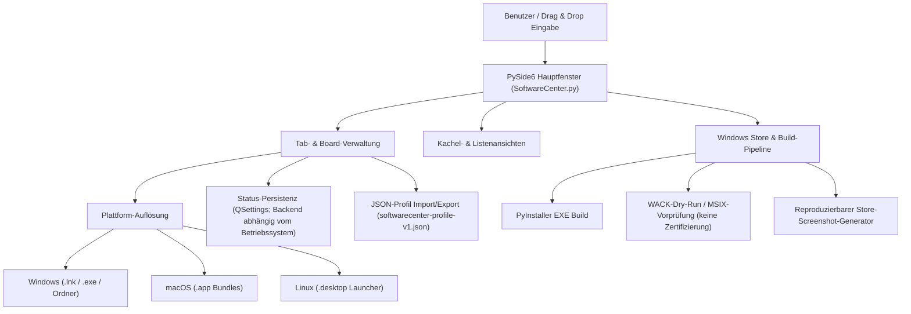
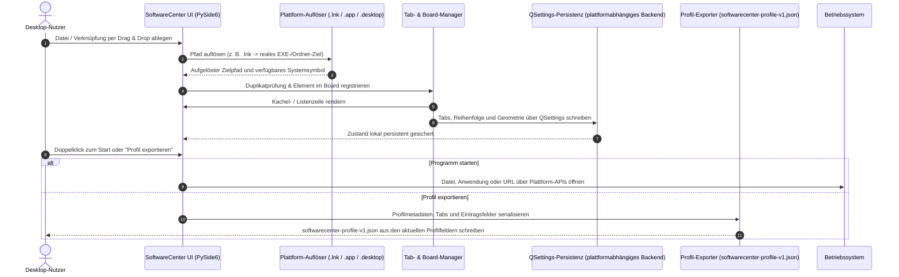

# SoftwareCenter

[](https://www.python.org/)
[](NOTICE)
[](https://docs.pytest.org/)
[](https://github.com/file-bricks/SoftwareCenter)
[](SECURITY.md)
[](SECURITY.md)
[](LICENSE)
[](https://doc.qt.io/qtforpython-6/)
[](https://github.com/file-bricks)
[](https://github.com/open-bricks)
[](llms.txt)

[English](README.md) · [Deutsch](README_de.md) · [Español](README.es.md) · [简体中文](README_zh.md) · [日本語](README_ja.md) · [Русский](README_ru.md)

Ein leichtgewichtiger, plattformübergreifender Desktop-Organizer für Software-Verknüpfungen mit Tab-basierter Kategorisierung.

> [!NOTE]
> **KI / LLM Integration & Maschinelles Register:** SoftwareCenter bietet maschinenlesbare Metadaten in [`llms.txt`](llms.txt) und unterstützt Profil-Migrationen über versioniertes JSON (`softwarecenter-profile-v1.json`).


## Schnellnavigation

- [Einstieg](#einstieg)
- [Funktionen](#funktionen)
- [Zielgruppen & Auffindbarkeit](#zielgruppen--auffindbarkeit)
- [Fähigkeiten und Grenzen von SoftwareCenter](#vergleichsmatrix-gegenüber-alternativen)
- [Systemarchitektur](#systemarchitektur)
- [Lebenszyklus-Ablaufdiagramm](#lebenszyklus-ablaufdiagramm)
- [Kernfähigkeiten und Beleggrenzen](#kernfähigkeiten--sicherheitsinvarianten)
- [Geschwister-Ökosystem & Schwesterprodukte](#geschwister-ökosystem--schwesterprodukte)
- [Auffindbarkeit](#auffindbarkeit)
- [Voraussetzungen](#voraussetzungen)
- [Installation](#installation)
- [Starten](#starten)
- [Verwendung](#verwendung)
- [EXE erstellen](#exe-erstellen)
- [Qualitätssicherung](#qualitätssicherung)
- [Headless-Katalogpflege](#headless-katalogpflege)
- [Austauschformat](#austauschformat)
- [LaunchBoards](#launchboards)
- [Schwesterprodukt-Grenze](#schwesterprodukt-grenze)
- [Windows-Store-Artefakte](#windows-store-artefakte)
- [Technik](#technik)
- [Sicherheitsrichtlinie](#sicherheitsrichtlinie)
- [Drittanbieter-Lizenzen & Governance](#drittanbieter-lizenzen--governance)
- [Lizenz](#lizenz)
- [Haftung](#haftung)

## Einstieg

| Eigenschaft | Details |
|---|---|
| **Tech Stack** | Python 3.10+ / PySide6 (Qt) / QSettings |
| **Lizenz** | Projektquellcode: MIT; PySide6 und weitere Abhängigkeiten haben eigene Bedingungen (siehe [THIRD_PARTY_LICENSES.md](THIRD_PARTY_LICENSES.md)) |
| **Austauschformat** | `softwarecenter-profile-v1.json` (siehe [EXPORTFORMAT.md](EXPORTFORMAT.md)) |
| **Letzte Prüfung** | 2026-09-23 (lokal: vollständige Pytest-Suite, Plattform-Smokes, Compileall, Ruff, Dependency-Audit, Dateimanager-Kontextmenü-Integration, NOTICE-Attribution, CI-Lifecycle-Härtung; WACK weiterhin nur Dry-Run) |

## Funktionen

- **Tab-Organisation** - Programme, Dokumente und Ordner in benennbare, verschiebbare Boards gruppieren
- **Drag & Drop & Universeller Ordnungslayer** - Beliebige Apps, Skripte, Dokumente, Ordner und Verknüpfungen direkt auf Boards ablegen; fungiert als unabhängiger Ordnungslayer außerhalb des starren Dateisystems
- **Leere-Board-Führung** - Hilfreicher visueller Platzhalter auf leeren Boards zur schnellen Orientierung
- **Zwei Ansichtsmodi** - Kacheln (große Icons) und Liste
- **Automatische Speicherung** - Tabs, Inhalte und Fensterposition bleiben erhalten
- **Kontextmenü** - Rechtsklick zum Öffnen oder Entfernen
- **Cross-Platform** - Windows, macOS und Linux
- **Native Icons** - Automatische Anzeige der System-Anwendungsicons
- **Windows-Verknüpfungen** - `.lnk`-Dateien mit `.exe`- oder Ordnerziel werden beim Hinzufügen als Originalziel gespeichert
- **macOS-App-Bundles** - `.app`-Programme lassen sich per Drag & Drop hinzufügen
- **Linux-Desktop-Starter** - `.desktop`-Launcher werden mit ihrem App-Namen angezeigt und korrekt gestartet
- **Profil-Export/Import** - Versioniertes Austauschformat `softwarecenter-profile-v1.json` für Migrationen und Backups
- **Mehrfachauswahl** - Mehrere Einträge können gemeinsam gelöscht werden
- **Lokal orientierter Betrieb** - Der Organizer-Code enthält keine Konto-, Telemetrie- oder Cloud-Sync-Funktion. HTTP(S)-URLs und gestartete Programme werden über die Plattform geöffnet und können das Netzwerk nutzen.

## Zielgruppen & Auffindbarkeit

SoftwareCenter adressiert gezielte Workflow-Engpässe über vier klar definierte Nutzerprofile:

| Persona | Profil & Kernaufgaben | Zentrales Problem | SoftwareCenter Lösung |
|---|---|---|---|
| **Persona 1: Desktop-Power-User & Kuratoren** | Fachanwender mit Dutzenden parallel genutzten Tools, Projektordnern und Skripten. | Überladener Windows-Desktop, träge Startmenü-Suche, fehlende persistente Board-Gruppierung. | Schnelle tab-basierte Boards, Drag & Drop Dateiablage, individuelle Notizen und sofortiger Wechsel. |
| **Persona 2: Software-Entwickler & DevOps-Engineers** | Entwickler mit projektbezogenen Launchern, CLI-Tools, portablen Apps und venv-Skripten. | Vermischung von Dev-Toolchains im allgemeinen Startmenü; speicherhungrige Launcher-Hintergrunddienste. | SoftwareCenter und LaunchBoards haben getrennte Produktidentitäten; Windows-Dateistarts fordern, soweit unterstützt, das Zielverzeichnis als Arbeitsverzeichnis an. Das ist keine projektbezogene Entwicklungsumgebung; das Verhalten hängt vom Betriebssystem und Zielprogramm ab. |
| **Persona 3: Nutzer mit mehreren Workstations** | Nutzer, die Profile manuell zwischen mehreren Workstations übertragen. | Absolute Pfade funktionieren auf einem anderen Gerät möglicherweise nicht; Labels und optionale Notizen können private Details enthalten. | Versionierter Export/Import über `softwarecenter-profile-v1.json`; Pfade und Notizen vor dem Teilen prüfen. Nach Bestätigung ersetzt der Import das aktuelle Profil; Zieldateien werden nicht kopiert. |
| **Persona 4: Datenschutzbewusste Nutzer** | Nutzer, die lokal gespeicherte Organizer-Einstellungen und keine integrierten Konto- oder Telemetriefunktionen bevorzugen. | Gespeicherte Pfade und Notizen können lokale Details offenlegen; geöffnete URLs oder gestartete Programme können Netzwerkkommunikation auslösen. | Im geprüften Organizer-Code gibt es keine Konto-, Telemetrie- oder Cloud-Sync-Funktion. Vertraulichkeit, Null-Egress für gestartete Prozesse und die Rechte von Zielprogrammen werden nicht garantiert. |

### Relevante Suchbegriffe

- `SoftwareCenter Desktop Schnellstarter Python`
- `file-bricks SoftwareCenter Anwendungsverwaltung`
- `Lokaler Programmstarter mit Reitern und Kategorien`
- `Desktop Verknüpfungs-Manager ohne Cloud-Zwang`
- `Open Source App Launcher Deutsch Windows`
- `SoftwareCenter vs LaunchBoards Profil Umschaltung`

<a id="vergleichsmatrix-gegenüber-alternativen"></a>
## Fähigkeiten und Grenzen von SoftwareCenter

| Fähigkeit | Verhalten laut Quellcode | Grenze |
|---|---|---|
| **Tab-Organisation** | Ordnet Pfadeinträge in benannten Tabs mit Kachel- und Listenansicht. | Tabs organisieren Verweise; sie sind keine projektbezogenen Laufzeitumgebungen. |
| **Lokale Pfade und URLs** | Drag-and-drop kann unterstützte lokale Pfade und HTTP(S)-URLs als Einträge übernehmen. | Einträge verweisen auf Ziele; der Organizer kopiert deren Inhalte nicht. |
| **Plattformziele** | Windows löst `.lnk`-Ziele zu vorhandenen `.exe`-Dateien oder Ordnern auf; macOS-App-Bundles werden über `open` geöffnet; Linux-`.desktop`-Einträge werden für Namen, Symbole und `Exec` ausgewertet. | Auflösung und Start sind plattformspezifisch. Linux `Exec` wird als Befehl gestartet; dies ist keine Skript-Sandbox. |
| **Arbeitsverzeichnis** | Windows-Dateistarts verwenden `_startfile_in_dir`, um nach Möglichkeit das Zielverzeichnis als Arbeitsverzeichnis anzufordern. | Fallbacks können ohne explizites Arbeitsverzeichnis starten; es gibt keine Garantie für das Eltern-CWD oder ein plattformübergreifendes Arbeitsverzeichnis. |
| **Lokale Einstellungen** | Qt `QSettings` speichert Tabs, Einträge, Ansichten und Fensterzustand im Produkt-Namespace. | Qt und Betriebssystem stellen das Backend bereit; atomare Schreibvorgänge oder Sicherheitsdeskriptoren werden nicht garantiert. |
| **Profilexport** | `softwarecenter-profile-v1.json` enthält Profilmetadaten, Tabs, Ansichten sowie Einträge mit `label`, `path`, `kind` und optionalen `notes`. | Pfade, Labels und Notizen können lokale Details preisgeben; Zieldateien werden nicht kopiert. |
| **Profilimport** | Der Import prüft Format und Version, normalisiert Einträge und fragt vor dem Ersetzen nach Bestätigung. | Ein bestätigter Import ersetzt das aktuelle Profil; er führt Profile nicht zusammen und bietet keine allgemeine Garantie gegen Datenverlust. |
| **Produktidentitäten** | SoftwareCenter und LaunchBoards teilen die Implementierung, haben aber getrennte Settings-Namespaces, Single-Instance-Endpunkte und Store-Identitäten. | Das trennt zwei Produkte; es gibt keine Profile je Nutzer oder Projekt innerhalb von SoftwareCenter. |
| **Netzwerkgrenze** | Im geprüften Organizer-Code gibt es keine Konto-, Telemetrie- oder Cloud-Sync-Implementierung. | HTTP(S)-URLs und externe Ziele können Netzwerkzugriff auslösen; für die Anwendung und gestartete Prozesse wird kein Null-Egress garantiert. |
| **Prüfumfang** | Repository-Tests prüfen benannte Verträge; CI führt die Python-Versionsmatrix auf Ubuntu sowie separate Linux/macOS-Smokejobs aus. | Daraus folgen weder Windows-Runner-CI, WACK-Zertifizierung, Store-Veröffentlichung noch allgemeine Laufzeitsicherheit. |

## Systemarchitektur



## Lebenszyklus-Ablaufdiagramm



<a id="kernfähigkeiten--sicherheitsinvarianten"></a>
## Kernfähigkeiten und Beleggrenzen

| Thema | Befund in geprüftem Code/Test | Umfang und Grenze |
|---|---|---|
| **Netzwerkverhalten des Organizers** | Der geprüfte App-Code enthält keine Konto-, Telemetrie- oder Cloud-Sync-Implementierung; `open_file` übergibt HTTP(S)-URLs an Qt oder den Systembrowser. | Die Quellcodeprüfung misst nicht das Laufzeitnetzwerkverhalten von SoftwareCenter, Browser oder gestarteten Prozessen. |
| **Startkontext** | Datei- und URL-Starts werden an Plattform-APIs delegiert; unter Windows fordert der Startcode nach Möglichkeit das Zielverzeichnis als Arbeitsverzeichnis an. | Code und Tests prüfen keine Prozess-Sicherheitsdeskriptoren und erzwingen keine Berechtigungen von Kindprozessen. |
| **Einträge entfernen** | Die UI entfernt Einträge aus Liste und gespeichertem Profilzustand, ohne referenzierte Dateien zu löschen. | Daraus folgt nichts über Ziele, die ein externes Programm öffnet oder verändert. |
| **Plattformauflösung** | Windows-`.lnk`-Ziele werden über COM mit PowerShell-Fallback ermittelt; Linux-`.desktop`-`Exec` wird ausgewertet und anschließend gestartet. | Diese Handler isolieren das Zielverhalten nicht; konfigurierte Befehle oder externe Programme können ausgeführt werden. |
| **QSettings-Speicherung** | `save_settings` schreibt Tab-, Eintrags-, Ansichts-, Geometrie- und Sprachwerte über Qt `QSettings`. | Der Code verspricht weder eine atomare Transaktion noch crashsichere Speicherung. |
| **Profildaten** | `softwarecenter-profile-v1.json` enthält Profilfelder und Einträge mit `label`, `path`, `kind` und optionalen `notes`; ein Import ersetzt nach Bestätigung das aktuelle Profil. | Werte können lokale Details preisgeben; Tests decken Test-Fixtures und einen Roundtrip ab; sie belegen keine allgemeine Erkennung oder Bereinigung vertraulicher Inhalte. Siehe `tests/test_export_contract.py`. |
| **Trennung der Schwesterprodukte** | `scripts/verify_product_boundaries.py` und Produkttests prüfen getrennte Settings-Namespaces und Single-Instance-Endpunkte für SoftwareCenter und LaunchBoards. | Das ist Produkttrennung, keine Nutzer- oder Projektprofile. Siehe `PRODUCT_BOUNDARIES.md` und `tests/test_product_boundaries.py`. |
| **CI- und Release-Umfang** | CI führt die Python-Versionsmatrix auf Ubuntu und separate Linux/macOS-Smokejobs aus. | Daraus folgen weder Windows-Runner-CI, WACK-Zertifizierung, Store-Veröffentlichung noch allgemeine Laufzeitsicherheit. Siehe `CI_CONTRACT.md`. |

## Geschwister-Ökosystem & Schwesterprodukte

SoftwareCenter ist fest verankert in der Desktop-Suite von **file-bricks** und der Open-Source-Dachorganisation **open-bricks**:

| Projekt | Ökosystem | Hauptfokus | Integration & Synergie |
|---|---|---|---|
| [`ProFiler`](https://github.com/file-bricks/ProFiler) | `file-bricks` | Dokument- & Dateiinspektion | Ergänzungs-App für Dateianalyse und forensische Profilierung |
| [`ExplorerPro`](https://github.com/file-bricks/ExplorerPro) | `file-bricks` | Mehr-Tab-Dateimanager | Komplementäre Dual-Pane-Dateiverwaltung für Desktop-Verknüpfungen |
| [`CloudLockFixer`](https://github.com/file-bricks/CloudLockFixer) | `file-bricks` | Cloud-Lock Diagnose & Entsperrung | Entsperrt blockierte Sync-Dateien und verknüpfte OneDrive-Ordner |
| [`knowledgedigest`](https://github.com/file-bricks/knowledgedigest) | `file-bricks` | Markdown- & Wissensbibliothek | Lokaler Wissens-Organizer für rechercheintensive Workflows |
| [`FormularErstellen`](https://github.com/doc-bricks/FormularErstellen) | `doc-bricks` | Formular- & Vorlagenerstellung | Desktop-Generator direkt über SoftwareCenter-Kacheln startbar |
| [`USR_PDFunlock`](https://github.com/doc-bricks/USR_PDFunlock) | `doc-bricks` | PDF-Passwort- & Berechtigungshelfer | Nicht-destruktive lokale PDF-Entsperrung |
| [`safe-start-for-codex`](https://github.com/dev-bricks/safe-start-for-codex) | `dev-bricks` | Automations-Anlaufschranke | Schützt Entwickler-Workstations vor Überlastungsspitzen beim Boot |
| [`MethodenAnalyser`](https://github.com/dev-bricks/MethodenAnalyser) | `dev-bricks` | AST-Quellcode-Analyse | Statische Analyse für Python-Desktop-Programme und Module |
| [`connectors`](https://github.com/ellmos-ai/connectors) | `ellmos-ai` | Agenten-Kommunikationsbrücke | Abhängigkeitsfreie Messaging- und Transport-Adapter |
| [`open-bricks`](https://github.com/open-bricks) | `open-bricks` | Open-Source-Desktop-Dach | Standards, Governance und plattformübergreifendes Packaging |

## Auffindbarkeit

SoftwareCenter ist am besten als **lokaler PySide6-App-Launcher** oder **Desktop-Shortcut-Organizer** einzuordnen. Das Tool liegt zwischen Windows-Startmenü, Desktop-Verknüpfungsordnern und großen Software-Inventarsystemen: Es startet vorhandene Programme, gruppiert Verknüpfungen in Tabs und exportiert/importiert portable Profile.

Nützliche Suchphrasen:

- `SoftwareCenter PySide6 Desktop Organizer`
- `lokaler App Launcher Python PySide6`
- `Desktop Verknüpfungen in Tabs organisieren`
- `softwarecenter-profile-v1.json`
- `Lokal orientierter Desktop-Organizer mit Profilexport`

Es ist nicht Microsoft Configuration Manager Software Center, kein App Store, kein Paketmanager und kein Remote-Deployment-Portal.

## Voraussetzungen

- Python 3.10+
- PySide6

## Installation

```bash
pip install -r requirements.txt
```

## Starten

```bash
python SoftwareCenter.py
```

Unter Windows auch per `START.bat`. Für eine lokale EXE-Aktualisierung ist zusätzlich `build_exe.bat` vorhanden.

## Verwendung

| Aktion | Anleitung |
|--------|-----------|
| Programme hinzufügen | Dateien, Ordner, Verknüpfungen, unter macOS `.app`-Bundles oder unter Linux `.desktop`-Starter ins Fenster ziehen; Windows-`.lnk`-Dateien mit `.exe`- oder Ordnerziel werden auf das Originalziel aufgelöst |
| Tabs organisieren | Toolbar > "Neuer Tab", Doppelklick zum Umbenennen |
| Ansicht wechseln | Toolbar > Kacheln / Liste |
| Programme starten | Doppelklick oder Rechtsklick > Öffnen/Starten |
| Einträge entfernen | Rechtsklick > Löschen (entfernt nur die Verknüpfung) |
| Profil exportieren | `Datei > Profil exportieren` oder Toolbar-Aktion |
| Profil importieren | `Datei > Profil importieren` oder Toolbar-Aktion; ersetzt das aktuelle Profil |

## EXE erstellen

```bash
build_exe.bat

# oder direkt
python -m PyInstaller --noconfirm --clean SoftwareCenter.spec
```

Die EXE liegt anschließend in `dist/SoftwareCenter.exe` und wird durch `build_exe.bat` zusätzlich nach `SoftwareCenter.exe` im Projektwurzelverzeichnis kopiert.

## Qualitätssicherung

```bash
python -m compileall -q SoftwareCenter.py manage_translations.py translator.py
python -m json.tool locales/translations.json
python -m json.tool store_package.json
python -m pytest -q
python tests/macos_platform_smoke.py
python tests/linux_platform_smoke.py
python scripts/verify_product_boundaries.py
```

Der gehostete Workflow und seine ausdrückliche Grenze für den optionalen
Web-Companion sind in [CI_CONTRACT.md](CI_CONTRACT.md) dokumentiert.

Die GitHub Actions führen diese Smoke-Checks ebenfalls aus; der macOS-Job prüft `.app`-Import, `open`-Startpfad, QSettings und den Profil-Export headless auf `macos-latest`, der Linux-Job zusätzlich `.desktop`-Import, `Exec`-/`xdg-open`-Startpfade, QSettings und den Profil-Export auf `ubuntu-latest`. Build-Artefakte wie `SoftwareCenter.exe`, `build/`, `dist/`, `releases/` und lokale Aufgaben-/Testdateien bleiben per `.gitignore` außerhalb des Repos.

Für den Windows-Store-Pfad prüft `python scripts/run_windows_wack.py --dry-run` die lokalen MSIX/AppCert-Pfade und gibt den reproduzierbaren WACK-Befehl aus. Der eigentliche Zertifizierungslauf sollte aus einer erhöhten PowerShell gegen ein frisch signiertes MSIX vor der Einreichung ausgeführt werden.

## Headless-Katalogpflege

Die optionale Katalogroutine liegt als Plan-D-Runtime-Code unter
`scripts/softwarecenter_sync.py`. Synchronisierte Katalog- und Registry-Dateien
werden als explizite CLI-Eingaben übergeben; ohne `--apply` bleibt der Lauf
read-only. Der gepinnte Scheduler-Payload, Apply-Gates, native Readbacks und das
Rollback stehen in [RUNTIME_DAILY_CARE.md](RUNTIME_DAILY_CARE.md).

## Austauschformat

Profile lassen sich als `softwarecenter-profile-v1.json` exportieren und wieder importieren. Das Format enthält Profilmetadaten, Tabs, Ansichtsmodi und Einträge mit `label`, `path`, `kind` und optionalen `notes`. Die Anwendung kopiert keine referenzierten Dateien; Pfade, Labels und Notizen können jedoch sensible Details enthalten und werden nicht als Geheimnisse bereinigt. Nach Bestätigung ersetzt der Import das aktuelle Profil. Fehlende Pfade bleiben als Verweise sichtbar. Details stehen in [EXPORTFORMAT.md](EXPORTFORMAT.md).

## LaunchBoards


[LaunchBoards](https://github.com/file-bricks/SoftwareCenter) ist das Schwesterprodukt
von SoftwareCenter: dieselbe Codebasis, aber eigenes Branding und eigene Identität,
ausgerichtet auf umschaltbare Arbeits-Boards statt eines allgemeinen Shortcut-Launchers.
Es teilt sich dieses Repository und die Release-Pipeline — es gibt keinen separaten
LaunchBoards-Quellbaum zu pflegen.

## Schwesterprodukt-Grenze

LaunchBoards nutzt denselben Unterbau, besitzt aber einen eigenen
QSettings-Namespace, Single-Instance-Endpunkt, ein eigenes Icon, Executable,
eine eigene Store-Identität und einen getrennten Releasepfad. Die
reproduzierbaren statischen, isolierten Parallelprozess- und Artefaktprüfungen
sind in [PRODUCT_BOUNDARIES.md](PRODUCT_BOUNDARIES.md) dokumentiert.

## Windows-Store-Artefakte

Der Windows-Store-Track beinhaltet einen reproduzierbaren Screenshot-Generator für
die aktuelle Desktop-Benutzeroberfläche. `python generate_store_screenshots.py`
aktualisiert `README/screenshots/store/` mit vier erzeugten Store-Screenshots und `summary.json`.

## Technik

| Komponente | Technologie |
|------------|------------|
| Sprache | Python 3.10+ |
| GUI-Framework | PySide6 (Qt for Python) |
| Speicherung | QSettings (Windows Registry / INI) |
| Codeumfang | Keine feste Zeilenangabe |

## Sicherheitsrichtlinie

[SECURITY.md](SECURITY.md) beschreibt unterstützte Versionen, Meldewege für Schwachstellen, die erklärte erste Rückmeldung innerhalb von 48 Stunden und die Triage innerhalb von 5 Werktagen. Die Richtlinienaussagen sind kein Laufzeitnachweis.

## Drittanbieter-Lizenzen & Governance

Die MIT-Lizenz des Repositories gilt für den Projektquellcode. Abhängigkeiten haben eigene Lizenzbedingungen; [THIRD_PARTY_LICENSES.md](THIRD_PARTY_LICENSES.md) dokumentiert Paketmetadaten, ist aber weder eine pauschale Einstufung aller Komponenten als permissiv noch eine Compliance-Garantie für jedes Paket.

- **Attribution:** [NOTICE](NOTICE) (Kanonische Open-Source-Attribution Lukas Geiger, file-bricks und open-bricks Dachorganisation).
- **PySide6 & shiboken6:** Das Inventar führt LGPL-3.0-only-Bedingungen auf; siehe den [LGPL-3.0-Text](https://www.gnu.org/licenses/lgpl-3.0.html) und die [Komponentenmetadaten](THIRD_PARTY_LICENSES.md). Die MIT-Lizenz des Projekts gilt nicht pauschal für diese Abhängigkeiten.
- **Python-Standardbibliothek:** [PSF-2.0](https://docs.python.org/3/license.html). Diese Lizenz sagt nicht aus, ob der Organizer oder gestartete Programme offline arbeiten.
- **PyInstaller:** [GPL-2.0-or-later mit PyInstaller-exception](https://pyinstaller.org/en/stable/license.html) ist ein Build-Werkzeug; für ein gepacktes Programm sind die Upstream-Lizenz und die Auslieferungshinweise maßgeblich, nicht eine pauschale Ausnahmebehauptung.
- **Prüfumfang:** Tests prüfen benannte Code- und Dokumentationsverträge; sie belegen keine universellen Laufzeitgarantien.

## Lizenz

[MIT](LICENSE)

**Hinweis:** MIT ist die Lizenz des Projektquellcodes in diesem Repository. Die Anwendung verwendet [PySide6](https://doc.qt.io/qtforpython-6/) mit eigenen Lizenzbedingungen; siehe [THIRD_PARTY_LICENSES.md](THIRD_PARTY_LICENSES.md).

---

## Haftung

Dieses Projekt ist eine **unentgeltliche Open-Source-Schenkung** im Sinne der §§ 516 ff. BGB. Die Haftung des Urhebers ist gemäß **§ 521 BGB** auf **Vorsatz und grobe Fahrlässigkeit** beschränkt. Ergänzend gelten die Haftungsausschlüsse der MIT-Lizenz.

Nutzung auf eigenes Risiko. Keine Wartungszusage, keine Verfügbarkeitsgarantie, keine Gewähr für Fehlerfreiheit oder Eignung für einen bestimmten Zweck.
