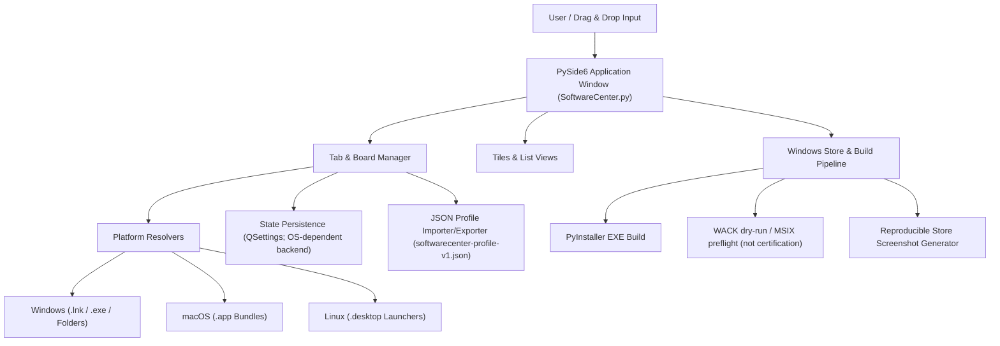
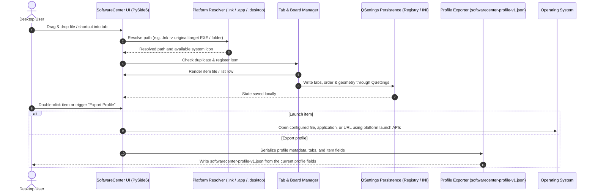

# SoftwareCenter

[](https://www.python.org/)
[](NOTICE)
[](https://docs.pytest.org/)
[](https://github.com/file-bricks/SoftwareCenter)
[](SECURITY.md)
[](SECURITY.md)
[](LICENSE)
[](https://doc.qt.io/qtforpython-6/)
[](https://github.com/file-bricks)
[](https://github.com/open-bricks)
[](llms.txt)

[English](README.md) · [Deutsch](README_de.md) · [Español](README.es.md) · [简体中文](README_zh.md) · [日本語](README_ja.md) · [Русский](README_ru.md) · [Français](README_fr.md) · [हिन्दी](README_hi.md) · [العربية](README_ar.md)

Un organiseur de bureau léger et multiplateforme pour gérer des raccourcis logiciels au moyen d’une classification par onglets.

> [!NOTE]
> **Intégration IA / LLM et index lisible par machine :** SoftwareCenter fournit des métadonnées structurées et lisibles par machine dans [`llms.txt`](llms.txt), et prend en charge la migration de profils au format JSON versionné (`softwarecenter-profile-v1.json`).


## Navigation rapide

- [Référence rapide](#quick-reference)
- [Fonctionnalités](#features)
- [Profils d’utilisateurs et visibilité](#target-personas--discoverability)
- [Fonctionnalités et limites de SoftwareCenter](#comparative-matrix-vs-alternatives)
- [Architecture du système](#system-architecture)
- [Séquence du cycle de vie](#lifecycle-sequence-flow)
- [Fonctionnalités principales et limites des éléments vérifiés](#core-capabilities--safety-invariants)
- [Écosystème et produits apparentés](#sibling-ecosystem--sister-products)
- [Contexte de recherche](#discovery-context)
- [Prérequis](#requirements)
- [Installation](#installation)
- [Lancement](#run)
- [Utilisation](#usage)
- [Création de l’exécutable](#build-executable)
- [Contrôles qualité](#quality-checks)
- [Maintenance du catalogue de lanceurs sans interface graphique](#headless-launcher-catalog-care)
- [Format d’échange](#exchange-format)
- [LaunchBoards](#launchboards)
- [Séparation des produits apparentés](#sister-product-boundary)
- [Ressources Windows Store](#windows-store-assets)
- [Technologies](#tech-stack)
- [Politique de sécurité](#security-policy)
- [Licences tierces et gouvernance](#third-party-licenses--governance)
- [Licence](#license)
- [Responsabilité](#liability)

<a id="quick-reference"></a>
## Référence rapide

| Attribut | Détails |
|---|---|
| **Technologies** | Python 3.10+ / PySide6 (Qt) / QSettings |
| **Licence** | Code du projet : MIT ; PySide6 et les autres dépendances ont leurs propres conditions (voir [THIRD_PARTY_LICENSES.md](THIRD_PARTY_LICENSES.md)) |
| **Format d’échange** | `softwarecenter-profile-v1.json` (voir [EXPORTFORMAT.md](EXPORTFORMAT.md)) |
| **Dernière vérification** | 2026-09-23 (en local : suite pytest complète, tests smoke des plateformes, compileall, Ruff, audit des dépendances, intégration au menu contextuel du gestionnaire de fichiers, attribution NOTICE, durcissement du cycle de vie CI ; WACK est toujours en dry-run uniquement) |

<a id="features"></a>
## Fonctionnalités

- **Organisation par onglets** — regroupez programmes, documents et dossiers dans des tableaux que vous pouvez renommer et déplacer
- **Glisser-déposer et organisation universelle** — déposez des applications, scripts, documents, dossiers ou raccourcis sur les tableaux ; cela ajoute une couche d’organisation indépendante au-dessus du système de fichiers
- **Aide pour les tableaux vides** — un espace réservé explique les types d’éléments qu’il est possible d’y déposer
- **Deux modes d’affichage** — mosaïque avec grandes icônes et liste
- **Enregistrement automatique** — les onglets, leur contenu et la position de la fenêtre sont enregistrés
- **Menu contextuel** — ouvrez ou supprimez un élément avec le bouton droit de la souris
- **Multiplateforme** — Windows, macOS et Linux
- **Icônes natives** — affichage automatique des icônes des applications système
- **Résolution des raccourcis Windows** — les fichiers `.lnk` déposés qui pointent vers un `.exe` ou un dossier sont enregistrés sous la forme de leur cible d’origine
- **Bundles d’applications macOS** — déposez directement les applications `.app` dans l’organiseur
- **Lanceurs Linux** — les entrées `.desktop` affichent le nom de l’application et la lancent avec la commande du fichier desktop
- **Export et import de profils** — format versionné `softwarecenter-profile-v1.json` pour les migrations et les sauvegardes
- **Sélection multiple** — supprimez plusieurs entrées à la fois
- **Fonctionnement local prioritaire** — le code de l’organiseur n’intègre aucune fonction de compte, de télémétrie ou de synchronisation cloud ; les URL HTTP(S) et les programmes lancés sont ouverts par l’intermédiaire de la plateforme et peuvent utiliser le réseau

<a id="target-personas--discoverability"></a>
## Profils d’utilisateurs et visibilité

SoftwareCenter répond à des difficultés précises rencontrées dans les flux de travail de quatre profils d’utilisateurs :

| Profil | Activités et responsabilités principales | Difficulté principale | Réponse de SoftwareCenter |
|---|---|---|---|
| **Profil 1 : utilisateurs expérimentés et organisateurs de postes de travail** | Utilisent chaque jour de nombreux outils, dossiers de travail et utilitaires. | Bureau Windows encombré, recherche lente dans le menu Démarrer, absence de regroupements personnalisés persistants. | Tableaux rapides à onglets, organisation des fichiers par glisser-déposer, notes personnalisées et changement instantané. |
| **Profil 2 : développeurs indépendants et ingénieurs DevOps** | Gèrent des chaînes d’outils, wrappers CLI, applications portables et environnements virtuels. | Mélange des outils de développement avec les applications grand public dans le menu Démarrer ; lanceurs lourds consommant de la mémoire. | SoftwareCenter et LaunchBoards ont des identités d’application distinctes ; sous Windows, le lancement de fichiers demande le dossier cible comme répertoire de travail lorsque cela est pris en charge. Ce n’est pas un gestionnaire d’environnements de projet, et le comportement dépend du système d’exploitation et de l’application cible. |
| **Profil 3 : utilisateurs de plusieurs postes de travail** | Déplacent manuellement des profils entre plusieurs postes de travail. | Les chemins absolus peuvent ne pas exister sur un autre appareil ; les libellés et notes facultatives peuvent contenir des informations privées. | Export/import versionné via `softwarecenter-profile-v1.json` ; vérifiez les chemins et les notes avant de partager. Après confirmation, l’import remplace le profil actuel ; les fichiers cibles ne sont pas copiés. |
| **Profil 4 : personnes soucieuses de confidentialité** | Préfèrent des paramètres de l’organiseur stockés localement et l’absence de compte ou de télémétrie intégrés à l’application. | Les chemins et notes enregistrés peuvent révéler des informations locales ; l’ouverture d’une URL ou le lancement d’un programme peut entraîner des communications réseau. | Le code de l’organiseur examiné ne comporte pas de fonction de compte, de télémétrie ou de synchronisation cloud. Il ne garantit ni la confidentialité, ni l’absence de trafic sortant des processus lancés, ni le comportement des programmes cibles en matière de privilèges. |

### Requêtes de recherche à forte intention

- `SoftwareCenter Python desktop launcher`
- `PySide6 desktop shortcut manager`
- `local-first desktop organizer python`
- `portable shortcut launcher without cloud account`
- `SoftwareCenter vs LaunchBoards profile switcher`
- `privacy friendly Windows app launcher with tabs`

<a id="comparative-matrix-vs-alternatives"></a>
## Fonctionnalités et limites de SoftwareCenter

| Fonctionnalité | Comportement implémenté | Limite |
|---|---|---|
| **Organisation par onglets** | Regroupe les entrées de chemin dans des onglets nommés, en mosaïque ou en liste. | Les onglets organisent des références ; ils ne constituent pas des environnements d’exécution par projet. |
| **Chemins locaux et URL** | Le glisser-déposer permet d’enregistrer les chemins locaux et URL HTTP(S) pris en charge. | Les entrées pointent vers des cibles ; l’organiseur n’en copie pas le contenu. |
| **Gestion des cibles selon la plateforme** | Sous Windows, la résolution `.lnk` accepte des cibles `.exe` ou des dossiers existants ; les bundles d’applications macOS sont ouverts avec `open` ; les entrées Linux `.desktop` sont analysées pour en extraire le nom, l’icône et `Exec`. | La résolution et le lancement dépendent du système d’exploitation. Sous Linux, `Exec` est lancé comme une commande ; il ne s’agit pas d’un bac à sable pour scripts. |
| **Répertoire de travail** | Sous Windows, le lancement d’un fichier utilise `_startfile_in_dir` pour demander le dossier contenant le fichier cible comme répertoire de travail lorsque cela est pris en charge. | Les solutions de lancement de repli peuvent ne pas définir explicitement de répertoire de travail ; aucun CWD du processus parent ni comportement commun entre plateformes n’est garanti. |
| **Paramètres locaux** | Qt `QSettings` stocke les onglets, entrées, vues et l’état de la fenêtre dans l’espace de noms de paramètres du produit. | Qt et le système d’exploitation fournissent le stockage ; aucune garantie d’écriture atomique ou de descripteur de sécurité n’est revendiquée. |
| **Export de profil** | `softwarecenter-profile-v1.json` contient des métadonnées de profil, des onglets, des vues et des entrées dotées de `label`, `path`, `kind` et d’un `notes` facultatif. | Les chemins, libellés et notes peuvent révéler des informations locales ; les fichiers cibles ne sont pas copiés. |
| **Import de profil** | L’importeur vérifie le format et la version, normalise les entrées et demande une confirmation. | Après confirmation, l’import remplace le profil actuel ; il ne fusionne pas les profils et n’offre pas de garantie générale contre la perte de données. |
| **Identité des produits** | SoftwareCenter et LaunchBoards partagent leur implémentation, mais ont des espaces de noms de paramètres, des points de terminaison d’instance unique et des identités Store distincts. | Cela sépare deux produits ; cela ne fournit pas de profils sélectionnables par utilisateur dans SoftwareCenter. |
| **Limites réseau** | Le code source de l’organiseur examiné ne comporte pas d’implémentation de compte, de télémétrie ou de synchronisation cloud. | Il ouvre des URL HTTP(S) et lance des cibles externes qui peuvent utiliser le réseau ; l’absence totale de trafic réseau pour l’application ou les processus lancés n’est pas garantie. |
| **Périmètre des vérifications** | Les tests du dépôt vérifient des contrats nommés ; la CI exécute une matrice de versions Python sur Ubuntu et des tests smoke distincts pour Linux/macOS. | Ces vérifications n’établissent pas le comportement sur tous les hôtes, ne certifient pas WACK ou une soumission au Store et ne prouvent pas des propriétés de sécurité universelles. |

<a id="system-architecture"></a>
## Architecture du système



<a id="lifecycle-sequence-flow"></a>
## Séquence du cycle de vie



<a id="core-capabilities--safety-invariants"></a>
## Fonctionnalités principales et limites des éléments vérifiés

| Sujet | Éléments observés dans le code et les tests examinés | Portée et limites |
|---|---|---|
| **Comportement réseau de l’organiseur** | Le code de l’application ne comporte aucun client de compte, de télémétrie ou de synchronisation cloud ; `open_file` transmet les URL HTTP(S) à Qt ou au navigateur de la plateforme. | L’inspection du code source ne mesure pas le trafic réseau de SoftwareCenter, du navigateur ou des processus lancés pendant l’exécution. |
| **Contexte de lancement** | Le lancement de fichiers et d’URL est délégué aux API de la plateforme ; sous Windows, le code demande le dossier cible comme répertoire de travail lorsque c’est possible. | Le code et les tests examinés ne vérifient pas les descripteurs de sécurité des processus et n’imposent pas les privilèges des processus enfants. |
| **Suppression d’entrées** | L’interface retire les entrées de la liste et de l’état de profil enregistré sans supprimer les fichiers référencés. | Cela ne décrit pas les cibles ouvertes ou modifiées par un programme externe. |
| **Résolution selon la plateforme** | Sous Windows, la recherche d’une cible `.lnk` utilise COM avec un repli PowerShell ; les données `Exec` des fichiers Linux `.desktop` sont analysées puis lancées. | Ces gestionnaires n’isolent pas le comportement des cibles ; des commandes configurées ou des programmes externes peuvent être exécutés. |
| **Persistance QSettings** | `save_settings` écrit les valeurs des onglets, entrées, vues, dimensions de fenêtre et langue via Qt `QSettings`. | Le code ne revendique ni transaction atomique ni écriture résistante aux plantages. |
| **Données de profil** | `softwarecenter-profile-v1.json` contient les champs du profil et les entrées `label`, `path`, `kind` et `notes` facultatif ; après confirmation, l’import remplace le profil actuel. | Les valeurs peuvent révéler des informations locales ; les tests couvrent des fixtures et un aller-retour, pas le nettoyage arbitraire des secrets. Voir `tests/test_export_contract.py`. |
| **Séparation des produits apparentés** | `scripts/verify_product_boundaries.py` et les tests de limites des produits vérifient la séparation des espaces de noms de paramètres et des points de terminaison d’instance unique de SoftwareCenter et LaunchBoards. | Il s’agit d’une séparation entre produits, pas de profils multi-utilisateurs ou par projet. Voir `PRODUCT_BOUNDARIES.md` et `tests/test_product_boundaries.py`. |
| **Périmètre CI et publication** | La CI exécute la matrice de régression des versions Python sur Ubuntu ainsi que des tests smoke distincts pour Linux/macOS. | Cela n’implique ni CI sur un hôte Windows, ni certification WACK, ni publication dans le Store, ni sécurité universelle à l’exécution. Voir `CI_CONTRACT.md`. |

<a id="sibling-ecosystem--sister-products"></a>
## Écosystème et produits apparentés

SoftwareCenter fait partie de la collection plus large d’outils de bureau **file-bricks** et de l’initiative open source fédératrice **open-bricks** :

| Projet | Écosystème | Fonction principale | Intégration / complémentarité |
|---|---|---|---|
| [`ProFiler`](https://github.com/file-bricks/ProFiler) | `file-bricks` | Inspection de documents et médias | Application complémentaire pour le tri de fichiers et l’analyse documentaire forensique |
| [`ExplorerPro`](https://github.com/file-bricks/ExplorerPro) | `file-bricks` | Explorateur de fichiers à onglets multiples | Gestion complémentaire à deux volets des fichiers liés par les raccourcis SoftwareCenter |
| [`CloudLockFixer`](https://github.com/file-bricks/CloudLockFixer) | `file-bricks` | Déblocage et réparation des verrous cloud | Débloque les fichiers de synchronisation figés et les fichiers OneDrive référencés par des raccourcis |
| [`knowledgedigest`](https://github.com/file-bricks/knowledgedigest) | `file-bricks` | Base de connaissances Markdown et documentaire | Organiseur local de synthèses documentaires pour les flux de recherche |
| [`FormularErstellen`](https://github.com/doc-bricks/FormularErstellen) | `doc-bricks` | Création de formulaires et de modèles | Générateur de documents de bureau lançable depuis les tuiles SoftwareCenter |
| [`USR_PDFunlock`](https://github.com/doc-bricks/USR_PDFunlock) | `doc-bricks` | Outil d’aide aux mots de passe et au déverrouillage PDF | Utilitaire local de déverrouillage PDF qui ne modifie pas le fichier d’origine |
| [`safe-start-for-codex`](https://github.com/dev-bricks/safe-start-for-codex) | `dev-bricks` | Barrière de démarrage pour l’automatisation | Protège les environnements de travail de bureau contre les démarrages en rafale |
| [`MethodenAnalyser`](https://github.com/dev-bricks/MethodenAnalyser) | `dev-bricks` | Analyseur de code source fondé sur l’AST | Analyse statique des outils et modules de bureau Python |
| [`connectors`](https://github.com/ellmos-ai/connectors) | `ellmos-ai` | Pont de communication entre agents | Adaptateurs de messagerie et de transport sans dépendances |
| [`open-bricks`](https://github.com/open-bricks) | `open-bricks` | Fédération open source de produits de bureau | Normes, gouvernance et empaquetage |

<a id="discovery-context"></a>
## Contexte de recherche

SoftwareCenter est plus facile à trouver comme **lanceur d’applications local sur PySide6** ou **organiseur de raccourcis de bureau**. Il se situe entre le menu Démarrer de Windows, les dossiers de raccourcis du bureau et les systèmes complets d’inventaire logiciel : il lance les programmes déjà présents sur votre ordinateur, regroupe les raccourcis dans des onglets et exporte ou importe des profils portables.

Exemples de requêtes utiles :

- `SoftwareCenter PySide6 desktop organizer`
- `local-first app launcher Python PySide6`
- `desktop shortcut organizer with tabs`
- `softwarecenter-profile-v1.json`
- `local-first desktop organizer with profile export`

Ce n’est ni Microsoft Configuration Manager Software Center, ni une boutique d’applications, ni un gestionnaire de paquets, ni un portail de déploiement à distance.

<a id="requirements"></a>
## Prérequis

- Python 3.10+
- PySide6

<a id="installation"></a>
## Installation

```bash
pip install -r requirements.txt
```

<a id="run"></a>
## Lancement

```bash
python SoftwareCenter.py
```

Sous Windows, vous pouvez aussi utiliser `START.bat` ou le fichier prêt à l’emploi `SoftwareCenter.exe` disponible dans les [Releases](https://github.com/file-bricks/SoftwareCenter/releases).

<a id="usage"></a>
## Utilisation

| Action | Instructions |
|--------|-------------|
| Ajouter des programmes | Faites glisser dans la fenêtre des fichiers, dossiers, raccourcis, bundles `.app` sous macOS ou lanceurs `.desktop` sous Linux ; les fichiers Windows `.lnk` pointant vers des fichiers `.exe` ou des dossiers sont résolus vers leur cible d’origine |
| Organiser les onglets | Barre d’outils > "New Tab", double-cliquez pour renommer |
| Changer de vue | Barre d’outils > Tiles / List |
| Lancer un programme | Double-clic ou clic droit > Open/Start |
| Supprimer des entrées | Clic droit > Delete (supprime uniquement le raccourci) |
| Exporter un profil | `File > Export Profile` ou l’action de la barre d’outils |
| Importer un profil | `File > Import Profile` ou l’action de la barre d’outils ; remplace le profil actuel |

<a id="build-executable"></a>
## Créer l’exécutable

```bash
pip install pyinstaller
python -m PyInstaller --noconfirm --clean SoftwareCenter.spec
```

L’EXE sera placé dans `dist/SoftwareCenter.exe`. Sous Windows, `build_exe.bat` le copie également à la racine du projet pour une utilisation locale.

<a id="quality-checks"></a>
## Contrôles qualité

```bash
python -m compileall -q SoftwareCenter.py manage_translations.py translator.py
python -m json.tool locales/translations.json
python -m json.tool store_package.json
python -m pytest -q
python tests/macos_platform_smoke.py
python tests/linux_platform_smoke.py
python scripts/verify_product_boundaries.py
```

Le workflow hébergé et la limite explicite de la partie Web facultative sont décrits dans [CI_CONTRACT.md](CI_CONTRACT.md).

GitHub Actions exécute ces tests smoke. Le test macOS vérifie l’import `.app`, le lancement avec `open`, la persistance QSettings et l’export du profil sur `macos-latest` ; le test Linux couvre l’import `.desktop`, le lancement avec `Exec`/`xdg-open`, la persistance QSettings et l’export du profil sur `ubuntu-latest`. Les artefacts de build et les fichiers locaux de tâches/tests sont ignorés et ne doivent pas être commités.

Pour le parcours Windows Store, `python scripts/run_windows_wack.py --dry-run` vérifie les chemins MSIX/AppCert locaux et affiche la commande WACK reproductible. La véritable certification doit être exécutée depuis une PowerShell élevée avec un MSIX fraîchement signé avant soumission.
La commande `python generate_store_screenshots.py` crée le jeu reproductible de captures d’écran Store dans `README/screenshots/store/`.

<a id="headless-launcher-catalog-care"></a>
## Maintenance du catalogue de lanceurs sans interface graphique

L’outil facultatif de rapprochement du catalogue est fourni sous forme de code d’exécution Plan-D dans `scripts/softwarecenter_sync.py`. Les fichiers du catalogue synchronisé et du registre sont des entrées CLI explicites ; la commande est en lecture seule sauf si `--apply` est indiqué. La charge utile du planificateur à environnement d’exécution épinglé, les barrières d’application, la lecture de contrôle native et la procédure de retour arrière sont décrites dans [RUNTIME_DAILY_CARE.md](RUNTIME_DAILY_CARE.md).

<a id="exchange-format"></a>
## Format d’échange

Les profils peuvent être exportés dans `softwarecenter-profile-v1.json` puis importés à nouveau. Le format contient les métadonnées du profil, les onglets, les modes d’affichage et les entrées dotées de `label`, `path`, `kind` et d’un `notes` facultatif. L’application ne copie pas les fichiers locaux référencés, mais les chemins, libellés et notes peuvent contenir des informations sensibles ; le format ne constitue pas une barrière de nettoyage des secrets. Après confirmation, l’import remplace le profil actuel. Les chemins manquants restent visibles comme références. Voir [EXPORTFORMAT.md](EXPORTFORMAT.md) pour plus de détails.

<a id="launchboards"></a>
## LaunchBoards


[LaunchBoards](https://github.com/file-bricks/SoftwareCenter) est le produit apparenté de SoftwareCenter : il partage la même base de code, mais possède sa propre marque et identité et s’articule autour de tableaux d’espace de travail interchangeables plutôt que d’un lanceur de raccourcis généraliste. Il partage ce dépôt et le pipeline de publication ; il n’existe pas d’arborescence source LaunchBoards séparée à maintenir.

<a id="sister-product-boundary"></a>
## Séparation des produits apparentés

LaunchBoards partage l’implémentation, mais dispose de son propre espace de noms QSettings, point de terminaison d’instance unique, icône, exécutable, identité Store et chemin de publication. Les vérifications statiques reproductibles, les tests de processus parallèles isolés et les contrôles d’artefacts sont documentés dans [PRODUCT_BOUNDARIES.md](PRODUCT_BOUNDARIES.md).

<a id="windows-store-assets"></a>
## Ressources Windows Store

Le parcours Windows Store comprend désormais un générateur reproductible de captures d’écran de l’interface actuelle. Exécutez `python generate_store_screenshots.py` pour actualiser `README/screenshots/store/` avec quatre captures Store générées et `summary.json`.

<a id="tech-stack"></a>
## Technologies

| Composant | Technologie |
|-----------|-----------|
| Langage | Python 3.10+ |
| Interface graphique | PySide6 (Qt for Python) |
| Stockage | QSettings (registre Windows / INI) |
| Taille du code | Voir les fichiers actuels du dépôt ; aucun nombre fixe de lignes n’est avancé |

<a id="security-policy"></a>
## Politique de sécurité

Le [SECURITY.md](SECURITY.md) du dépôt décrit les versions prises en charge, les canaux de signalement des vulnérabilités, un délai initial de réponse annoncé de 48 heures et un délai de triage de 5 jours ouvrés. Ces déclarations de politique ne doivent pas être interprétées comme une vérification du comportement à l’exécution.

<a id="third-party-licenses--governance"></a>
## Licences tierces et gouvernance

La licence MIT du dépôt s’applique au code source du projet. Les dépendances tierces ont leurs propres conditions ; [THIRD_PARTY_LICENSES.md](THIRD_PARTY_LICENSES.md) consigne les métadonnées des composants, mais ne constitue pas une garantie générale de permissivité des licences ou de conformité de l’empaquetage.

- **Attribution :** [NOTICE](NOTICE) (mentions de droits d’auteur pour Lukas Geiger et les organisations file-bricks / open-bricks).
- **PySide6 et shiboken6 :** l’inventaire indique les conditions LGPL-3.0-only ; voir le [texte LGPL-3.0](https://www.gnu.org/licenses/lgpl-3.0.html) et les [métadonnées des composants](THIRD_PARTY_LICENSES.md). La licence MIT du projet ne s’applique pas globalement à ces dépendances.
- **Bibliothèque standard Python :** [PSF-2.0](https://docs.python.org/3/license.html). Cette licence n’implique pas que l’organiseur ou les programmes qu’il lance fonctionnent hors ligne.
- **PyInstaller :** [GPL-2.0-or-later with PyInstaller-exception](https://pyinstaller.org/en/stable/license.html) concerne un outil de build ; pour une distribution empaquetée, examinez la licence amont et les mentions de distribution au lieu de supposer une exemption générale.
- **Limites des vérifications :** les tests couvrent des contrats de code et de documentation nommés ; ils n’établissent pas de garanties universelles à l’exécution.

<a id="license"></a>
## Licence

[MIT](LICENSE)

**Remarque :** la licence MIT du dépôt porte sur le code source du projet. L’application utilise [PySide6](https://doc.qt.io/qtforpython-6/), qui a des conditions de licence propres à cette dépendance ; voir [THIRD_PARTY_LICENSES.md](THIRD_PARTY_LICENSES.md).

---

<a id="liability"></a>
## Responsabilité

Ce projet est un don open source non rémunéré. La responsabilité est limitée à l’intention et à la faute lourde (§ 521 du Code civil allemand). Utilisez-le à vos risques. Aucune garantie, aucun engagement de maintenance et aucune aptitude à un usage particulier ne sont présumés.
