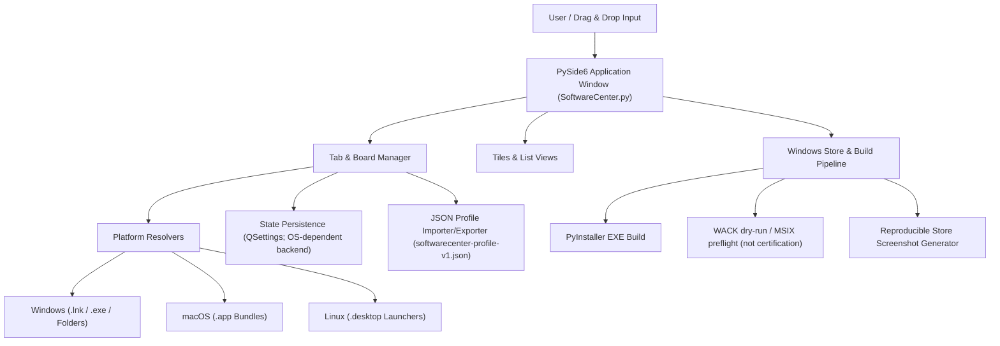
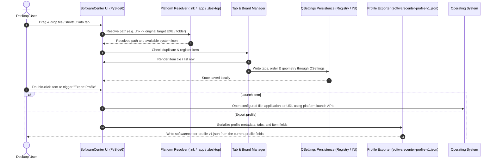

# SoftwareCenter

[](https://www.python.org/)
[](NOTICE)
[](https://docs.pytest.org/)
[](https://github.com/file-bricks/SoftwareCenter)
[](SECURITY.md)
[](SECURITY.md)
[](LICENSE)
[](https://doc.qt.io/qtforpython-6/)
[](https://github.com/file-bricks)
[](https://github.com/open-bricks)
[](llms.txt)

[English](README.md) · [Deutsch](README_de.md) · [Español](README.es.md) · [简体中文](README_zh.md) · [日本語](README_ja.md) · [Русский](README_ru.md) · [Français](README_fr.md) · [हिन्दी](README_hi.md) · [العربية](README_ar.md)

टैब-आधारित वर्गीकरण के साथ सॉफ़्टवेयर शॉर्टकट प्रबंधित करने वाला हल्का, क्रॉस-प्लेटफ़ॉर्म डेस्कटॉप आयोजक।

> [!NOTE]
> **LLM / AI एकीकरण और मशीन-पठनीय अनुक्रमणिका:** SoftwareCenter [`llms.txt`](llms.txt) में संरचित, मशीन-पठनीय मेटाडेटा देता है और संस्करणयुक्त JSON (`softwarecenter-profile-v1.json`) के ज़रिए प्रोफ़ाइल माइग्रेशन का समर्थन करता है।


## त्वरित नेविगेशन

- [त्वरित संदर्भ](#quick-reference)
- [विशेषताएँ](#features)
- [लक्षित उपयोगकर्ता और खोज में दृश्यता](#target-personas--discoverability)
- [SoftwareCenter की क्षमताएँ और सीमाएँ](#comparative-matrix-vs-alternatives)
- [सिस्टम आर्किटेक्चर](#system-architecture)
- [लाइफ़साइकल क्रम प्रवाह](#lifecycle-sequence-flow)
- [मुख्य क्षमताएँ और साक्ष्य की सीमाएँ](#core-capabilities--safety-invariants)
- [सहयोगी इकोसिस्टम और संबंधित उत्पाद](#sibling-ecosystem--sister-products)
- [खोज संदर्भ](#discovery-context)
- [आवश्यकताएँ](#requirements)
- [इंस्टॉलेशन](#installation)
- [चलाएँ](#run)
- [उपयोग](#usage)
- [एक्ज़ीक्यूटेबल बनाएँ](#build-executable)
- [गुणवत्ता जाँच](#quality-checks)
- [बिना GUI के लॉन्चर कैटलॉग का रखरखाव](#headless-launcher-catalog-care)
- [आदान-प्रदान प्रारूप](#exchange-format)
- [LaunchBoards](#launchboards)
- [संबंधित उत्पादों की सीमा](#sister-product-boundary)
- [Windows Store संसाधन](#windows-store-assets)
- [तकनीकी स्टैक](#tech-stack)
- [सुरक्षा नीति](#security-policy)
- [तृतीय-पक्ष लाइसेंस और शासन](#third-party-licenses--governance)
- [लाइसेंस](#license)
- [दायित्व](#liability)

<a id="quick-reference"></a>
## त्वरित संदर्भ

| विशेषता | विवरण |
|---|---|
| **टेक स्टैक** | Python 3.10+ / PySide6 (Qt) / QSettings |
| **लाइसेंस** | प्रोजेक्ट कोड: MIT; PySide6 और अन्य निर्भरताओं की शर्तें अलग हैं (देखें [THIRD_PARTY_LICENSES.md](THIRD_PARTY_LICENSES.md)) |
| **आदान-प्रदान प्रारूप** | `softwarecenter-profile-v1.json` (देखें [EXPORTFORMAT.md](EXPORTFORMAT.md)) |
| **अंतिम जाँच** | 2026-09-23 (स्थानीय: पूरी pytest suite, प्लेटफ़ॉर्म smoke जाँचें, compileall, Ruff, निर्भरता ऑडिट, फ़ाइल प्रबंधक के संदर्भ मेनू का एकीकरण, NOTICE श्रेय, CI लाइफ़साइकल को मज़बूत करना; WACK अभी केवल dry-run है) |

<a id="features"></a>
## विशेषताएँ

- **टैब के आधार पर संगठन** — प्रोग्राम, दस्तावेज़ और फ़ोल्डर को बोर्डों में समूहित करें; बोर्डों का नाम बदलें और उन्हें स्थानांतरित करें
- **ड्रैग-एंड-ड्रॉप और सार्वभौमिक आयोजक** — ऐप, स्क्रिप्ट, दस्तावेज़, फ़ोल्डर या शॉर्टकट सीधे बोर्डों पर छोड़ें; यह फ़ाइल सिस्टम के ऊपर स्वतंत्र संगठन-परत की तरह काम करता है
- **खाली बोर्ड के लिए मार्गदर्शन** — खाली बोर्ड पर सहायक प्लेसहोल्डर बताता है कि वहाँ किन प्रकार की चीज़ों को छोड़ा जा सकता है
- **देखने के दो तरीके** — बड़े आइकन वाले टाइल और सूची
- **स्वतः सहेजना** — टैब, उनकी सामग्री और विंडो की स्थिति सहेजी जाती है
- **संदर्भ मेनू** — दायाँ-क्लिक करके खोलें या हटाएँ
- **क्रॉस-प्लेटफ़ॉर्म** — Windows, macOS और Linux
- **नेटिव आइकन** — सिस्टम ऐप्लिकेशन के आइकन अपने-आप दिखते हैं
- **Windows शॉर्टकट समाधान** — छोड़ी गई `.lnk` फ़ाइलें यदि `.exe` या फ़ोल्डर को लक्षित करती हैं, तो मूल लक्ष्य के रूप में सहेजी जाती हैं
- **macOS ऐप बंडल** — `.app` ऐप्लिकेशन सीधे आयोजक में ड्रैग-एंड-ड्रॉप करें
- **Linux डेस्कटॉप लॉन्चर** — `.desktop` प्रविष्टियाँ ऐप का नाम दिखाती हैं और अपनी desktop command से लॉन्च होती हैं
- **प्रोफ़ाइल एक्सपोर्ट/इम्पोर्ट** — माइग्रेशन और बैकअप के लिए संस्करणयुक्त `softwarecenter-profile-v1.json` प्रारूप
- **एकाधिक चयन** — एक बार में कई प्रविष्टियाँ हटाएँ
- **स्थानीय उपयोग को प्राथमिकता** — आयोजक के कोड में अकाउंट, टेलीमेट्री या क्लाउड-सिंक सुविधा नहीं है; HTTP(S) URL और लॉन्च किए गए प्रोग्राम प्लेटफ़ॉर्म के माध्यम से खोले जाते हैं और नेटवर्क का उपयोग कर सकते हैं

<a id="target-personas--discoverability"></a>
## लक्षित उपयोगकर्ता और खोज में दृश्यता

SoftwareCenter चार अलग-अलग उपयोगकर्ता-प्रोफ़ाइलों के कार्यप्रवाह की विशिष्ट अड़चनों को दूर करने के लिए बनाया गया है:

| उपयोगकर्ता-प्रोफ़ाइल | मुख्य गतिविधियाँ और ज़िम्मेदारियाँ | प्रमुख समस्या | SoftwareCenter का समाधान |
|---|---|---|---|
| **प्रोफ़ाइल 1: डेस्कटॉप पावर यूज़र और क्यूरेटर** | रोज़ाना अनेक टूल, कार्यक्षेत्र फ़ोल्डर और यूटिलिटी इस्तेमाल करते हैं। | Windows डेस्कटॉप पर अव्यवस्था, Start Menu में खोज धीमी, स्थायी कस्टम समूह बनाने का अभाव। | तेज़ टैब-आधारित बोर्ड, ड्रैग-एंड-ड्रॉप फ़ाइल संगठन, कस्टम नोट और तुरंत स्विच करना। |
| **प्रोफ़ाइल 2: स्वतंत्र डेवलपर और DevOps इंजीनियर** | टूलचेन, CLI wrapper, पोर्टेबल ऐप और वर्चुअल एनवायरनमेंट सँभालते हैं। | डेवलपमेंट टूल का सामान्य Start Menu में मिल जाना; मेमोरी लेने वाले भारी लॉन्चर daemon। | SoftwareCenter और LaunchBoards की ऐप पहचान अलग है; Windows में फ़ाइल लॉन्च करते समय, जहाँ समर्थित हो, लक्ष्य फ़ोल्डर को working directory के रूप में माँगा जाता है। यह प्रोजेक्ट-एनवायरनमेंट मैनेजर नहीं है और लक्ष्य का व्यवहार OS तथा ऐप पर निर्भर है। |
| **प्रोफ़ाइल 3: कई PC पर काम करने वाले उपयोगकर्ता** | प्रोफ़ाइलों को हाथ से एक वर्कस्टेशन से दूसरे पर ले जाते हैं। | पूर्ण पथ दूसरे डिवाइस पर काम न करें; लेबल और वैकल्पिक नोट में निजी जानकारी हो सकती है। | संस्करणयुक्त `softwarecenter-profile-v1.json` से एक्सपोर्ट/इम्पोर्ट; साझा करने से पहले पथ और नोट जाँचें। पुष्टि के बाद इम्पोर्ट मौजूदा प्रोफ़ाइल को बदल देता है; लक्ष्य फ़ाइलें कॉपी नहीं होतीं। |
| **प्रोफ़ाइल 4: गोपनीयता के प्रति सजग उपयोगकर्ता** | आयोजक सेटिंग स्थानीय रूप से रखना और ऐप में अकाउंट या टेलीमेट्री सुविधा न होना पसंद करते हैं। | सहेजे गए पथ और नोट स्थानीय जानकारी उजागर कर सकते हैं; URL खोलने या प्रोग्राम लॉन्च करने पर नेटवर्क संचार हो सकता है। | जाँचे गए आयोजक कोड में अकाउंट, टेलीमेट्री या क्लाउड-सिंक सुविधा नहीं है। यह गोपनीयता, लॉन्च की गई प्रक्रियाओं के लिए शून्य नेटवर्क-निकास, या लक्ष्य प्रोग्राम के विशेषाधिकार व्यवहार की गारंटी नहीं देता। |

### उच्च-इरादे वाली खोज क्वेरी

- `SoftwareCenter Python desktop launcher`
- `PySide6 desktop shortcut manager`
- `local-first desktop organizer python`
- `portable shortcut launcher without cloud account`
- `SoftwareCenter vs LaunchBoards profile switcher`
- `privacy friendly Windows app launcher with tabs`

<a id="comparative-matrix-vs-alternatives"></a>
## SoftwareCenter की क्षमताएँ और सीमाएँ

| क्षमता | लागू व्यवहार | सीमा |
|---|---|---|
| **टैब संगठन** | पथ-संदर्भित प्रविष्टियों को नामित टैब में समूहित करता है; टाइल और सूची दृश्य उपलब्ध हैं। | टैब संदर्भों को व्यवस्थित करते हैं; वे प्रति-प्रोजेक्ट निष्पादन एनवायरनमेंट नहीं हैं। |
| **स्थानीय पथ और URL** | ड्रैग-एंड-ड्रॉप से समर्थित स्थानीय पथ और HTTP(S) URL दर्ज किए जा सकते हैं। | प्रविष्टियाँ लक्ष्यों का संदर्भ देती हैं; आयोजक उनकी सामग्री कॉपी नहीं करता। |
| **प्लेटफ़ॉर्म के अनुसार लक्ष्य सँभालना** | Windows में `.lnk` समाधान मौजूदा `.exe` या फ़ोल्डर लक्ष्य स्वीकार करता है; macOS ऐप बंडल `open` से खुलते हैं; Linux `.desktop` प्रविष्टियों से नाम, आइकन और `Exec` निकाले जाते हैं। | समाधान और लॉन्च OS के अनुसार अलग होते हैं। Linux में `Exec` को कमांड की तरह चलाया जाता है; यह स्क्रिप्ट सैंडबॉक्स नहीं है। |
| **कार्यशील डायरेक्टरी** | Windows में फ़ाइल लॉन्च `_startfile_in_dir` का उपयोग करके समर्थित होने पर लक्ष्य फ़ाइल के फ़ोल्डर को working directory के रूप में माँगता है। | वैकल्पिक लॉन्च तरीकों में working directory स्पष्ट रूप से सेट न हो; parent CWD या सभी प्लेटफ़ॉर्म पर समान working-directory व्यवहार की गारंटी नहीं है। |
| **स्थानीय सेटिंग** | Qt `QSettings` टैब, प्रविष्टियाँ, दृश्य और विंडो की स्थिति उत्पाद के settings namespace में सहेजता है। | स्टोरेज बैकएंड Qt और OS देते हैं; atomic-write या security-descriptor की कोई गारंटी नहीं दी जाती। |
| **प्रोफ़ाइल एक्सपोर्ट** | `softwarecenter-profile-v1.json` में प्रोफ़ाइल मेटाडेटा, टैब, दृश्य और `label`, `path`, `kind` तथा वैकल्पिक `notes` वाली प्रविष्टियाँ होती हैं। | पथ, लेबल और नोट स्थानीय जानकारी उजागर कर सकते हैं; लक्ष्य फ़ाइलें कॉपी नहीं होतीं। |
| **प्रोफ़ाइल इम्पोर्ट** | इम्पोर्टर प्रारूप/संस्करण जाँचता है, प्रविष्टियों को सामान्यीकृत करता है और पुष्टि माँगता है। | इम्पोर्ट की पुष्टि करने पर मौजूदा प्रोफ़ाइल बदल जाती है; प्रोफ़ाइल मर्ज नहीं होती और डेटा-हानि न होने की कोई सामान्य गारंटी नहीं है। |
| **उत्पाद पहचान** | SoftwareCenter और LaunchBoards एक ही implementation साझा करते हैं, लेकिन इनके settings namespace, single-instance endpoint और Store पहचान अलग हैं। | इससे दोनों उत्पाद अलग रहते हैं; SoftwareCenter के भीतर उपयोगकर्ता-चयन योग्य प्रोफ़ाइलें नहीं मिलतीं। |
| **नेटवर्क सीमा** | जाँचे गए आयोजक स्रोत में अकाउंट, टेलीमेट्री या क्लाउड-सिंक implementation नहीं है। | यह HTTP(S) URL खोलता और बाहरी लक्ष्य लॉन्च करता है, जो नेटवर्क इस्तेमाल कर सकते हैं; पूरे ऐप या लॉन्च की गई प्रक्रिया के लिए शून्य नेटवर्क-निकास की गारंटी नहीं है। |
| **सत्यापन का दायरा** | रिपॉज़िटरी परीक्षण नामित अनुबंध जाँचते हैं; CI, Ubuntu पर Python संस्करण मैट्रिक्स और अलग Linux/macOS smoke jobs चलाता है। | ये जाँचें हर होस्ट का व्यवहार स्थापित नहीं करतीं, WACK/Store सबमिशन प्रमाणित नहीं करतीं और सार्वभौमिक सुरक्षा गुण सिद्ध नहीं करतीं। |

<a id="system-architecture"></a>
## सिस्टम आर्किटेक्चर



<a id="lifecycle-sequence-flow"></a>
## लाइफ़साइकल क्रम प्रवाह



<a id="core-capabilities--safety-invariants"></a>
## मुख्य क्षमताएँ और साक्ष्य की सीमाएँ

| विषय | जाँचे गए कोड/परीक्षणों में साक्ष्य | दायरा और सीमा |
|---|---|---|
| **आयोजक का नेटवर्क व्यवहार** | ऐप कोड में अकाउंट, टेलीमेट्री या क्लाउड-सिंक क्लाइंट नहीं है; `open_file` HTTP(S) URL Qt या प्लेटफ़ॉर्म ब्राउज़र को सौंपता है। | स्रोत का निरीक्षण करना SoftwareCenter, ब्राउज़र या लॉन्च की गई प्रक्रियाओं के रनटाइम नेटवर्क-निकास की जाँच नहीं करता। |
| **लॉन्च संदर्भ** | फ़ाइल और URL लॉन्च प्लेटफ़ॉर्म API को सौंपे जाते हैं; Windows लॉन्च कोड उपलब्ध होने पर लक्ष्य working directory माँगता है। | समीक्षा किए गए कोड और परीक्षण process security descriptor सत्यापित नहीं करते और child-process विशेषाधिकार लागू नहीं करते। |
| **प्रविष्टि हटाना** | UI सूची और सहेजी गई प्रोफ़ाइल स्थिति से प्रविष्टियाँ हटाता है, पर संदर्भित फ़ाइलें नहीं मिटाता। | इससे यह नहीं पता चलता कि कोई बाहरी प्रोग्राम खोले गए लक्ष्यों के साथ क्या करता है। |
| **प्लेटफ़ॉर्म समाधान** | Windows में `.lnk` लक्ष्य COM से खोजा जाता है और PowerShell fallback भी है; Linux `.desktop` का `Exec` डेटा पार्स करके चलाया जाता है। | ये handler लक्ष्य के व्यवहार को sandbox नहीं करते; लॉन्च से configured command या बाहरी प्रोग्राम चल सकते हैं। |
| **QSettings स्थायित्व** | `save_settings` Qt `QSettings` के ज़रिए टैब, प्रविष्टि, दृश्य, विंडो आयाम और भाषा मान लिखता है। | कोड atomic transaction या crash-proof लेखन का दावा नहीं करता। |
| **प्रोफ़ाइल डेटा** | `softwarecenter-profile-v1.json` में प्रोफ़ाइल फ़ील्ड और `label`, `path`, `kind` तथा वैकल्पिक `notes` वाली प्रविष्टियाँ होती हैं; पुष्टि के बाद इम्पोर्ट मौजूदा प्रोफ़ाइल बदल देता है। | मान स्थानीय जानकारी उजागर कर सकते हैं; परीक्षण fixtures और round trip जाँचते हैं, मनमाने secrets की सफ़ाई नहीं। देखें `tests/test_export_contract.py`। |
| **संबंधित उत्पादों का पृथक्करण** | `scripts/verify_product_boundaries.py` और उत्पाद-सीमा परीक्षण SoftwareCenter तथा LaunchBoards के अलग settings namespace और single-instance endpoint जाँचते हैं। | यह उत्पादों का पृथक्करण है, multi-user या per-project प्रोफ़ाइल नहीं। देखें `PRODUCT_BOUNDARIES.md` और `tests/test_product_boundaries.py`। |
| **CI और रिलीज़ का दायरा** | CI में Ubuntu पर Python संस्करण regression matrix और अलग Linux/macOS smoke jobs हैं। | इसका अर्थ Windows-host CI, WACK प्रमाणन, Store प्रकाशन या सार्वभौमिक रनटाइम सुरक्षा नहीं है। देखें `CI_CONTRACT.md`। |

<a id="sibling-ecosystem--sister-products"></a>
## सहयोगी इकोसिस्टम और संबंधित उत्पाद

SoftwareCenter व्यापक **file-bricks** डेस्कटॉप टूल संग्रह और छत्र **open-bricks** ओपन-सोर्स पहल का हिस्सा है:

| प्रोजेक्ट | इकोसिस्टम | मुख्य काम | एकीकरण / पूरक उपयोग |
|---|---|---|---|
| [`ProFiler`](https://github.com/file-bricks/ProFiler) | `file-bricks` | दस्तावेज़ और मीडिया निरीक्षण | फ़ाइल छँटाई और फॉरेंसिक दस्तावेज़ प्रोफ़ाइलिंग के लिए सहयोगी ऐप |
| [`ExplorerPro`](https://github.com/file-bricks/ExplorerPro) | `file-bricks` | बहु-टैब फ़ाइल-सिस्टम एक्सप्लोरर | SoftwareCenter शॉर्टकट से जुड़ी फ़ाइलों का पूरक दो-पैनल प्रबंधन |
| [`CloudLockFixer`](https://github.com/file-bricks/CloudLockFixer) | `file-bricks` | क्लाउड लॉक खोलना और मरम्मत | शॉर्टकट द्वारा संदर्भित अटके हुए sync placeholder और OneDrive फ़ाइलें खोलता है |
| [`knowledgedigest`](https://github.com/file-bricks/knowledgedigest) | `file-bricks` | Markdown और दस्तावेज़ ज्ञान-आधार | शोध कार्यप्रवाहों के लिए स्थानीय दस्तावेज़-सार आयोजक |
| [`FormularErstellen`](https://github.com/doc-bricks/FormularErstellen) | `doc-bricks` | फ़ॉर्म बनाना और टेम्पलेटिंग | SoftwareCenter टाइल से लॉन्च किया जा सकने वाला डेस्कटॉप दस्तावेज़ जनरेटर |
| [`USR_PDFunlock`](https://github.com/doc-bricks/USR_PDFunlock) | `doc-bricks` | PDF पासवर्ड और अनलॉक टूल | मूल फ़ाइल बदले बिना PDF खोलने वाली स्थानीय यूटिलिटी |
| [`safe-start-for-codex`](https://github.com/dev-bricks/safe-start-for-codex) | `dev-bricks` | ऑटोमेशन स्टार्टअप गेट | डेस्कटॉप वर्कस्टेशन एनवायरनमेंट को अचानक शुरू होने वाले कामों से बचाता है |
| [`MethodenAnalyser`](https://github.com/dev-bricks/MethodenAnalyser) | `dev-bricks` | AST स्रोत-कोड विश्लेषक | Python डेस्कटॉप टूल और मॉड्यूल का स्थिर विश्लेषण |
| [`connectors`](https://github.com/ellmos-ai/connectors) | `ellmos-ai` | एजेंट संचार पुल | बिना अतिरिक्त निर्भरताओं के संदेश और परिवहन adapters |
| [`open-bricks`](https://github.com/open-bricks) | `open-bricks` | डेस्कटॉप ओपन-सोर्स छत्र-संगठन | मानक, शासन और पैकेजिंग का साझा ढाँचा |

<a id="discovery-context"></a>
## खोज संदर्भ

SoftwareCenter को **local-first PySide6 app launcher** या **desktop shortcut organizer** के रूप में ढूँढ़ना सबसे आसान है। यह Windows Start menu, डेस्कटॉप शॉर्टकट फ़ोल्डरों और पूर्ण सॉफ़्टवेयर इन्वेंटरी प्रणालियों के बीच आता है: यह आपके कंप्यूटर पर पहले से मौजूद प्रोग्राम लॉन्च करता है, शॉर्टकट को टैब में समूहित करता है और पोर्टेबल प्रोफ़ाइल एक्सपोर्ट/इम्पोर्ट करता है।

उपयोगी खोज वाक्यांश:

- `SoftwareCenter PySide6 desktop organizer`
- `local-first app launcher Python PySide6`
- `desktop shortcut organizer with tabs`
- `softwarecenter-profile-v1.json`
- `local-first desktop organizer with profile export`

यह Microsoft Configuration Manager Software Center, ऐप स्टोर, पैकेज मैनेजर या रिमोट डिप्लॉयमेंट पोर्टल नहीं है।

<a id="requirements"></a>
## आवश्यकताएँ

- Python 3.10+
- PySide6

<a id="installation"></a>
## इंस्टॉलेशन

```bash
pip install -r requirements.txt
```

<a id="run"></a>
## चलाएँ

```bash
python SoftwareCenter.py
```

Windows पर आप `START.bat` या [Releases](https://github.com/file-bricks/SoftwareCenter/releases) से उपलब्ध पहले से बने `SoftwareCenter.exe` का भी उपयोग कर सकते हैं।

<a id="usage"></a>
## उपयोग

| क्रिया | निर्देश |
|--------|-------------|
| प्रोग्राम जोड़ें | फ़ाइलें, फ़ोल्डर, शॉर्टकट, macOS पर `.app` बंडल या Linux पर `.desktop` लॉन्चर विंडो में ड्रैग करें; `.exe` फ़ाइल या फ़ोल्डर को इंगित करने वाली Windows `.lnk` फ़ाइलें मूल लक्ष्य में resolve होती हैं |
| टैब व्यवस्थित करें | Toolbar > "New Tab", नाम बदलने के लिए डबल-क्लिक करें |
| दृश्य बदलें | Toolbar > Tiles / List |
| प्रोग्राम लॉन्च करें | डबल-क्लिक या राइट-क्लिक > Open/Start |
| प्रविष्टियाँ हटाएँ | राइट-क्लिक > Delete (इससे केवल शॉर्टकट हटता है) |
| प्रोफ़ाइल एक्सपोर्ट करें | `File > Export Profile` या toolbar की कार्रवाई |
| प्रोफ़ाइल इम्पोर्ट करें | `File > Import Profile` या toolbar की कार्रवाई; मौजूदा प्रोफ़ाइल बदल देता है |

<a id="build-executable"></a>
## एक्ज़ीक्यूटेबल बनाएँ

```bash
pip install pyinstaller
python -m PyInstaller --noconfirm --clean SoftwareCenter.spec
```

EXE `dist/SoftwareCenter.exe` में बनेगा। Windows पर `build_exe.bat` इसे स्थानीय उपयोग के लिए प्रोजेक्ट रूट में भी कॉपी करता है।

<a id="quality-checks"></a>
## गुणवत्ता जाँच

```bash
python -m compileall -q SoftwareCenter.py manage_translations.py translator.py
python -m json.tool locales/translations.json
python -m json.tool store_package.json
python -m pytest -q
python tests/macos_platform_smoke.py
python tests/linux_platform_smoke.py
python scripts/verify_product_boundaries.py
```

होस्टेड workflow और वैकल्पिक web सुविधा की स्पष्ट सीमा [CI_CONTRACT.md](CI_CONTRACT.md) में दी गई है।

GitHub Actions ये smoke जाँचें चलाता है। macOS smoke में `macos-latest` पर `.app` इम्पोर्ट, `open` से लॉन्च, QSettings स्थायित्व और प्रोफ़ाइल एक्सपोर्ट जाँचे जाते हैं; Linux smoke में `ubuntu-latest` पर `.desktop` इम्पोर्ट, `Exec`/`xdg-open` से लॉन्च, QSettings स्थायित्व और प्रोफ़ाइल एक्सपोर्ट जाँचे जाते हैं। Build artifacts और स्थानीय task/test फ़ाइलें ignore की जाती हैं और उन्हें commit नहीं करना चाहिए।

Windows Store मार्ग के लिए `python scripts/run_windows_wack.py --dry-run` स्थानीय MSIX/AppCert पथ जाँचता है और दोहराई जा सकने वाली WACK कमांड दिखाता है। वास्तविक प्रमाणन, सबमिशन से पहले, नए हस्ताक्षरित MSIX के लिए elevated PowerShell से चलाया जाना चाहिए।
`python generate_store_screenshots.py` `README/screenshots/store/` में दोहराई जा सकने वाली Store स्क्रीनशॉट शृंखला बनाता है।

<a id="headless-launcher-catalog-care"></a>
## बिना GUI के लॉन्चर कैटलॉग का रखरखाव

वैकल्पिक कैटलॉग समायोजक `scripts/softwarecenter_sync.py` में Plan-D runtime code के रूप में दिया गया है। सिंक किए गए कैटलॉग और registry फ़ाइलें स्पष्ट CLI inputs हैं; `--apply` दिए बिना कमांड केवल पढ़ती है। pinned-runtime scheduler payload, apply gates, native readback और rollback प्रक्रिया [RUNTIME_DAILY_CARE.md](RUNTIME_DAILY_CARE.md) में दी गई है।

<a id="exchange-format"></a>
## आदान-प्रदान प्रारूप

प्रोफ़ाइल को `softwarecenter-profile-v1.json` के रूप में एक्सपोर्ट करके बाद में फिर इम्पोर्ट किया जा सकता है। इस प्रारूप में प्रोफ़ाइल मेटाडेटा, टैब, दृश्य मोड और `label`, `path`, `kind` तथा वैकल्पिक `notes` वाली प्रविष्टियाँ होती हैं। ऐप संदर्भित स्थानीय फ़ाइलों की कॉपी नहीं करता, लेकिन पथ, लेबल और नोट में संवेदनशील जानकारी हो सकती है; यह प्रारूप secrets हटाने की सीमा नहीं है। पुष्टि के बाद इम्पोर्ट मौजूदा प्रोफ़ाइल बदल देता है। गुम पथ संदर्भ के रूप में दिखाई देते रहते हैं। अधिक जानकारी के लिए [EXPORTFORMAT.md](EXPORTFORMAT.md) देखें।

<a id="launchboards"></a>
## LaunchBoards


[LaunchBoards](https://github.com/file-bricks/SoftwareCenter) SoftwareCenter का संबंधित उत्पाद है: इसका codebase समान है, पर ब्रांड और पहचान अलग हैं; यह सामान्य शॉर्टकट लॉन्चर के बजाय बदल सकने वाले workspace बोर्डों पर केंद्रित है। यह इसी रिपॉज़िटरी और रिलीज़ पाइपलाइन को साझा करता है — अलग LaunchBoards source tree बनाए रखने की ज़रूरत नहीं है।

<a id="sister-product-boundary"></a>
## संबंधित उत्पादों की सीमा

LaunchBoards implementation साझा करता है, लेकिन उसका QSettings namespace, single-instance endpoint, आइकन, executable, Store पहचान और release path अलग हैं। दोहराए जा सकने वाले static checks, अलग-थलग parallel-process जाँचें और artifact जाँचें [PRODUCT_BOUNDARIES.md](PRODUCT_BOUNDARIES.md) में दर्ज हैं।

<a id="windows-store-assets"></a>
## Windows Store संसाधन

Windows Store ट्रैक में अब मौजूदा desktop UI के लिए दोहराई जा सकने वाला screenshot generator है। चार बनाए गए Store screenshots और `summary.json` के साथ `README/screenshots/store/` अपडेट करने के लिए `python generate_store_screenshots.py` चलाएँ।

<a id="tech-stack"></a>
## तकनीकी स्टैक

| घटक | तकनीक |
|-----------|-----------|
| भाषा | Python 3.10+ |
| GUI framework | PySide6 (Qt for Python) |
| स्टोरेज | QSettings (Windows Registry / INI) |
| कोड आकार | मौजूदा रिपॉज़िटरी फ़ाइलें देखें; पंक्तियों की कोई निश्चित संख्या का दावा नहीं |

<a id="security-policy"></a>
## सुरक्षा नीति

रिपॉज़िटरी की [SECURITY.md](SECURITY.md) समर्थित संस्करणों, सुरक्षा कमज़ोरियों की रिपोर्टिंग के चैनलों, घोषित 48-घंटे की प्रारंभिक प्रतिक्रिया अवधि और 5 कार्यदिवस की प्रारंभिक मूल्यांकन अवधि का वर्णन करती है। इन नीति-वक्तव्यों को रनटाइम सत्यापन नहीं समझना चाहिए।

<a id="third-party-licenses--governance"></a>
## तृतीय-पक्ष लाइसेंस और शासन

रिपॉज़िटरी का MIT लाइसेंस प्रोजेक्ट स्रोत कोड पर लागू होता है। तृतीय-पक्ष निर्भरताओं की अपनी शर्तें हैं; [THIRD_PARTY_LICENSES.md](THIRD_PARTY_LICENSES.md) घटकों का मेटाडेटा दर्ज करता है, लेकिन यह व्यापक permissive-license या package-compliance की गारंटी नहीं है।

- **श्रेय:** [NOTICE](NOTICE) (Lukas Geiger और file-bricks / open-bricks संगठनों के कॉपीराइट का उल्लेख)।
- **PySide6 और shiboken6:** सूची में LGPL-3.0-only शर्तें दर्ज हैं; [LGPL-3.0 पाठ](https://www.gnu.org/licenses/lgpl-3.0.html) और [घटक मेटाडेटा](THIRD_PARTY_LICENSES.md) देखें। प्रोजेक्ट का MIT लाइसेंस इन निर्भरताओं पर समग्र रूप से लागू नहीं होता।
- **Python Standard Library:** [PSF-2.0](https://docs.python.org/3/license.html)। इस लाइसेंस का अर्थ यह नहीं कि आयोजक या उसके लॉन्च किए गए प्रोग्राम ऑफ़लाइन चलते हैं।
- **PyInstaller:** [GPL-2.0-or-later with PyInstaller-exception](https://pyinstaller.org/en/stable/license.html) build tooling का लाइसेंस है; पैक किए गए build के लिए सामान्य छूट मानने के बजाय upstream लाइसेंस और वितरण नोटिस जाँचें।
- **सत्यापन सीमा:** परीक्षण नामित कोड और दस्तावेज़ अनुबंध जाँचते हैं; वे सार्वभौमिक रनटाइम गारंटी स्थापित नहीं करते।

<a id="license"></a>
## लाइसेंस

[MIT](LICENSE)

**नोट:** MIT इस रिपॉज़िटरी के प्रोजेक्ट स्रोत कोड का लाइसेंस है। ऐप [PySide6](https://doc.qt.io/qtforpython-6/) का उपयोग करता है, जिसकी निर्भरता-लाइसेंस शर्तें अलग हैं; [THIRD_PARTY_LICENSES.md](THIRD_PARTY_LICENSES.md) देखें।

---

<a id="liability"></a>
## दायित्व

यह ओपन-सोर्स परियोजना बिना किसी पारिश्रमिक के उपलब्ध कराई गई है। दायित्व केवल जानबूझकर किए गए कृत्य और गंभीर लापरवाही (§ 521 जर्मन नागरिक संहिता) तक सीमित है। अपने जोखिम पर उपयोग करें। कोई वारंटी, रखरखाव की गारंटी या किसी विशिष्ट उद्देश्य के लिए उपयुक्तता निहित नहीं है।
