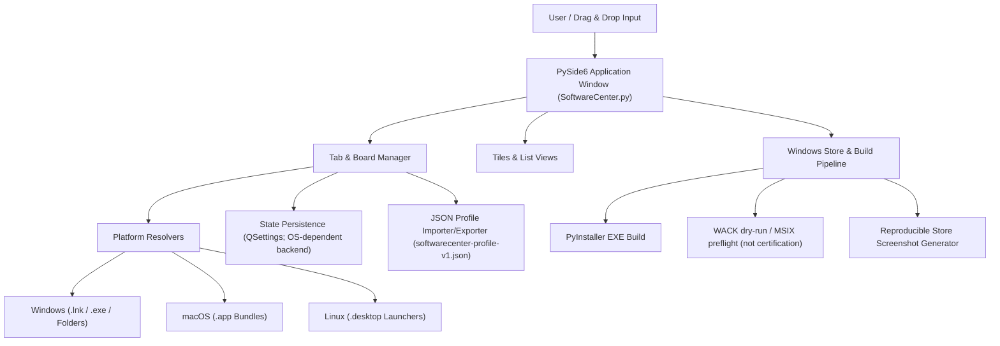
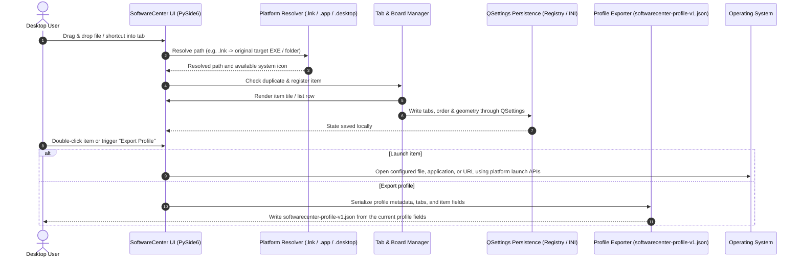

# SoftwareCenter

[](https://www.python.org/)
[](NOTICE)
[](https://docs.pytest.org/)
[](https://github.com/file-bricks/SoftwareCenter)
[](SECURITY.md)
[](SECURITY.md)
[](LICENSE)
[](https://doc.qt.io/qtforpython-6/)
[](https://github.com/file-bricks)
[](https://github.com/open-bricks)
[](llms.txt)

[English](README.md) · [Deutsch](README_de.md) · [Español](README.es.md) · [简体中文](README_zh.md) · [日本語](README_ja.md) · [Русский](README_ru.md) · [Français](README_fr.md)

> 本ページは日本語ドキュメントの翻訳です。アプリのUIでは、ドイツ語、英語、スペイン語、簡体字中国語、日本語、ロシア語の6つの実行時言語を引き続き利用できます。ドキュメントの言語とアプリのUI言語は別です。

タブによる分類でソフトウェアのショートカットを管理する、軽量なクロスプラットフォーム対応デスクトップ整理ツールです。

> [!NOTE]
> **LLM / AI連携と機械可読インデックス：** SoftwareCenter は [`llms.txt`](llms.txt) に構造化された機械可読メタデータを用意し、バージョン管理された JSON（`softwarecenter-profile-v1.json`）によるプロファイル移行をサポートします。


## クイックナビゲーション

- [クイックリファレンス](#quick-reference)
- [機能](#features)
- [対象ユーザーと見つけやすさ](#target-personas--discoverability)
- [SoftwareCenter の機能と境界](#comparative-matrix-vs-alternatives)
- [システム構成](#system-architecture)
- [ライフサイクルのシーケンス図](#lifecycle-sequence-flow)
- [主要機能と根拠の範囲](#core-capabilities--safety-invariants)
- [関連エコシステムと姉妹製品](#sibling-ecosystem--sister-products)
- [検索・発見の背景](#discovery-context)
- [必要環境](#requirements)
- [インストール](#installation)
- [起動](#run)
- [使い方](#usage)
- [実行ファイルのビルド](#build-executable)
- [品質チェック](#quality-checks)
- [ヘッドレスランチャーカタログの管理](#headless-launcher-catalog-care)
- [交換形式](#exchange-format)
- [LaunchBoards](#launchboards)
- [姉妹製品の境界](#sister-product-boundary)
- [Windows Store アセット](#windows-store-assets)
- [技術スタック](#tech-stack)
- [セキュリティ方針](#security-policy)
- [サードパーティライセンスとガバナンス](#third-party-licenses--governance)
- [ライセンス](#license)
- [責任範囲](#liability)

<a id="quick-reference"></a>
## クイックリファレンス

| 項目 | 詳細 |
|---|---|
| **技術スタック** | Python 3.10+ / PySide6 (Qt) / QSettings |
| **ライセンス** | プロジェクトのソースコードは MIT。PySide6 などの依存関係には別の条件が適用されます（[THIRD_PARTY_LICENSES.md](THIRD_PARTY_LICENSES.md) を参照） |
| **交換形式** | `softwarecenter-profile-v1.json`（[EXPORTFORMAT.md](EXPORTFORMAT.md) を参照） |
| **最終確認** | 2026-09-23（ローカル：完全な pytest スイート、各プラットフォームのスモークテスト、compileall、Ruff、依存関係監査、ファイルマネージャーのコンテキストメニュー統合、NOTICE の帰属表示、CI ライフサイクルの強化。WACK は引き続き dry-run のみ） |

<a id="features"></a>
## 機能

- **タブによる整理** - プログラム、ドキュメント、フォルダーを、名前変更や移動ができるボードにまとめます
- **ドラッグ＆ドロップと汎用オーガナイザー** - アプリ、スクリプト、ドキュメント、フォルダー、ショートカットをボードに直接ドロップできます。ファイルシステム上に独立した整理レイヤーを提供します
- **空のボードでのガイド** - 空のボードに、対応するドロップ対象を示す分かりやすいプレースホルダーを表示します
- **2種類の表示モード** - タイル（大きなアイコン）とリスト
- **自動保存** - タブ、内容、ウィンドウ位置を保存します
- **コンテキストメニュー** - 右クリックで開く、または削除できます
- **クロスプラットフォーム** - Windows、macOS、Linux に対応
- **ネイティブアイコン** - システムアプリケーションのアイコンを自動表示します
- **Windows ショートカットの解決** - `.lnk` ファイルが `.exe` またはフォルダーのターゲットを指す場合、元のターゲットを保存します
- **macOS アプリバンドル** - `.app` アプリケーションをオーガナイザーに直接ドラッグ＆ドロップできます
- **Linux デスクトップランチャー** - `.desktop` エントリーにアプリ名を表示し、デスクトップコマンドで起動します
- **プロファイルのエクスポート／インポート** - 移行とバックアップに使えるバージョン管理済み `softwarecenter-profile-v1.json` 形式
- **複数選択** - 複数のエントリーを一度に削除できます
- **ローカル中心の運用** - オーガナイザーのコードにはアカウント、テレメトリー、クラウド同期機能がありません。HTTP(S) URL と起動したプログラムはプラットフォーム経由で開かれ、ネットワークを利用する場合があります

<a id="target-personas--discoverability"></a>
## 対象ユーザーと見つけやすさ

SoftwareCenter は、4種類のユーザーが抱える具体的なワークフロー上のボトルネックに対応するよう設計されています。

| ペルソナ | 主なプロフィールと責務 | 主な課題 | SoftwareCenter の解決策 |
|---|---|---|---|
| **ペルソナ1：デスクトップのパワーユーザーと整理担当者** | 日常的に多数のツール、ワークスペースフォルダー、ユーティリティを使うパワーユーザー。 | Windows デスクトップの散らかり、スタートメニュー検索の遅延、独自の分類を保持できないこと。 | タブ式ボード、ドラッグ＆ドロップによるファイル整理、カスタムメモ、すばやい切り替え。 |
| **ペルソナ2：個人開発者と DevOps エンジニア** | ツールチェーン、CLI ラッパー、ポータブルアプリ、仮想環境を管理する開発者。 | 開発ツールが一般向けのスタートメニューに混在すること、メモリーを消費する重いランチャーデーモン。 | SoftwareCenter と LaunchBoards は別のアプリ識別情報を持ちます。Windows でファイルを起動する際は、対応していれば対象フォルダーを作業ディレクトリとして指定します。プロジェクト専用の実行環境を提供するものではなく、動作は OS と対象アプリに依存します。 |
| **ペルソナ3：複数PCのワークステーション利用者** | 複数のワークステーション間でプロファイルを手動で移行するユーザー。 | 絶対パスが別の端末では解決できない場合があります。ラベルや任意のメモには個人情報が含まれることがあります。 | バージョン管理された `softwarecenter-profile-v1.json` のエクスポート／インポートを利用できます。共有前にパスとメモを確認してください。インポートは確認後に現在のプロファイルを置き換えます。参照先のファイルはコピーされません。 |
| **ペルソナ4：プライバシーを重視するユーザー** | オーガナイザーの設定がローカルに保存され、アプリにアカウントやテレメトリー機能が組み込まれていないことを望む人。 | 保存したパスやメモからローカル情報が漏れることがあります。開いた URL や起動したプログラムがネットワーク通信を行う場合があります。 | 確認したオーガナイザーのコードにはアカウント、テレメトリー、クラウド同期の機能がありません。ただし、機密性、起動したプロセスの通信がゼロであること、対象プログラムの権限動作は保証しません。 |

### 検索意図の強いフレーズ

- `SoftwareCenter Python desktop launcher`
- `PySide6 desktop shortcut manager`
- `local-first desktop organizer python`
- `portable shortcut launcher without cloud account`
- `SoftwareCenter vs LaunchBoards profile switcher`
- `privacy friendly Windows app launcher with tabs`

<a id="comparative-matrix-vs-alternatives"></a>
## SoftwareCenter の機能と境界

| 能力 | 実装されている動作 | 境界 |
|---|---|---|
| **タブによる整理** | パスのエントリーを名前付きタブにまとめ、タイル表示またはリスト表示にできます。 | タブは参照先を整理するもので、プロジェクト別の実行環境ではありません。 |
| **ローカルパスと URL** | ドラッグ＆ドロップで、対応するローカルパスと HTTP(S) URL を登録できます。 | エントリーは対象を参照するだけで、オーガナイザーが内容をコピーすることはありません。 |
| **プラットフォームごとの対象処理** | Windows の `.lnk` は既存の `.exe` またはフォルダーの対象を解決します。macOS のアプリバンドルは `open` で開き、Linux の `.desktop` エントリーは名前、アイコン、`Exec` を解析します。 | 解決と起動の方法は OS ごとに異なります。Linux の `Exec` はコマンドとして起動され、スクリプト用サンドボックスではありません。 |
| **作業ディレクトリ** | Windows でファイルを起動する際は、対応していれば `_startfile_in_dir` を使って対象ファイルのあるフォルダーを作業ディレクトリに指定します。 | フォールバックでは作業ディレクトリが明示されない場合があります。親プロセスの CWD や、全 OS に共通する作業ディレクトリは保証しません。 |
| **ローカル設定** | Qt の `QSettings` は、製品ごとの設定名前空間にタブ、エントリー、表示モード、ウィンドウ状態を保存します。 | 保存先は Qt と OS が提供します。アトミック書き込みやセキュリティ記述子は保証していません。 |
| **プロファイルのエクスポート** | `softwarecenter-profile-v1.json` にプロファイルのメタデータ、タブ、表示モード、`label`、`path`、`kind`、任意の `notes` を持つエントリーを記録します。 | パス、ラベル、メモからローカル情報が漏れることがあります。参照先のファイルはコピーしません。 |
| **プロファイルのインポート** | インポーターは形式とバージョンを確認し、エントリーを正規化して、置き換え前に確認を求めます。 | 確認してインポートすると現在のプロファイルが置き換わります。マージではなく、一般的なデータ損失防止も保証しません。 |
| **製品識別情報** | SoftwareCenter と LaunchBoards は実装を共有しますが、設定名前空間、シングルインスタンスのエンドポイント、Store 識別情報は別です。 | これは2つの製品を分ける仕組みです。SoftwareCenter 内でユーザー別プロファイルを選ぶ機能ではありません。 |
| **ネットワークの境界** | 確認したオーガナイザーのソースには、アカウント、テレメトリー、クラウド同期の実装はありません。 | HTTP(S) URL を開き、外部の対象を起動するため、それらがネットワークを利用する場合があります。アプリ全体や起動プロセスの通信がゼロであることは保証しません。 |
| **検証範囲** | リポジトリのテストは明示された契約を確認します。CI は Ubuntu 上で Python バージョンのマトリクスを実行し、Linux と macOS のスモークテストも別に実行します。 | これらの確認は、すべてのホスト上での動作、WACK／Store の認証、普遍的なセキュリティ特性を証明するものではありません。 |

<a id="system-architecture"></a>
## システム構成



<a id="lifecycle-sequence-flow"></a>
## ライフサイクルのシーケンス図



<a id="core-capabilities--safety-invariants"></a>
## 主要機能と根拠の範囲

| 項目 | 確認したコード／テスト上の根拠 | 範囲と限界 |
|---|---|---|
| **オーガナイザーのネットワーク動作** | アプリのコードにはアカウント、テレメトリー、クラウド同期クライアントがありません。`open_file` は HTTP(S) URL を Qt またはプラットフォームのブラウザーに渡します。 | ソースの確認は、SoftwareCenter、ブラウザー、起動したプロセスの実行時通信を測定するものではありません。 |
| **起動時のコンテキスト** | ファイルや URL の起動はプラットフォーム API に委ねられます。Windows の起動コードは、利用できる場合に対象のフォルダーを作業ディレクトリとして指定します。 | 確認したコードとテストは、プロセスのセキュリティ記述子を検証せず、子プロセスの権限も強制しません。 |
| **エントリーの削除** | UI は参照先のファイルを削除せずに、一覧と保存されたプロファイル状態からエントリーを取り除きます。 | 外部プログラムが開いたり変更したりする対象の動作までは示しません。 |
| **プラットフォームごとの解決** | Windows の `.lnk` は COM で検索し、PowerShell によるフォールバックがあります。Linux の `.desktop` の `Exec` データは解析後に起動されます。 | これらの処理は対象の動作を隔離しません。設定されたコマンドや外部プログラムが実行される場合があります。 |
| **QSettings による保存** | `save_settings` はタブ、エントリー、表示モード、ウィンドウ位置、言語の値を Qt の `QSettings` に書き込みます。 | コードはアトミックなトランザクションや、クラッシュ時にも壊れない書き込みを保証していません。 |
| **プロファイルのデータ** | `softwarecenter-profile-v1.json` にはプロファイルの項目と、`label`、`path`、`kind`、任意の `notes` を含むエントリーが記録されます。インポートは確認後に現在のプロファイルを置き換えます。 | 値からローカル情報が漏れることがあります。テストはフィクスチャと往復処理を確認しますが、任意の秘密情報を検出・除去するものではありません。`tests/test_export_contract.py` を参照してください。 |
| **姉妹製品の分離** | `scripts/verify_product_boundaries.py` と製品境界テストは、SoftwareCenter と LaunchBoards の設定名前空間およびシングルインスタンスのエンドポイントが分かれていることを確認します。 | これは製品の分離であり、複数ユーザー用やプロジェクト別のプロファイルではありません。`PRODUCT_BOUNDARIES.md` と `tests/test_product_boundaries.py` を参照してください。 |
| **CI とリリースの範囲** | CI は Ubuntu 上で Python バージョンの回帰テストマトリクスを実行し、Linux と macOS のスモークテストも別に実行します。 | Windows ホストでの CI、WACK 認証、Store への公開、実行時の普遍的な安全性を意味するものではありません。`CI_CONTRACT.md` を参照してください。 |

<a id="sibling-ecosystem--sister-products"></a>
## 関連エコシステムと姉妹製品

SoftwareCenter は、より広い **file-bricks** デスクトップツール群と、傘下の **open-bricks** オープンソース活動の一部です。

| プロジェクト | エコシステム | 主な用途 | 連携／相乗効果 |
|---|---|---|---|
| [`ProFiler`](https://github.com/file-bricks/ProFiler) | `file-bricks` | ドキュメントとメディアの検査 | ファイル整理とフォレンジック文書プロファイリングのためのコンパニオンアプリ |
| [`ExplorerPro`](https://github.com/file-bricks/ExplorerPro) | `file-bricks` | マルチタブのファイルシステムエクスプローラー | SoftwareCenter のショートカット管理を補完する2ペインのファイル管理 |
| [`CloudLockFixer`](https://github.com/file-bricks/CloudLockFixer) | `file-bricks` | クラウドロックの解除と修復 | ショートカットが参照する、フリーズした同期プレースホルダーや OneDrive ファイルのロックを解除 |
| [`knowledgedigest`](https://github.com/file-bricks/knowledgedigest) | `file-bricks` | Markdown とドキュメントのナレッジベース | 研究ワークフロー向けのローカルファーストなドキュメント整理ツール |
| [`FormularErstellen`](https://github.com/doc-bricks/FormularErstellen) | `doc-bricks` | フォーム作成とテンプレート化 | SoftwareCenter のタイルから起動できるデスクトップ文書生成ツール |
| [`USR_PDFunlock`](https://github.com/doc-bricks/USR_PDFunlock) | `doc-bricks` | PDF のパスワード解除とロック解除 | 非破壊で動作するローカルPDFロック解除ツール |
| [`safe-start-for-codex`](https://github.com/dev-bricks/safe-start-for-codex) | `dev-bricks` | 自動化の起動ゲート | デスクトップワークステーション環境で起動の急増を防ぎます |
| [`MethodenAnalyser`](https://github.com/dev-bricks/MethodenAnalyser) | `dev-bricks` | AST ソースコードアナライザー | Python デスクトップツールとモジュールの静的解析 |
| [`connectors`](https://github.com/ellmos-ai/connectors) | `ellmos-ai` | エージェント間通信ブリッジ | 依存関係ゼロのメッセージングとトランスポートアダプター |
| [`open-bricks`](https://github.com/open-bricks) | `open-bricks` | オープンソースデスクトップ製品の傘下組織 | 標準、ガバナンス、パッケージングを統括 |

<a id="discovery-context"></a>
## 検索・発見の背景

SoftwareCenter は、**ローカルファーストの PySide6 アプリランチャー**または**デスクトップショートカット整理ツール**として見つけやすい製品です。Windows のスタートメニュー、デスクトップのショートカットフォルダー、完全なソフトウェア資産管理システムの中間に位置します。コンピューター上にあるものを起動し、ショートカットをタブにまとめ、持ち運び可能なプロファイルをインポート／エクスポートします。

役立つ検索フレーズ：

- `SoftwareCenter PySide6 desktop organizer`
- `local-first app launcher Python PySide6`
- `desktop shortcut organizer with tabs`
- `softwarecenter-profile-v1.json`
- `local-first desktop organizer with profile export`

これは Microsoft Configuration Manager Software Center、アプリストア、パッケージマネージャー、リモート展開ポータルではありません。

<a id="requirements"></a>
## 必要環境

- Python 3.10+
- PySide6

<a id="installation"></a>
## インストール

```bash
pip install -r requirements.txt
```

<a id="run"></a>
## 起動

```bash
python SoftwareCenter.py
```

Windows では `START.bat`、または [リリース](https://github.com/file-bricks/SoftwareCenter/releases) から入手できるビルド済み `SoftwareCenter.exe` も利用できます。

<a id="usage"></a>
## 使い方

| 操作 | 手順 |
|--------|-------------|
| プログラムを追加 | ファイル、フォルダー、ショートカット、macOS の `.app` バンドル、Linux の `.desktop` ランチャーをウィンドウにドラッグします。Windows の `.lnk` ファイルが `.exe` ファイルやフォルダーを指す場合、元のターゲットに解決されます |
| タブを整理 | ツールバー > "New Tab"（新しいタブ）を選択し、タブをダブルクリックして名前を変更 |
| 表示を切り替え | ツールバー > Tiles / List |
| プログラムを起動 | ダブルクリック、または右クリック > Open/Start |
| エントリーを削除 | 右クリック > Delete（ショートカットのみ削除） |
| プロファイルをエクスポート | `File > Export Profile`、またはツールバーのアクション |
| プロファイルをインポート | `File > Import Profile`、またはツールバーのアクション。確認後、現在のプロファイルを置き換えます |

<a id="build-executable"></a>
## 実行ファイルのビルド

```bash
pip install pyinstaller
python -m PyInstaller --noconfirm --clean SoftwareCenter.spec
```

EXE は `dist/SoftwareCenter.exe` に生成されます。Windows では `build_exe.bat` により、ローカル利用向けにプロジェクトルートへもコピーされます。

<a id="quality-checks"></a>
## 品質チェック

```bash
python -m compileall -q SoftwareCenter.py manage_translations.py translator.py
python -m json.tool locales/translations.json
python -m json.tool store_package.json
python -m pytest -q
python tests/macos_platform_smoke.py
python tests/linux_platform_smoke.py
python scripts/verify_product_boundaries.py
```

ホスト型ワークフローと、明示されたオプションのWeb境界については [CI_CONTRACT.md](CI_CONTRACT.md) を参照してください。

GitHub Actions はこれらのスモークチェックを実行します。macOS のスモークテストでは、`.app` のインポート、`open` による起動、QSettings の保存、プロファイルのエクスポートを `macos-latest` 上で検証します。Linux のスモークテストでは、`.desktop` のインポート、`Exec`／`xdg-open` による起動、QSettings の保存、プロファイルのエクスポートを `ubuntu-latest` 上で確認します。ビルド成果物とローカルのタスク／テストファイルは無視対象であり、コミットすべきではありません。

Windows Store 向けでは、`python scripts/run_windows_wack.py --dry-run` により、ローカルの MSIX／AppCert パスを確認し、再現可能な WACK コマンドを表示します。実際の認証試験は、提出前に新しい署名済み MSIX を使い、昇格した PowerShell から実行してください。
`python generate_store_screenshots.py` を実行すると、再現可能な Store スクリーンショット一式が `README/screenshots/store/` に生成されます。

<a id="headless-launcher-catalog-care"></a>
## ヘッドレスランチャーカタログの管理

オプションのカタログ照合ツールは Plan-D のランタイムコードとして `scripts/softwarecenter_sync.py` に用意されています。同期するカタログとレジストリのファイルは CLI の明示的な引数で指定します。`--apply` を指定しない場合、コマンドは読み取り専用です。ピン留めされたランタイムスケジューラーのペイロード、適用ゲート、ネイティブの読み戻し、ロールバック手順は [RUNTIME_DAILY_CARE.md](RUNTIME_DAILY_CARE.md) に記載されています。

<a id="exchange-format"></a>
## 交換形式

プロファイルは `softwarecenter-profile-v1.json` としてエクスポートし、後でインポートできます。この形式にはプロファイルのメタデータ、タブ、表示モード、`label`、`path`、`kind`、任意の `notes` を持つエントリーが含まれます。アプリは参照先のローカルファイルをコピーしませんが、パス、ラベル、メモには機微な情報が含まれることがあります。この形式は秘密情報を検出・除去する仕組みではありません。確認後、インポートは現在のプロファイルを置き換えます。見つからないパスも参照として表示されたままです。詳細は [EXPORTFORMAT.md](EXPORTFORMAT.md) を参照してください。

<a id="launchboards"></a>
## LaunchBoards


[LaunchBoards](https://github.com/file-bricks/SoftwareCenter) は SoftwareCenter の姉妹製品です。同じコードベースを共有し、切り替え可能なワークスペースボードを中心に据えた独自のブランドとアイデンティティを持ちます。リポジトリとリリースパイプラインは共有しており、別個に保守する LaunchBoards のソースツリーはありません。

<a id="sister-product-boundary"></a>
## 姉妹製品の境界

LaunchBoards は実装を共有しますが、QSettings 名前空間、シングルインスタンスのエンドポイント、アイコン、実行ファイル、Store ID、リリースパスは独立しています。再現可能な静的検査、分離された並列プロセス検査、成果物検査は [PRODUCT_BOUNDARIES.md](PRODUCT_BOUNDARIES.md) に記載されています。

<a id="windows-store-assets"></a>
## Windows Store アセット

Windows Store の工程には、現在のデスクトップ UI 向けの再現可能なスクリーンショット生成ツールが含まれています。`python generate_store_screenshots.py` を実行すると、4枚の Store スクリーンショットと `summary.json` が `README/screenshots/store/` に生成されます。

<a id="tech-stack"></a>
## 技術スタック

| コンポーネント | 技術 |
|-----------|-----------|
| 言語 | Python 3.10+ |
| GUI フレームワーク | PySide6 (Qt for Python) |
| ストレージ | QSettings（Windows レジストリ／INI） |
| コード規模 | 現在のリポジトリ内のファイルを参照してください。固定の行数は示していません |

<a id="security-policy"></a>
## セキュリティ方針

リポジトリの [SECURITY.md](SECURITY.md) には、サポート対象のバージョン、脆弱性の報告窓口、初回応答を48時間以内に行うという方針、5営業日以内のトリアージが記載されています。方針の記述は実行時の検証結果を意味しません。

<a id="third-party-licenses--governance"></a>
## サードパーティライセンスとガバナンス

リポジトリの MIT ライセンスはプロジェクトのソースコードに適用されます。サードパーティ依存関係には個別の条件があります。[THIRD_PARTY_LICENSES.md](THIRD_PARTY_LICENSES.md) にはコンポーネントのメタデータが記載されていますが、すべての依存関係がパーミッシブライセンスであることや、あらゆるパッケージ形式の適合性を保証するものではありません。

- **帰属表示：** [NOTICE](NOTICE)（オープンソースの著作権表示に関する正本。Lukas Geiger、file-bricks、open-bricks 傘下組織を記載）。
- **PySide6 と shiboken6：** インベントリには LGPL-3.0-only の条件が記録されています。[LGPL-3.0 の本文](https://www.gnu.org/licenses/lgpl-3.0.html) と[コンポーネントのメタデータ](THIRD_PARTY_LICENSES.md)を参照してください。プロジェクトの MIT ライセンスがこれらの依存関係に一律に適用されるわけではありません。
- **Python 標準ライブラリ：** [PSF-2.0](https://docs.python.org/3/license.html)。このライセンスは、オーガナイザーや起動したプログラムがオフラインで動作することを意味しません。
- **PyInstaller：** [GPL-2.0-or-later with PyInstaller-exception](https://pyinstaller.org/en/stable/license.html) はビルドツールのライセンスです。パッケージ化したビルドについて一律の例外を推定せず、配布時の通知と上流のライセンスを確認してください。
- **検証の範囲：** テストは名前を挙げたコードと文書上の契約を確認します。実行時の普遍的な保証を確立するものではありません。

<a id="license"></a>
## ライセンス

[MIT](LICENSE)

**注：** MIT はリポジトリのプロジェクトソースに適用されるライセンスです。アプリケーションで使用する [PySide6](https://doc.qt.io/qtforpython-6/) には別の依存関係ライセンス条件があります。詳細は [THIRD_PARTY_LICENSES.md](THIRD_PARTY_LICENSES.md) を参照してください。

---

<a id="liability"></a>
## 責任範囲

本プロジェクトは無償で提供されるオープンソースの寄付です。責任は故意および重大な過失に限定されます（ドイツ民法 § 521）。ご自身の責任で使用してください。保証はなく、保守の保証も、特定目的への適合性も前提としていません。
