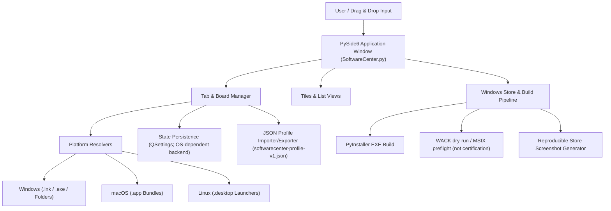
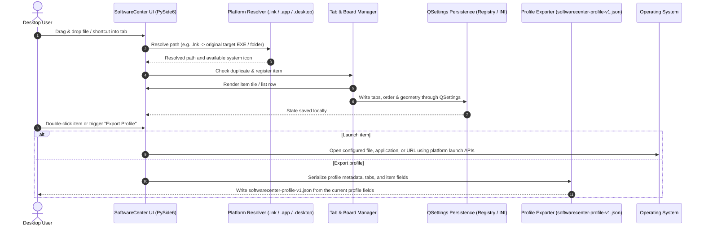

# SoftwareCenter

[](https://www.python.org/)
[](NOTICE)
[](https://docs.pytest.org/)
[](https://github.com/file-bricks/SoftwareCenter)
[](SECURITY.md)
[](SECURITY.md)
[](LICENSE)
[](https://doc.qt.io/qtforpython-6/)
[](https://github.com/file-bricks)
[](https://github.com/open-bricks)
[](llms.txt)

[English](README.md) · [Deutsch](README_de.md) · [Español](README.es.md) · [简体中文](README_zh.md) · [日本語](README_ja.md) · [Русский](README_ru.md) · [Français](README_fr.md) · [हिन्दी](README_hi.md) · [العربية](README_ar.md) · [বাংলা](README_bn.md) · [Português](README_pt.md)

Um organizador de desktop leve e multiplataforma para gerenciar atalhos de programas em abas.

> [!NOTE]
> **Integração com LLM / IA e índice legível por máquina:** o SoftwareCenter fornece metadados estruturados e legíveis por máquina em [`llms.txt`](llms.txt) e oferece suporte à migração de perfis por meio de JSON versionado (`softwarecenter-profile-v1.json`).


## Navegação rápida

- [Referência rápida](#quick-reference)
- [Recursos](#features)
- [Perfis de usuário e facilidade de descoberta](#target-personas--discoverability)
- [Recursos e limites do SoftwareCenter](#comparative-matrix-vs-alternatives)
- [Arquitetura do sistema](#system-architecture)
- [Fluxo da sequência do ciclo de vida](#lifecycle-sequence-flow)
- [Recursos principais e limites das evidências](#core-capabilities--safety-invariants)
- [Ecossistema relacionado e produtos irmãos](#sibling-ecosystem--sister-products)
- [Contexto de descoberta](#discovery-context)
- [Requisitos](#requirements)
- [Instalação](#installation)
- [Executar](#run)
- [Uso](#usage)
- [Compilar o executável](#build-executable)
- [Verificações de qualidade](#quality-checks)
- [Manutenção do catálogo de inicializadores sem interface gráfica](#headless-launcher-catalog-care)
- [Formato de intercâmbio](#exchange-format)
- [LaunchBoards](#launchboards)
- [Limites entre produtos irmãos](#sister-product-boundary)
- [Recursos da Windows Store](#windows-store-assets)
- [Tecnologias](#tech-stack)
- [Política de segurança](#security-policy)
- [Licenças de terceiros e governança](#third-party-licenses--governance)
- [Licença](#license)
- [Responsabilidade](#liability)

<a id="quick-reference"></a>
## Referência rápida

| Atributo | Detalhes |
|---|---|
| **Tecnologias** | Python 3.10+ / PySide6 (Qt) / QSettings |
| **Licença** | Código do projeto: MIT; PySide6 e as demais dependências têm termos próprios (consulte [THIRD_PARTY_LICENSES.md](THIRD_PARTY_LICENSES.md)) |
| **Formato de intercâmbio** | `softwarecenter-profile-v1.json` (consulte [EXPORTFORMAT.md](EXPORTFORMAT.md)) |
| **Última verificação** | 2026-09-23 (local: suíte completa do pytest, testes rápidos das plataformas, compileall, Ruff, auditoria de dependências, integração com o menu de contexto do gerenciador de arquivos, atribuição do NOTICE e reforço do ciclo de vida do CI; o WACK permanece somente em dry-run) |

<a id="features"></a>
## Recursos

- **Organização por abas** — agrupe programas, documentos e pastas em quadros que podem ser renomeados e movidos
- **Arrastar e soltar e organização universal** — solte aplicativos, scripts, documentos, pastas ou atalhos diretamente nos quadros; isso cria uma camada de organização independente sobre o sistema de arquivos
- **Orientação para quadros vazios** — um espaço reservado nos quadros vazios informa quais tipos de itens podem ser soltos ali
- **Dois modos de visualização** — blocos com ícones grandes e lista
- **Salvamento automático** — abas, conteúdo e posição da janela são persistidos
- **Menu de contexto** — clique com o botão direito para abrir ou remover um item
- **Multiplataforma** — Windows, macOS e Linux
- **Ícones nativos** — exibição automática dos ícones dos aplicativos do sistema
- **Resolução de atalhos do Windows** — arquivos `.lnk` soltos que apontam para `.exe` ou pastas são armazenados como o destino original
- **Pacotes de aplicativos do macOS** — arraste e solte aplicativos `.app` diretamente no organizador
- **Inicializadores Linux para desktop** — entradas `.desktop` exibem o nome do aplicativo e o iniciam pelo comando definido no arquivo desktop
- **Exportação/importação de perfis** — formato versionado `softwarecenter-profile-v1.json` para migrações e backups
- **Seleção múltipla** — remova várias entradas de uma vez
- **Operação que prioriza o uso local** — o código do organizador não inclui recursos de conta, telemetria ou sincronização na nuvem; URLs HTTP(S) e programas iniciados são abertos pela plataforma e podem usar a rede

<a id="target-personas--discoverability"></a>
## Perfis de usuário e facilidade de descoberta

O SoftwareCenter foi projetado para resolver gargalos específicos de fluxo de trabalho de quatro perfis distintos de usuários:

| Perfil | Atividades e responsabilidades principais | Principal dificuldade | Solução do SoftwareCenter |
|---|---|---|---|
| **Perfil 1: usuários avançados e organizadores de desktop** | Usam diariamente dezenas de ferramentas, pastas de trabalho e utilitários. | Desktop do Windows desorganizado, busca lenta no menu Iniciar e falta de agrupamentos personalizados persistentes. | Quadros rápidos com abas, organização de arquivos por arrastar e soltar, notas personalizadas e alternância imediata. |
| **Perfil 2: desenvolvedores independentes e engenheiros de DevOps** | Gerenciam cadeias de ferramentas, wrappers de CLI, aplicativos portáteis e ambientes virtuais. | Mistura de ferramentas de desenvolvimento nos menus Iniciar voltados ao público geral; serviços de inicialização pesados que consomem memória. | SoftwareCenter e LaunchBoards têm identidades de aplicativo separadas; ao iniciar arquivos no Windows, o diretório de destino é solicitado como diretório de trabalho quando há suporte. Este não é um gerenciador de ambientes de projeto, e o comportamento do destino depende do sistema operacional e do aplicativo. |
| **Perfil 3: usuários de várias estações de trabalho** | Movem perfis manualmente entre diferentes estações de trabalho. | Caminhos absolutos podem não funcionar em outro dispositivo; rótulos e notas opcionais podem conter informações privadas. | Exportação/importação versionada por `softwarecenter-profile-v1.json`; verifique caminhos e notas antes de compartilhar. Após a confirmação, a importação substitui o perfil atual; os arquivos de destino não são copiados. |
| **Perfil 4: usuários atentos à privacidade** | Preferem configurações do organizador armazenadas localmente e a ausência de recursos de conta ou telemetria no aplicativo. | Caminhos e notas salvos podem revelar detalhes locais; abrir uma URL ou iniciar um programa pode gerar comunicação pela rede. | O código do organizador inspecionado não inclui recursos de conta, telemetria ou sincronização na nuvem. Isso não garante confidencialidade, ausência de tráfego de saída dos processos iniciados nem o comportamento de privilégios dos programas de destino. |

### Expressões de busca com intenção clara

- `SoftwareCenter Python desktop launcher`
- `PySide6 desktop shortcut manager`
- `local-first desktop organizer python`
- `portable shortcut launcher without cloud account`
- `SoftwareCenter vs LaunchBoards profile switcher`
- `privacy friendly Windows app launcher with tabs`

<a id="comparative-matrix-vs-alternatives"></a>
## Recursos e limites do SoftwareCenter

| Recurso | Comportamento implementado | Limite |
|---|---|---|
| **Organização por abas** | Agrupa entradas de caminhos em abas nomeadas, com visualização em blocos e em lista. | As abas organizam referências; não são ambientes de execução por projeto. |
| **Caminhos locais e URLs** | O recurso de arrastar e soltar pode registrar caminhos locais e URLs HTTP(S) compatíveis. | As entradas apontam para destinos; o organizador não copia o conteúdo deles. |
| **Tratamento de destinos por plataforma** | No Windows, a resolução de `.lnk` aceita destinos `.exe` ou pastas existentes; pacotes de aplicativos do macOS usam `open`; entradas `.desktop` do Linux são analisadas para obter nome, ícone e `Exec`. | A resolução e a inicialização dependem do sistema operacional. No Linux, `Exec` é iniciado como comando; isso não é uma sandbox para scripts. |
| **Diretório de trabalho** | No Windows, a inicialização de arquivos usa `_startfile_in_dir` para solicitar que a pasta que contém o arquivo de destino seja o diretório de trabalho, quando há suporte. | Alternativas de inicialização podem não definir um diretório de trabalho explícito; não há garantia para o CWD do processo pai nem para um comportamento uniforme entre plataformas. |
| **Configurações locais** | Qt `QSettings` armazena abas, entradas, visualizações e estado da janela no namespace de configurações do produto. | Qt e o sistema operacional fornecem o backend de armazenamento; não há garantia de gravação atômica ou de descritor de segurança. |
| **Exportação de perfil** | `softwarecenter-profile-v1.json` contém metadados do perfil, abas, visualizações e entradas com `label`, `path`, `kind` e `notes` opcional. | Caminhos, rótulos e notas podem revelar detalhes locais; os arquivos de destino não são copiados. |
| **Importação de perfil** | O importador verifica o formato e a versão, normaliza as entradas e solicita confirmação. | Ao confirmar, a importação substitui o perfil atual; não mescla perfis nem oferece uma garantia geral contra perda de dados. |
| **Identidade dos produtos** | SoftwareCenter e LaunchBoards compartilham a implementação, mas têm namespaces de configurações, endpoints de instância única e identidades da Store separados. | Isso separa dois produtos; não oferece perfis selecionáveis pelo usuário dentro do SoftwareCenter. |
| **Limite de rede** | O código-fonte inspecionado do organizador não contém implementação de conta, telemetria ou sincronização na nuvem. | Ele abre URLs HTTP(S) e inicia destinos externos, que podem usar a rede; não há garantia de ausência total de tráfego de rede do aplicativo ou dos processos iniciados. |
| **Escopo da verificação** | Os testes do repositório cobrem contratos definidos; o CI executa uma matriz de versões do Python no Ubuntu e testes rápidos separados para Linux/macOS. | Essas verificações não estabelecem o comportamento em todos os hosts, não certificam o WACK ou o envio à Store e não provam propriedades universais de segurança. |

<a id="system-architecture"></a>
## Arquitetura do sistema



<a id="lifecycle-sequence-flow"></a>
## Sequência do ciclo de vida



<a id="core-capabilities--safety-invariants"></a>
## Recursos principais e limites das evidências

| Tema | Evidências no código e nos testes inspecionados | Escopo e limite |
|---|---|---|
| **Comportamento de rede do organizador** | O código do aplicativo não inclui cliente de conta, telemetria ou sincronização na nuvem; `open_file` encaminha URLs HTTP(S) ao Qt ou ao navegador da plataforma. | A inspeção do código-fonte não é um teste de tráfego de rede em tempo de execução do SoftwareCenter, do navegador ou dos processos iniciados. |
| **Contexto de inicialização** | A abertura de arquivos e URLs é delegada às APIs da plataforma; no Windows, o código solicita o diretório de trabalho do destino quando disponível. | O código e os testes revisados não verificam descritores de segurança de processos nem impõem privilégios aos processos filhos. |
| **Remoção de entradas** | A interface remove entradas da lista e do estado de perfil salvo sem excluir os arquivos referenciados. | Isso não descreve o que um programa externo faz com os destinos que abre ou modifica. |
| **Resolução por plataforma** | A busca por destinos `.lnk` no Windows usa COM, com alternativa em PowerShell; os dados `Exec` de `.desktop` no Linux são analisados e depois iniciados. | Esses manipuladores não isolam o comportamento do destino; a inicialização pode executar comandos configurados ou programas externos. |
| **Persistência de QSettings** | `save_settings` grava valores de abas, entradas, visualizações, geometria e idioma por meio do Qt `QSettings`. | O código não afirma que há transação atômica ou gravação resistente a falhas. |
| **Dados do perfil** | `softwarecenter-profile-v1.json` inclui campos do perfil e entradas `label`, `path`, `kind` e `notes` opcional; após confirmação, a importação substitui o perfil atual. | Os valores podem revelar detalhes locais; os testes cobrem fixtures e um ciclo de exportação e importação, não a remoção de segredos em geral. Consulte `tests/test_export_contract.py`. |
| **Separação dos produtos relacionados** | `scripts/verify_product_boundaries.py` e os testes de limites entre produtos verificam namespaces de configuração e endpoints de instância única separados para SoftwareCenter e LaunchBoards. | Isso é separação entre produtos, não perfis multiusuário ou por projeto. Consulte `PRODUCT_BOUNDARIES.md` e `tests/test_product_boundaries.py`. |
| **Escopo do CI e da publicação** | O CI inclui a matriz de regressão de versões do Python no Ubuntu e testes rápidos separados para Linux/macOS. | Isso não implica CI em host Windows, certificação WACK, publicação na Store ou segurança universal em tempo de execução. Consulte `CI_CONTRACT.md`. |

<a id="sibling-ecosystem--sister-products"></a>
## Ecossistema relacionado e produtos irmãos

O SoftwareCenter faz parte da coleção mais ampla de ferramentas de desktop **file-bricks** e da iniciativa guarda-chuva de código aberto **open-bricks**:

| Projeto | Ecossistema | Foco principal | Integração / complementaridade |
|---|---|---|---|
| [`ProFiler`](https://github.com/file-bricks/ProFiler) | `file-bricks` | Inspeção de documentos e mídia | Aplicativo complementar para organização de arquivos e análise forense de documentos |
| [`ExplorerPro`](https://github.com/file-bricks/ExplorerPro) | `file-bricks` | Explorador de arquivos com várias abas | Gerenciamento complementar de arquivos em dois painéis para atalhos do SoftwareCenter |
| [`CloudLockFixer`](https://github.com/file-bricks/CloudLockFixer) | `file-bricks` | Desbloqueio e reparo de bloqueios na nuvem | Desbloqueia marcadores de sincronização travados e arquivos do OneDrive referenciados por atalhos |
| [`knowledgedigest`](https://github.com/file-bricks/knowledgedigest) | `file-bricks` | Base de conhecimento em Markdown e documentos | Organizador local de resumos de documentos para fluxos de pesquisa |
| [`FormularErstellen`](https://github.com/doc-bricks/FormularErstellen) | `doc-bricks` | Criação de formulários e modelos | Gerador de documentos de desktop que pode ser iniciado pelos blocos do SoftwareCenter |
| [`USR_PDFunlock`](https://github.com/doc-bricks/USR_PDFunlock) | `doc-bricks` | Ferramenta para senhas e desbloqueio de PDF | Utilitário local para desbloquear PDF sem alterar o arquivo original |
| [`safe-start-for-codex`](https://github.com/dev-bricks/safe-start-for-codex) | `dev-bricks` | Barreira de inicialização para automação | Protege ambientes de estações de trabalho contra picos de inicialização |
| [`MethodenAnalyser`](https://github.com/dev-bricks/MethodenAnalyser) | `dev-bricks` | Analisador de código-fonte AST | Análise estática de ferramentas e módulos de desktop em Python |
| [`connectors`](https://github.com/ellmos-ai/connectors) | `ellmos-ai` | Ponte de comunicação entre agentes | Adaptadores de mensagens e transporte sem dependências |
| [`open-bricks`](https://github.com/open-bricks) | `open-bricks` | Iniciativa guarda-chuva de código aberto para desktop | Estrutura comum para padrões, governança e empacotamento |

<a id="discovery-context"></a>
## Contexto de descoberta

É mais fácil encontrar o SoftwareCenter como **local-first PySide6 app launcher** ou **desktop shortcut organizer**. Ele fica entre o menu Iniciar do Windows, as pastas de atalhos da área de trabalho e sistemas completos de inventário de software: inicia o que já está no computador, agrupa atalhos em abas e exporta/importa perfis portáteis.

Expressões de busca úteis:

- `SoftwareCenter PySide6 desktop organizer`
- `local-first app launcher Python PySide6`
- `desktop shortcut organizer with tabs`
- `softwarecenter-profile-v1.json`
- `local-first desktop organizer with profile export`

Ele não é o Microsoft Configuration Manager Software Center, uma loja de aplicativos, um gerenciador de pacotes nem um portal de implantação remota.

<a id="requirements"></a>
## Requisitos

- Python 3.10+
- PySide6

<a id="installation"></a>
## Instalação

```bash
pip install -r requirements.txt
```

<a id="run"></a>
## Executar

```bash
python SoftwareCenter.py
```

No Windows, você também pode usar `START.bat` ou o `SoftwareCenter.exe` pré-compilado disponível em [Releases](https://github.com/file-bricks/SoftwareCenter/releases).

<a id="usage"></a>
## Uso

| Ação | Instruções |
|--------|-------------|
| Adicionar programas | Arraste arquivos, pastas, atalhos, pacotes `.app` no macOS ou inicializadores `.desktop` no Linux para a janela; arquivos Windows `.lnk` que apontam para arquivos `.exe` ou pastas são resolvidos para o destino original |
| Organizar abas | Toolbar > "New Tab"; dê um clique duplo para renomear |
| Alternar visualização | Toolbar > Tiles / List |
| Iniciar programas | Clique duplo ou clique com o botão direito > Open/Start |
| Remover entradas | Clique com o botão direito > Delete (remove somente o atalho) |
| Exportar perfil | `File > Export Profile` ou a ação da barra de ferramentas |
| Importar perfil | `File > Import Profile` ou a ação da barra de ferramentas; substitui o perfil atual |

<a id="build-executable"></a>
## Compilar o executável

```bash
pip install pyinstaller
python -m PyInstaller --noconfirm --clean SoftwareCenter.spec
```

O EXE ficará em `dist/SoftwareCenter.exe`. No Windows, `build_exe.bat` também o copia para a raiz do projeto para uso local.

<a id="quality-checks"></a>
## Verificações de qualidade

```bash
python -m compileall -q SoftwareCenter.py manage_translations.py translator.py
python -m json.tool locales/translations.json
python -m json.tool store_package.json
python -m pytest -q
python tests/macos_platform_smoke.py
python tests/linux_platform_smoke.py
python scripts/verify_product_boundaries.py
```

O fluxo hospedado e o limite explícito da parte opcional para web estão documentados em [CI_CONTRACT.md](CI_CONTRACT.md).

O GitHub Actions executa esses testes rápidos. O teste do macOS valida a importação de `.app`, a inicialização por `open`, a persistência do QSettings e a exportação de perfil em `macos-latest`; o teste do Linux cobre a importação de `.desktop`, a inicialização por `Exec`/`xdg-open`, a persistência do QSettings e a exportação de perfil em `ubuntu-latest`. Artefatos de compilação e arquivos locais de tarefa/teste são ignorados e não devem ser commitados.

Para o fluxo da Windows Store, `python scripts/run_windows_wack.py --dry-run` verifica os caminhos locais de MSIX/AppCert e exibe o comando WACK reproduzível. A certificação real deve ser executada em um PowerShell elevado, com um MSIX recém-assinado, antes do envio.
`python generate_store_screenshots.py` cria o conjunto reproduzível de capturas de tela da Store em `README/screenshots/store/`.

<a id="headless-launcher-catalog-care"></a>
## Manutenção do catálogo de inicializadores sem interface gráfica

O reconciliador opcional do catálogo é fornecido como código de execução Plan-D em `scripts/softwarecenter_sync.py`. Os arquivos sincronizados do catálogo e do registro são entradas explícitas de CLI; o comando é somente leitura, a menos que `--apply` seja informado. A carga do agendador com runtime fixado, as barreiras de aplicação, a leitura de confirmação nativa e o procedimento de reversão estão documentados em [RUNTIME_DAILY_CARE.md](RUNTIME_DAILY_CARE.md).

<a id="exchange-format"></a>
## Formato de intercâmbio

Os perfis podem ser exportados como `softwarecenter-profile-v1.json` e importados novamente depois. O formato contém metadados do perfil, abas, modos de visualização e entradas com `label`, `path`, `kind` e `notes` opcional. O aplicativo não copia os arquivos locais referenciados, mas caminhos, rótulos e notas podem conter informações sensíveis; o formato não garante a remoção de segredos. Após a confirmação, a importação substitui o perfil atual. Caminhos inexistentes continuam visíveis como referências. Consulte [EXPORTFORMAT.md](EXPORTFORMAT.md) para mais detalhes.

<a id="launchboards"></a>
## LaunchBoards


[LaunchBoards](https://github.com/file-bricks/SoftwareCenter) é o produto irmão do SoftwareCenter: usa a mesma base de código, tem marca e identidade próprias e se concentra em quadros de espaços de trabalho alternáveis, em vez de ser um inicializador geral de atalhos. Compartilha este repositório e o fluxo de publicação — não há uma árvore de código separada do LaunchBoards para manter.

<a id="sister-product-boundary"></a>
## Limites entre produtos irmãos

O LaunchBoards compartilha a implementação, mas tem namespace próprio do QSettings, endpoint de instância única, ícone, executável, identidade da Store e caminho de publicação. As verificações estáticas reproduzíveis, os testes isolados de processos paralelos e as verificações de artefatos estão documentados em [PRODUCT_BOUNDARIES.md](PRODUCT_BOUNDARIES.md).

<a id="windows-store-assets"></a>
## Recursos da Windows Store

O fluxo da Windows Store agora inclui um gerador reproduzível de capturas de tela da interface atual do desktop. Execute `python generate_store_screenshots.py` para atualizar `README/screenshots/store/` com quatro capturas de tela geradas para a Store e `summary.json`.

<a id="tech-stack"></a>
## Tecnologias

| Componente | Tecnologia |
|-----------|-----------|
| Linguagem | Python 3.10+ |
| Framework de interface gráfica | PySide6 (Qt for Python) |
| Armazenamento | QSettings (Windows Registry / INI) |
| Tamanho do código | Consulte os arquivos atuais do repositório; não há alegação de número fixo de linhas |

<a id="security-policy"></a>
## Política de segurança

O [SECURITY.md](SECURITY.md) do repositório descreve versões compatíveis, canais para relatar vulnerabilidades, um prazo declarado de 48 horas para a resposta inicial e um prazo de triagem de 5 dias úteis. Essas declarações de política não devem ser interpretadas como verificação em tempo de execução.

<a id="third-party-licenses--governance"></a>
## Licenças de terceiros e governança

A licença MIT do repositório se aplica ao código-fonte do projeto. As dependências de terceiros têm termos próprios; [THIRD_PARTY_LICENSES.md](THIRD_PARTY_LICENSES.md) registra os metadados dos componentes, mas não é uma garantia geral de licenças permissivas nem de conformidade do pacote.

- **Atribuição:** [NOTICE](NOTICE) (atribuição de direitos autorais a Lukas Geiger e às organizações file-bricks / open-bricks).
- **PySide6 e shiboken6:** o inventário registra os termos LGPL-3.0-only; consulte o [texto da LGPL-3.0](https://www.gnu.org/licenses/lgpl-3.0.html) e os [metadados dos componentes](THIRD_PARTY_LICENSES.md). A licença MIT do projeto não se aplica de forma geral a essas dependências.
- **Biblioteca padrão do Python:** [PSF-2.0](https://docs.python.org/3/license.html). Essa licença não significa que o organizador ou os programas que ele inicia funcionem offline.
- **PyInstaller:** [GPL-2.0-or-later with PyInstaller-exception](https://pyinstaller.org/en/stable/license.html) é uma ferramenta de compilação; para uma versão empacotada, revise a licença upstream e os avisos de distribuição em vez de presumir uma isenção geral.
- **Limite da verificação:** os testes cobrem contratos definidos de código e documentação; não estabelecem garantias universais em tempo de execução.

<a id="license"></a>
## Licença

[MIT](LICENSE)

**Observação:** MIT é a licença do código-fonte do projeto no repositório. O aplicativo usa [PySide6](https://doc.qt.io/qtforpython-6/), que tem termos de licenciamento próprios para dependências; consulte [THIRD_PARTY_LICENSES.md](THIRD_PARTY_LICENSES.md).

---

<a id="liability"></a>
## Responsabilidade

Este projeto é uma contribuição de código aberto sem remuneração. A responsabilidade limita-se ao dolo e à negligência grave (§ 521 do Código Civil Alemão). Use por sua conta e risco. Não se presume qualquer garantia, compromisso de manutenção ou adequação a uma finalidade específica.
