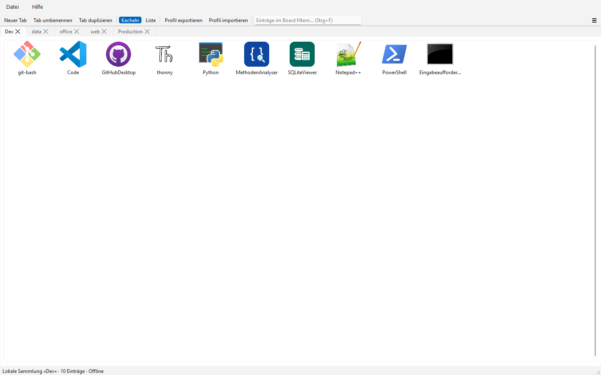
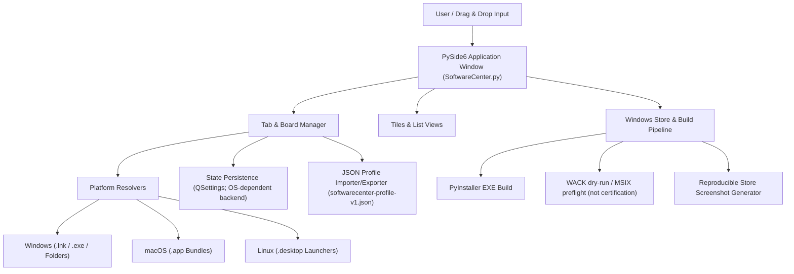
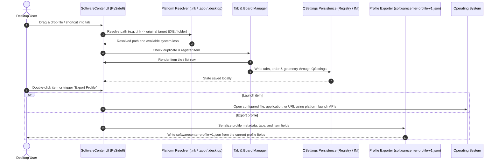

# SoftwareCenter

[](https://www.python.org/)
[](NOTICE)
[](https://docs.pytest.org/)
[](https://github.com/file-bricks/SoftwareCenter)
[](SECURITY.md)
[](SECURITY.md)
[](LICENSE)
[](https://doc.qt.io/qtforpython-6/)
[](https://github.com/file-bricks)
[](https://github.com/open-bricks)
[](llms.txt)

[English](README.md) · [Deutsch](README_de.md) · [Español](README.es.md) · [简体中文](README_zh.md) · [日本語](README_ja.md) · [Русский](README_ru.md) · [Français](README_fr.md) · [हिन्दी](README_hi.md)

Лёгкий кроссплатформенный настольный органайзер для управления программными ярлыками с помощью категорий на вкладках.

> [!NOTE]
> **Интеграция ИИ / LLM и машиночитаемый индекс:** SoftwareCenter предоставляет структурированные машиночитаемые метаданные в [`llms.txt`](llms.txt) и поддерживает перенос профилей в версионируемом JSON-формате (`softwarecenter-profile-v1.json`).



## Быстрая навигация

- [Краткая справка](#quick-reference)
- [Возможности](#features)
- [Целевые пользователи и обнаруживаемость](#target-personas--discoverability)
- [Возможности и границы SoftwareCenter](#comparative-matrix-vs-alternatives)
- [Архитектура системы](#system-architecture)
- [Последовательность жизненного цикла](#lifecycle-sequence-flow)
- [Основные возможности и границы подтверждённых данных](#core-capabilities--safety-invariants)
- [Экосистема и родственные продукты](#sibling-ecosystem--sister-products)
- [Контекст поиска](#discovery-context)
- [Требования](#requirements)
- [Установка](#installation)
- [Запуск](#run)
- [Использование](#usage)
- [Сборка исполняемого файла](#build-executable)
- [Проверки качества](#quality-checks)
- [Обслуживание каталога запусков без графического интерфейса](#headless-launcher-catalog-care)
- [Формат обмена](#exchange-format)
- [LaunchBoards](#launchboards)
- [Граница родственных продуктов](#sister-product-boundary)
- [Материалы для Windows Store](#windows-store-assets)
- [Технологический стек](#tech-stack)
- [Политика безопасности](#security-policy)
- [Лицензии сторонних компонентов и управление](#third-party-licenses--governance)
- [Лицензия](#license)
- [Ответственность](#liability)

<a id="quick-reference"></a>
## Краткая справка

| Параметр | Значение |
|---|---|
| **Технологический стек** | Python 3.10+ / PySide6 (Qt) / QSettings |
| **Лицензия** | Код проекта: MIT; для PySide6 и других зависимостей действуют отдельные условия (см. [THIRD_PARTY_LICENSES.md](THIRD_PARTY_LICENSES.md)) |
| **Формат обмена** | `softwarecenter-profile-v1.json` (см. [EXPORTFORMAT.md](EXPORTFORMAT.md)) |
| **Последняя проверка** | 2026-09-23 (локально: полный набор pytest, платформенные smoke-проверки, compileall, Ruff, аудит зависимостей, интеграция контекстного меню файлового менеджера, атрибуция NOTICE, усиление жизненного цикла CI; WACK по-прежнему только dry-run) |

<a id="features"></a>
## Возможности

- **Организация по вкладкам** — объединяйте программы, документы и папки в переименовываемые и перемещаемые доски
- **Drag & Drop и универсальная организация** — перетаскивайте приложения, скрипты, документы, папки и ярлыки на доски; это отдельный слой организации поверх файловой системы
- **Подсказки для пустых досок** — на пустой доске отображаются понятные подсказки с поддерживаемыми типами перетаскиваемых объектов
- **Два режима отображения** — плитки с крупными значками и список
- **Автосохранение** — сохраняются вкладки, их содержимое и положение окна
- **Контекстное меню** — открытие или удаление элемента правой кнопкой мыши
- **Кроссплатформенность** — Windows, macOS и Linux
- **Системные значки** — автоматическое отображение значков системных приложений
- **Разрешение ярлыков Windows** — для добавленных файлов `.lnk`, ведущих к `.exe` или папкам, сохраняется исходный целевой объект
- **Пакеты приложений macOS** — перетаскивайте `.app` прямо в органайзер
- **Средства запуска Linux** — для записей `.desktop` отображается имя приложения, а запуск выполняется указанной в записи командой
- **Экспорт и импорт профилей** — версионируемый формат `softwarecenter-profile-v1.json` для переноса и резервного копирования
- **Множественный выбор** — удаляйте несколько записей одновременно
- **Локальная работа** — в коде органайзера нет функций учётной записи, телеметрии или облачной синхронизации; URL HTTP(S) и запущенные программы открываются средствами платформы и могут использовать сеть

<a id="target-personas--discoverability"></a>
## Целевые пользователи и обнаруживаемость

SoftwareCenter помогает устранять конкретные затруднения в рабочих процессах четырёх групп пользователей:

| Группа пользователей | Задачи и профиль | Основная проблема | Решение SoftwareCenter |
|---|---|---|---|
| **Группа 1: опытные пользователи настольных систем и кураторы** | Ежедневно работают с десятками инструментов, папок рабочих пространств и утилит. | Загромождённый рабочий стол Windows, медленный поиск в меню «Пуск», отсутствие постоянной пользовательской группировки. | Быстрые доски с вкладками, организация файлов перетаскиванием, пользовательские заметки и мгновенное переключение. |
| **Группа 2: индивидуальные разработчики и DevOps-инженеры** | Управляют цепочками инструментов, CLI-обёртками, переносимыми приложениями и виртуальными окружениями. | Смешение инструментов разработки с обычными программами в меню «Пуск»; тяжёлые службы запуска, расходующие память. | У SoftwareCenter и LaunchBoards разные идентификаторы приложений; при запуске файлов в Windows программа по возможности запрашивает каталог целевого файла как рабочий. Это не менеджер окружений проекта; поведение зависит от ОС и целевого приложения. |
| **Группа 3: пользователи нескольких рабочих станций** | Вручную переносят профили между рабочими станциями. | Абсолютные пути могут не разрешиться на другом устройстве; метки и необязательные заметки могут содержать личные сведения. | Версионируемый экспорт и импорт `softwarecenter-profile-v1.json`; перед передачей проверьте пути и заметки. После подтверждения импорт заменяет текущий профиль; целевые файлы не копируются. |
| **Группа 4: пользователи, заботящиеся о конфиденциальности** | Предпочитают локально сохранённые настройки органайзера и отсутствие встроенной учётной записи или телеметрии. | Сохранённые пути и заметки могут раскрывать локальные сведения; открытие URL или запуск программы может приводить к сетевому обмену. | В изученном коде органайзера нет функций учётной записи, телеметрии или облачной синхронизации. Не гарантируются конфиденциальность данных, отсутствие исходящего трафика у запущенных процессов или поведение целевых программ с точки зрения привилегий. |

### Поисковые запросы с выраженным намерением

- `SoftwareCenter Python desktop launcher`
- `PySide6 desktop shortcut manager`
- `local-first desktop organizer python`
- `portable shortcut launcher without cloud account`
- `SoftwareCenter vs LaunchBoards profile switcher`
- `privacy friendly Windows app launcher with tabs`

<a id="comparative-matrix-vs-alternatives"></a>
## Возможности и границы SoftwareCenter

| Возможность | Реализованное поведение | Граница |
|---|---|---|
| **Организация по вкладкам** | Группирует записи с путями в именованные вкладки с плиточным или списочным представлением. | Вкладки упорядочивают ссылки на объекты, но сами не являются средами выполнения для проектов. |
| **Локальные пути и URL** | Перетаскивание позволяет добавлять поддерживаемые локальные пути и URL HTTP(S). | Записи ссылаются на целевые объекты; органайзер не копирует их содержимое. |
| **Обработка целевых объектов платформ** | Windows-разрешение `.lnk` принимает существующие цели `.exe` или папки; пакеты приложений macOS открываются через `open`; из записей Linux `.desktop` извлекаются имя, значок и `Exec`. | Разрешение ссылок и запуск зависят от ОС. В Linux `Exec` запускается как команда; это не песочница для скриптов. |
| **Рабочий каталог** | При запуске файла в Windows `_startfile_in_dir` запрашивает каталог целевого файла как рабочий, если это поддерживается. | Резервные способы запуска могут не задавать рабочий каталог явно; не гарантируется ни CWD родительского процесса, ни единое для всех платформ поведение рабочего каталога. |
| **Локальные настройки** | Qt `QSettings` хранит вкладки, записи, режимы просмотра и состояние окна в пространстве имён настроек продукта. | Хранилище предоставляют Qt и ОС; атомарная запись и наличие дескрипторов безопасности не гарантируются. |
| **Экспорт профиля** | `softwarecenter-profile-v1.json` содержит метаданные профиля, вкладки, режимы просмотра и записи с `label`, `path`, `kind` и необязательным `notes`. | Пути, метки и заметки могут раскрывать локальные сведения; целевые файлы не копируются. |
| **Импорт профиля** | Импортёр проверяет формат и версию, нормализует записи и запрашивает подтверждение. | После подтверждения импорт заменяет текущий профиль; это не слияние и не гарантирует отсутствия потери данных в общем случае. |
| **Идентичность продуктов** | SoftwareCenter и LaunchBoards используют общую реализацию, но у них разные пространства имён настроек, каналы связи механизма запуска в одном экземпляре и идентификаторы Store. | Это разделяет два продукта, но не предоставляет выбор профиля пользователя внутри SoftwareCenter. |
| **Сетевые границы** | В изученном исходном коде органайзера нет реализации учётной записи, телеметрии или облачной синхронизации. | Приложение открывает URL HTTP(S) и запускает внешние целевые объекты, которые могут использовать сеть; отсутствие сетевого трафика у всего приложения или запущенных процессов не гарантируется. |
| **Объём проверок** | Тесты репозитория проверяют явно описанные контракты; CI выполняет матрицу версий Python на Ubuntu и отдельные smoke-проверки Linux/macOS. | Эти проверки не подтверждают работу на каждом хосте, не сертифицируют WACK/публикацию в Store и не доказывают универсальные свойства безопасности. |

<a id="system-architecture"></a>
## Архитектура системы



<a id="lifecycle-sequence-flow"></a>
## Последовательность жизненного цикла



<a id="core-capabilities--safety-invariants"></a>
## Основные возможности и границы подтверждённых данных

| Тема | Подтверждение в изученном коде и тестах | Область действия и ограничения |
|---|---|---|
| **Сетевое поведение органайзера** | В коде приложения нет клиента учётной записи, телеметрии или облачной синхронизации; `open_file` передаёт URL HTTP(S) в Qt или браузер платформы. | Анализ исходного кода не измеряет сетевой трафик во время работы SoftwareCenter, браузера или запущенных процессов. |
| **Контекст запуска** | Запуск файлов и URL передаётся API платформы; код запуска в Windows задаёт каталог целевого файла как рабочий, если это доступно. | Изученные код и тесты не проверяют дескрипторы безопасности процессов и не устанавливают привилегии дочерних процессов. |
| **Удаление записей** | Интерфейс удаляет записи из списка и сохранённого состояния профиля, не удаляя файлы, на которые они ссылаются. | Это ничего не говорит о целевых объектах, которые открывает или изменяет внешняя программа. |
| **Разрешение объектов для платформ** | Поиск цели Windows `.lnk` выполняется через COM с запасным вариантом на PowerShell; данные `Exec` в Linux `.desktop` разбираются, а затем запускаются. | Эти обработчики не изолируют поведение целевых объектов: могут выполняться заданные команды или внешние программы. |
| **Сохранение через QSettings** | `save_settings` записывает через Qt `QSettings` значения вкладок, записей, представлений, геометрии окна и языка. | Код не обещает атомарную транзакцию или сохранение, устойчивое к сбою. |
| **Данные профиля** | `softwarecenter-profile-v1.json` содержит поля профиля и записи с `label`, `path`, `kind` и необязательным `notes`; после подтверждения импорт заменяет текущий профиль. | Значения могут раскрывать локальные сведения; тесты проверяют фикстуры и круговой экспорт/импорт, но не произвольное обнаружение и удаление секретов. См. `tests/test_export_contract.py`. |
| **Разделение родственных продуктов** | `scripts/verify_product_boundaries.py` и тесты границ продуктов проверяют отдельные пространства имён настроек и каналы связи механизма запуска в одном экземпляре для SoftwareCenter и LaunchBoards. | Это разделение продуктов, а не профили для нескольких пользователей или проектов. См. `PRODUCT_BOUNDARIES.md` и `tests/test_product_boundaries.py`. |
| **Объём CI и выпуска** | CI запускает матрицу регрессионных тестов версий Python на Ubuntu и отдельные smoke-проверки Linux/macOS. | Это не означает наличие CI на хосте Windows, сертификацию WACK, публикацию в Store или универсальную безопасность во время выполнения. См. `CI_CONTRACT.md`. |

<a id="sibling-ecosystem--sister-products"></a>
## Экосистема и родственные продукты

SoftwareCenter входит в более широкую коллекцию настольных инструментов **file-bricks** и объединение open-source-проектов **open-bricks**:

| Проект | Экосистема | Основное назначение | Интеграция / взаимодополнение |
|---|---|---|---|
| [`ProFiler`](https://github.com/file-bricks/ProFiler) | `file-bricks` | Проверка документов и медиафайлов | Дополняющее приложение для сортировки файлов и криминалистического анализа документов |
| [`ExplorerPro`](https://github.com/file-bricks/ExplorerPro) | `file-bricks` | Проводник файловой системы с несколькими вкладками | Дополняет ярлыки SoftwareCenter двухпанельным управлением файлами |
| [`CloudLockFixer`](https://github.com/file-bricks/CloudLockFixer) | `file-bricks` | Разблокировка и исправление облачных блокировок | Снимает блокировку с зависших синхронизируемых файлов-заполнителей и файлов OneDrive, на которые ссылаются ярлыки |
| [`knowledgedigest`](https://github.com/file-bricks/knowledgedigest) | `file-bricks` | База знаний на Markdown и документах | Локальный органайзер дайджестов документов для исследовательских процессов |
| [`FormularErstellen`](https://github.com/doc-bricks/FormularErstellen) | `doc-bricks` | Создание форм и шаблонов | Настольный генератор документов, запускаемый с плиток SoftwareCenter |
| [`USR_PDFunlock`](https://github.com/doc-bricks/USR_PDFunlock) | `doc-bricks` | Помощник по паролям и разблокировке PDF | Локальная утилита для разблокировки PDF без изменения исходного файла |
| [`safe-start-for-codex`](https://github.com/dev-bricks/safe-start-for-codex) | `dev-bricks` | Шлюз запуска автоматизаций | Защищает настольные рабочие среды от всплесков одновременного запуска |
| [`MethodenAnalyser`](https://github.com/dev-bricks/MethodenAnalyser) | `dev-bricks` | Анализатор исходного кода на AST | Статический анализ инструментов и модулей для настольных приложений Python |
| [`connectors`](https://github.com/ellmos-ai/connectors) | `ellmos-ai` | Мост связи между агентами | Адаптеры обмена сообщениями и транспорта без зависимостей |
| [`open-bricks`](https://github.com/open-bricks) | `open-bricks` | Объединение open-source-продуктов для настольных систем | Стандарты, управление проектами и упаковка |

<a id="discovery-context"></a>
## Контекст поиска

SoftwareCenter проще всего найти как **локальный запускатель приложений на PySide6** или **органайзер настольных ярлыков**. Он занимает промежуточное положение между меню «Пуск» Windows, папками с ярлыками на рабочем столе и полноценными системами учёта программ: запускает уже имеющиеся на компьютере программы, группирует ярлыки по вкладкам и экспортирует/импортирует переносимые профили.

Полезные поисковые фразы:

- `SoftwareCenter PySide6 desktop organizer`
- `local-first app launcher Python PySide6`
- `desktop shortcut organizer with tabs`
- `softwarecenter-profile-v1.json`
- `local-first desktop organizer with profile export`

Это не Microsoft Configuration Manager Software Center, не магазин приложений, не менеджер пакетов и не портал удалённого развёртывания.

<a id="requirements"></a>
## Требования

- Python 3.10+
- PySide6

<a id="installation"></a>
## Установка

```bash
pip install -r requirements.txt
```

<a id="run"></a>
## Запуск

```bash
python SoftwareCenter.py
```

В Windows можно также использовать `START.bat` или готовый файл `SoftwareCenter.exe` со страницы [Releases](https://github.com/file-bricks/SoftwareCenter/releases).

<a id="usage"></a>
## Использование

| Действие | Инструкции |
|--------|-------------|
| Добавить программы | Перетащите в окно файлы, папки, ярлыки, пакеты `.app` в macOS или средства запуска `.desktop` в Linux; если файл Windows `.lnk` указывает на `.exe` или папку, он разрешается в исходную цель |
| Упорядочить вкладки | Панель инструментов > "New Tab" («Новая вкладка»), двойной щелчок по вкладке для переименования |
| Переключить представление | Панель инструментов > Tiles / List |
| Запустить программу | Двойной щелчок или щелчок правой кнопкой мыши > Open/Start |
| Удалить записи | Щелчок правой кнопкой мыши > Delete (удаляется только ярлык) |
| Экспортировать профиль | `File > Export Profile` или соответствующее действие на панели инструментов |
| Импортировать профиль | `File > Import Profile` или соответствующее действие на панели инструментов; после подтверждения текущий профиль заменяется |

<a id="build-executable"></a>
## Сборка исполняемого файла

```bash
pip install pyinstaller
python -m PyInstaller --noconfirm --clean SoftwareCenter.spec
```

EXE появится в `dist/SoftwareCenter.exe`. В Windows скрипт `build_exe.bat` также копирует его в корень проекта для локального использования.

<a id="quality-checks"></a>
## Проверки качества

```bash
python -m compileall -q SoftwareCenter.py manage_translations.py translator.py
python -m json.tool locales/translations.json
python -m json.tool store_package.json
python -m pytest -q
python tests/macos_platform_smoke.py
python tests/linux_platform_smoke.py
python scripts/verify_product_boundaries.py
```

Размещённый workflow и явно обозначенная граница необязательной веб-части описаны в [CI_CONTRACT.md](CI_CONTRACT.md).

GitHub Actions запускает эти smoke-проверки. macOS smoke проверяет импорт `.app`, запуск через `open`, сохранение в QSettings и экспорт профиля на `macos-latest`; Linux smoke проверяет импорт `.desktop`, запуск через `Exec`/`xdg-open`, сохранение в QSettings и экспорт профиля на `ubuntu-latest`. Артефакты сборки и локальные файлы задач/тестов игнорируются и не должны попадать в коммиты.

Для Windows Store команда `python scripts/run_windows_wack.py --dry-run` проверяет локальные пути MSIX/AppCert и выводит воспроизводимую команду WACK. Перед отправкой настоящую сертификационную проверку следует запускать из повышенной PowerShell для свежего подписанного MSIX.
Команда `python generate_store_screenshots.py` создаёт воспроизводимый набор снимков Store в `README/screenshots/store/`.

<a id="headless-launcher-catalog-care"></a>
## Обслуживание каталога запусков без графического интерфейса

Необязательный инструмент сверки каталога включён в код выполнения Plan-D в `scripts/softwarecenter_sync.py`. Файлы синхронизируемого каталога и реестра задаются как явные аргументы CLI; команда работает только на чтение, если не передан `--apply`. Данные планировщика с закреплённой версией среды выполнения, условия применения изменений, чтение результата средствами системы и процедура отката описаны в [RUNTIME_DAILY_CARE.md](RUNTIME_DAILY_CARE.md).

<a id="exchange-format"></a>
## Формат обмена

Профили можно экспортировать в `softwarecenter-profile-v1.json` и позднее импортировать. Формат содержит метаданные профиля, вкладки, режимы просмотра и записи с `label`, `path`, `kind` и необязательным `notes`. Приложение не копирует файлы, на которые есть ссылки, однако пути, метки и заметки могут содержать чувствительные сведения; формат не предназначен для обнаружения и удаления секретов. После подтверждения импорт заменяет текущий профиль. Отсутствующие пути остаются видимыми как ссылки. Подробности см. в [EXPORTFORMAT.md](EXPORTFORMAT.md).

<a id="launchboards"></a>
## LaunchBoards


[LaunchBoards](https://github.com/file-bricks/SoftwareCenter) — родственный продукт SoftwareCenter: он использует ту же кодовую базу, но имеет собственный бренд и идентичность и предназначен для переключения между досками рабочих пространств, а не для общих ярлыков. Репозиторий и конвейер выпуска общие; отдельного дерева исходников LaunchBoards нет.

<a id="sister-product-boundary"></a>
## Граница родственных продуктов

LaunchBoards использует общую реализацию, но имеет собственное пространство имён QSettings, канал связи механизма запуска в одном экземпляре, значок, исполняемый файл, идентификатор Store и путь выпуска. Воспроизводимые статические проверки, проверки изолированных параллельных процессов и проверки артефактов описаны в [PRODUCT_BOUNDARIES.md](PRODUCT_BOUNDARIES.md).

<a id="windows-store-assets"></a>
## Материалы для Windows Store

Для канала Windows Store предусмотрен воспроизводимый генератор снимков текущего интерфейса настольного приложения. Запустите `python generate_store_screenshots.py`, чтобы обновить четыре сгенерированных снимка Store и `summary.json` в `README/screenshots/store/`.

<a id="tech-stack"></a>
## Технологический стек

| Компонент | Технология |
|-----------|-----------|
| Язык | Python 3.10+ |
| GUI-фреймворк | PySide6 (Qt for Python) |
| Хранилище | QSettings (реестр Windows / INI) |
| Размер кода | См. текущие файлы репозитория; фиксированное число строк не заявляется |

<a id="security-policy"></a>
## Политика безопасности

В репозитории [SECURITY.md](SECURITY.md) описаны поддерживаемые версии, каналы сообщения об уязвимостях, заявленное окно первичного ответа до 48 часов и срок триажа в 5 рабочих дней. Эти положения политики не следует считать проверкой поведения программы во время выполнения.

<a id="third-party-licenses--governance"></a>
## Лицензии сторонних компонентов и управление

Лицензия MIT в репозитории распространяется на исходный код проекта. У сторонних зависимостей собственные условия; в [THIRD_PARTY_LICENSES.md](THIRD_PARTY_LICENSES.md) записаны метаданные компонентов, но этот файл не гарантирует, что все используемые лицензии разрешительные или что конкретный вариант упаковки соответствует лицензионным требованиям.

- **Атрибуция:** [NOTICE](NOTICE) — сведения об авторских правах Lukas Geiger и организаций file-bricks / open-bricks.
- **PySide6 и shiboken6:** в реестре указаны условия LGPL-3.0-only; см. [текст LGPL-3.0](https://www.gnu.org/licenses/lgpl-3.0.html) и [метаданные компонентов](THIRD_PARTY_LICENSES.md). Лицензия MIT проекта не распространяется автоматически на эти зависимости.
- **Стандартная библиотека Python:** [PSF-2.0](https://docs.python.org/3/license.html). Эта лицензия не означает, что органайзер или запускаемые им программы работают без сети.
- **PyInstaller:** [GPL-2.0-or-later with PyInstaller-exception](https://pyinstaller.org/en/stable/license.html) — лицензия инструмента сборки; при распространении упакованной сборки проверьте лицензию PyInstaller и уведомления о распространении; не следует предполагать, что исключение распространяется на всё.
- **Границы проверок:** тесты проверяют названные контракты кода и документации; они не устанавливают универсальные гарантии для поведения во время выполнения.

<a id="license"></a>
## Лицензия

[MIT](LICENSE)

**Примечание:** MIT — лицензия исходного кода проекта в репозитории. Для используемой приложением [PySide6](https://doc.qt.io/qtforpython-6/) действуют отдельные условия лицензирования зависимости; см. [THIRD_PARTY_LICENSES.md](THIRD_PARTY_LICENSES.md).

---

<a id="liability"></a>
## Ответственность

Проект предоставляется как безвозмездный open-source-проект. Ответственность ограничена умыслом и грубой неосторожностью (§ 521 Гражданского кодекса Германии). Используйте на свой риск. Гарантии, обязательства по сопровождению и пригодности для конкретной цели не предоставляются.
