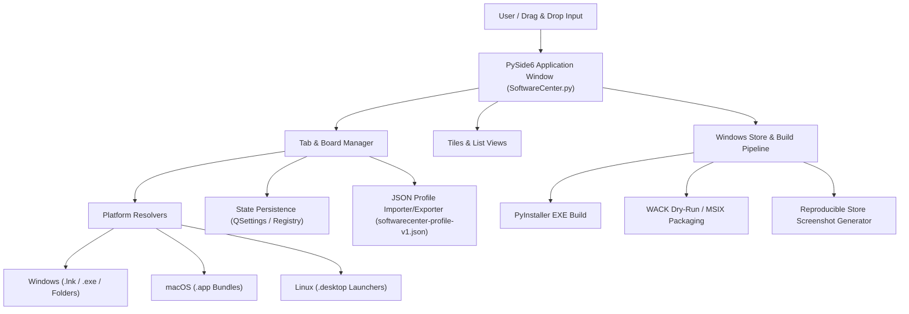
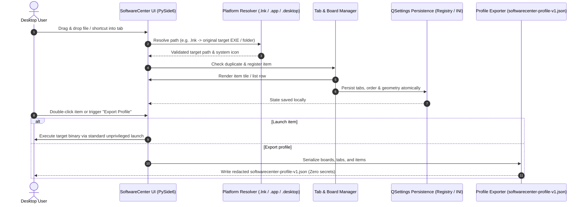

# SoftwareCenter

[](https://www.python.org/)
[](NOTICE)
[](https://docs.pytest.org/)
[](https://github.com/file-bricks/SoftwareCenter)
[](SECURITY.md)
[](SECURITY.md)
[](LICENSE)
[](https://doc.qt.io/qtforpython-6/)
[](https://github.com/file-bricks)
[](https://github.com/open-bricks)
[](llms.txt)

[English](README.md) · [Deutsch](README_de.md) · [Español](README.es.md) · [简体中文](README_zh.md)

> 本页是简体中文文档译文。应用界面仍提供德语、英语、西班牙语、简体中文、日语和俄语六种运行时语言；文档语言与界面语言是两个不同范围。

SoftwareCenter 是一款轻量、跨平台的桌面整理工具，可通过标签页分类管理软件快捷方式。

> [!NOTE]
> **LLM / AI 集成与机器可读索引：** SoftwareCenter 在 `llms.txt` 中提供结构化、机器可读的元数据，并通过带版本的 JSON（`softwarecenter-profile-v1.json`）支持配置文件迁移。


## 快速导航

- [快速参考](#快速参考)
- [功能](#功能)
- [目标用户与搜索发现](#目标用户与搜索发现)
- [与替代方案的对比矩阵](#与替代方案的对比矩阵)
- [系统架构](#系统架构)
- [生命周期顺序流程](#生命周期顺序流程)
- [核心能力与安全不变量](#核心能力与安全不变量)
- [关联生态与姐妹产品](#关联生态与姐妹产品)
- [搜索发现背景](#搜索发现背景)
- [系统要求](#系统要求)
- [安装](#安装)
- [运行](#运行)
- [使用](#使用)
- [构建可执行文件](#构建可执行文件)
- [质量检查](#质量检查)
- [无头模式下的启动器目录维护](#无头模式下的启动器目录维护)
- [交换格式](#交换格式)
- [LaunchBoards](#launchboards)
- [姐妹产品边界](#姐妹产品边界)
- [Windows 应用商店资源](#windows-应用商店资源)
- [技术栈](#技术栈)
- [安全策略](#安全策略)
- [第三方许可证与治理](#第三方许可证与治理)
- [许可证](#许可证)
- [责任限制](#责任限制)

## 快速参考

| 属性 | 详情 |
|---|---|
| **技术栈** | Python 3.10+ / PySide6 (Qt) / QSettings |
| **许可证** | MIT（PySide6 以动态链接方式使用，遵循 LGPLv3） |
| **交换格式** | `softwarecenter-profile-v1.json`（详见 [EXPORTFORMAT.md](EXPORTFORMAT.md)） |
| **最后检查** | 2026-09-23（本地：完整 pytest 套件、平台 smoke、compileall、Ruff、依赖审计、文件管理器上下文菜单集成、NOTICE 署名和 CI 生命周期加固；WACK 仍仅为 dry-run） |

## 功能

- **标签页组织** - 将程序、文档和文件夹分组到可重命名、可移动的工作区中
- **拖放与通用整理** - 将任意应用、脚本、文档、文件夹或快捷方式直接拖到工作区；它在文件系统之上提供独立的整理层
- **空工作区引导** - 在空工作区中显示有帮助的占位提示，说明支持的拖放目标
- **两种视图模式** - 瓦片（大图标）和列表
- **自动保存** - 保存标签页、内容和窗口位置
- **上下文菜单** - 右键即可打开或移除条目
- **跨平台** - 支持 Windows、macOS 和 Linux
- **原生图标** - 自动显示系统应用图标
- **Windows 快捷方式解析** - 拖入指向 `.exe` 或文件夹目标的 `.lnk` 文件时，会将原始目标保存为条目
- **macOS 应用包** - 可将 `.app` 应用直接拖入整理器
- **Linux 桌面启动器** - `.desktop` 条目会显示应用名称，并通过其桌面命令启动
- **配置文件导出/导入** - 使用带版本的 `softwarecenter-profile-v1.json` 格式进行迁移和备份
- **多选** - 一次删除多个条目
- **离线优先** - 无遥测、无账号、无云连接

## 目标用户与搜索发现

SoftwareCenter 面向四类具有明确工作流程需求的用户：

| 用户类型 | 主要特点与职责 | 核心痛点 | SoftwareCenter 的解决方式 |
|---|---|---|---|
| **用户类型 1：桌面高级用户与整理者** | 每天使用大量工具、工作区文件夹和实用程序的用户。 | Windows 桌面杂乱、开始菜单搜索缓慢、缺少可持续使用的自定义分组。 | 快速的标签式工作区、拖放式文件整理、自定义备注和即时切换。 |
| **用户类型 2：独立开发者与 DevOps 工程师** | 管理工具链、CLI 包装器、便携式应用和虚拟环境的开发者。 | 开发工具与普通开始菜单混杂；占用内存的启动器后台进程过重。 | 相互隔离的多配置身份、保留工作目录（`_startfile_in_dir`），且无需守护进程。 |
| **用户类型 3：多 PC 工作站操作人员** | 在多台工作站（例如工作站与笔记本电脑）之间同步配置的用户。 | 绝对路径写死、驱动器盘符不一致、机器本地秘密泄漏。 | 通过架构校验的导出（`softwarecenter-profile-v1.json`）、严格清除秘密信息、非破坏性导入。 |
| **用户类型 4：重视隐私的用户与安全团队** | 需要完整数据机密性的安全工程师和企业用户。 | 商业整理工具强制要求云账号、遥测和后台跟踪。 | 100% 本地优先、离线运行（INV-LOCAL-01）、零网络外连、以非特权用户权限运行（`RunAsInvoker`）。 |

### 高意图搜索词

- `SoftwareCenter Python desktop launcher`
- `PySide6 desktop shortcut manager`
- `local-first desktop organizer python`
- `portable shortcut launcher without cloud account`
- `SoftwareCenter vs LaunchBoards profile switcher`
- `privacy friendly Windows app launcher with tabs`

## 与替代方案的对比矩阵

| 能力 / 维度 | SoftwareCenter | Windows 开始菜单 | Stardock Fences | SyMenu | Launchy / Flow Launcher |
|---|:---:|:---:|:---:|:---:|:---:|
| **基于标签页分类** | **是**（动态工作区） | 否（平面列表 / 文件夹） | 是（桌面围栏） | 是（分层菜单） | 否（仅搜索框） |
| **开放源代码（MIT 许可证）** | **是**（完全宽松） | 否（捆绑专有） | 否（商业闭源） | 是（免费软件、闭源） | 是（开放源代码） |
| **零遥测与完全离线** | **是**（严格零外连） | 否（Bing 搜索与遥测） | 否（许可证与遥测） | 是（可离线使用） | 部分（插件会联网） |
| **多配置文件隔离** | **是**（双身份核心） | 否（单用户配置） | 否（仅桌面表层） | 部分（配置文件） | 否（单一配置） |
| **可移植的脱敏配置导出** | **是**（`softwarecenter-profile-v1.json`） | 否（依赖注册表） | 否（专有备份） | 部分（自定义 XML） | 否（无标准导出格式） |
| **保留工作目录** | **是**（保证父进程工作目录） | 部分（工作目录可变） | 部分（资源管理器默认值） | 是（可配置工作目录） | 部分（启动根目录） |
| **通用文件/文档/文件夹整理层** | **是**（任意文件系统目标 / 可拖放） | 部分（应用与固定项目） | 是（桌面文件） | 是（菜单条目） | 部分（索引爬取器） |
| **无头批量目录维护** | **是**（自动协调器） | 否（仅交互式） | 否（仅交互式） | 否（仅 GUI） | 否（仅交互式） |
| **系统托盘快速导航** | **是**（集成托盘菜单） | 否（任务栏固定） | 否（桌面表层） | 是（以托盘为中心） | 否（键盘快捷键） |
| **以非特权权限运行（`RunAsInvoker`）** | **是**（严格不提权） | SYSTEM / 高权限 | 标准用户 / 管理员 | 标准用户 | 标准用户 |

## 系统架构



## 生命周期顺序流程



## 核心能力与安全不变量

| 不变量 / 能力 | 架构保证 | 验证方式 |
|---|---|---|
| **完全本地优先与零外连** | 完全在本机运行；无遥测、无云跟踪、无远程网络调用 | 源码审计、离线运行检查、测试套件 |
| **不提权（最小权限）** | 严格以标准用户的非特权权限运行；不会请求 UAC 管理员权限 | 进程安全描述符验证 |
| **非破坏性快捷方式操作** | 移除条目只会取消跟踪快捷方式元数据；不会触碰或删除目标可执行文件或文件系统文件 | UI 删除操作隔离测试 |
| **安全的路径与链接解析** | 解析 Windows `.lnk`、macOS `.app` 和 Linux `.desktop` 目标时不会调用 shell 脚本 | 静态目标解析契约测试 |
| **原子状态持久化** | QSettings 安全刷新窗口几何、标签页顺序和活动视图状态到本地 OS 存储 | 原子往返持久化测试套件 |
| **可移植且经过脱敏的配置交换** | 通过架构校验的 JSON（`softwarecenter-profile-v1.json`）仅导出路径和标签；不会提取凭据 | `tests/test_export_contract.py` 回归测试 |
| **姐妹产品隔离** | SoftwareCenter 与 LaunchBoards 使用独立的 QSettings 命名空间、互斥端点和 Store 身份 | `scripts/verify_product_boundaries.py` |
| **多操作系统 CI 矩阵验证** | 已在 Windows、macOS 和 Linux runner 的 Python 3.10–3.12 环境中验证 | GitHub Actions 工作流和 smoke 检查 |

## 关联生态与姐妹产品

SoftwareCenter 是更大的 **file-bricks** 桌面工具集合和 **open-bricks** 开源计划的一部分：

| 项目 | 生态 | 主要用途 | 集成 / 协同 |
|---|---|---|---|
| [`ProFiler`](https://github.com/file-bricks/ProFiler) | `file-bricks` | 文档与媒体检查 | 配套文件分类与文档取证分析应用 |
| [`ExplorerPro`](https://github.com/file-bricks/ExplorerPro) | `file-bricks` | 多标签页文件系统浏览器 | 为 SoftwareCenter 快捷方式提供互补的双窗格文件管理 |
| [`CloudLockFixer`](https://github.com/file-bricks/CloudLockFixer) | `file-bricks` | 云锁解锁与修复 | 解锁快捷方式所指向的冻结同步占位文件和 OneDrive 文件 |
| [`knowledgedigest`](https://github.com/file-bricks/knowledgedigest) | `file-bricks` | Markdown 与文档知识库 | 用于研究工作流程的本地优先文档摘要整理器 |
| [`FormularErstellen`](https://github.com/doc-bricks/FormularErstellen) | `doc-bricks` | 表单创建与模板 | 可通过 SoftwareCenter 磁贴启动的桌面文档生成器 |
| [`USR_PDFunlock`](https://github.com/doc-bricks/USR_PDFunlock) | `doc-bricks` | PDF 密码与解锁工具 | 非破坏性的本地 PDF 解锁实用程序 |
| [`safe-start-for-codex`](https://github.com/dev-bricks/safe-start-for-codex) | `dev-bricks` | 自动化启动闸门 | 保护桌面工作站环境，避免启动负载突增 |
| [`MethodenAnalyser`](https://github.com/dev-bricks/MethodenAnalyser) | `dev-bricks` | AST 源码分析器 | 面向 Python 桌面工具和模块的静态分析 |
| [`connectors`](https://github.com/ellmos-ai/connectors) | `ellmos-ai` | 代理通信桥接器 | 零依赖消息与传输适配器 |
| [`open-bricks`](https://github.com/open-bricks) | `open-bricks` | 桌面开源计划 | 标准、治理与打包计划 |

## 搜索发现背景

SoftwareCenter 最容易被描述为**本地优先的 PySide6 应用启动器**或**桌面快捷方式整理器**。它介于 Windows 开始菜单、桌面快捷方式文件夹和完整软件资产管理系统之间：它启动本机已有的内容，将快捷方式分组到标签页中，并支持配置文件的导入与导出。

可用的搜索词：

- `SoftwareCenter PySide6 desktop organizer`
- `local-first app launcher Python PySide6`
- `desktop shortcut organizer with tabs`
- `softwarecenter-profile-v1.json`
- `offline software launcher no cloud no telemetry`

它不是 Microsoft Configuration Manager Software Center、应用商店、软件包管理器或远程部署门户。

## 系统要求

- Python 3.10+
- PySide6

## 安装

```bash
pip install -r requirements.txt
```

## 运行

```bash
python SoftwareCenter.py
```

在 Windows 上，还可使用 `START.bat`，或从 [Releases](https://github.com/file-bricks/SoftwareCenter/releases) 下载预构建的 `SoftwareCenter.exe`。

## 使用

| 操作 | 说明 |
|--------|-------------|
| 添加程序 | 将文件、文件夹、快捷方式、macOS 上的 `.app` 包或 Linux 上的 `.desktop` 启动器拖入窗口；指向 `.exe` 文件或文件夹的 Windows `.lnk` 文件会解析为原始目标 |
| 整理标签页 | 工具栏 > “New Tab”，双击标签页可重命名 |
| 切换视图 | 工具栏 > Tiles / List |
| 启动程序 | 双击，或右键选择 Open/Start |
| 移除条目 | 右键 > Delete（只移除快捷方式条目） |
| 导出配置文件 | `File > Export Profile` 或工具栏操作 |
| 导入配置文件 | `File > Import Profile` 或工具栏操作；此操作会替换当前配置文件 |

## 构建可执行文件

```bash
pip install pyinstaller
python -m PyInstaller --noconfirm --clean SoftwareCenter.spec
```

生成的 EXE 位于 `dist/SoftwareCenter.exe`。在 Windows 上，`build_exe.bat` 还会将其复制到项目根目录，供本地使用。

## 质量检查

```bash
python -m compileall -q SoftwareCenter.py manage_translations.py translator.py
python -m json.tool locales/translations.json
python -m json.tool store_package.json
python -m pytest -q
python tests/macos_platform_smoke.py
python tests/linux_platform_smoke.py
python scripts/verify_product_boundaries.py
```

托管工作流及其明确的可选 Web 边界详见 [CI_CONTRACT.md](CI_CONTRACT.md)。

GitHub Actions 会运行这些 smoke 检查。macOS smoke 会在 `macos-latest` 上验证 `.app` 导入、`open` 启动、QSettings 持久化和配置导出；Linux smoke 会在 `ubuntu-latest` 上覆盖 `.desktop` 导入、`Exec` / `xdg-open` 启动、QSettings 持久化和配置导出。构建产物以及本地任务/测试文件均被忽略，不应提交。

对于 Windows Store 流程，运行 `python scripts/run_windows_wack.py --dry-run` 可检查本地 MSIX/AppCert 路径并输出可复现的 WACK 命令。正式认证检查应在提交前，针对新的已签名 MSIX，在提升权限的 PowerShell 中执行。
运行 `python generate_store_screenshots.py` 可为当前桌面界面生成可复现的 Store 截图，更新 `README/screenshots/store/` 中的四张脱敏商店图片和 `summary.json`。

## 无头模式下的启动器目录维护

可选的目录协调器以 Plan-D 运行时代码的形式提供于 `scripts/softwarecenter_sync.py` 中。同步目录及注册表文件必须作为 CLI 显式输入；除非提供 `--apply`，命令只读。
固定运行时的计划任务载荷、应用闸门、本地原生回读和回滚步骤见 [RUNTIME_DAILY_CARE.md](RUNTIME_DAILY_CARE.md)。

## 交换格式

配置文件可导出为 `softwarecenter-profile-v1.json`，之后再导入。该格式包含标签页、视图模式以及带有 `label`、`path`、`kind` 和可选 `notes` 的条目，但不会复制本地文件或凭据。缺失的路径仍会作为引用保留。详情请参阅 [EXPORTFORMAT.md](EXPORTFORMAT.md)。

## LaunchBoards


[LaunchBoards](https://github.com/file-bricks/SoftwareCenter) 是 SoftwareCenter 的姐妹产品：两者使用同一代码库，但采用独立品牌与身份，更强调可切换的工作区，而非通用快捷方式启动器。它与 SoftwareCenter 共用此仓库和发布流程——无需维护单独的 LaunchBoards 源码树。

## 姐妹产品边界

LaunchBoards 与 SoftwareCenter 共用实现，但拥有独立的 QSettings 命名空间、单实例端点、图标、可执行文件、Store 身份和发布路径。
可复现的静态检查、隔离的并行进程检查和产物检查详见 [PRODUCT_BOUNDARIES.md](PRODUCT_BOUNDARIES.md)。

## Windows 应用商店资源

Windows Store 流程现包含当前桌面界面的可复现截图生成器。运行 `python generate_store_screenshots.py` 可刷新 `README/screenshots/store/`。

## 技术栈

| 组件 | 技术 |
|-----------|-----------|
| 语言 | Python 3.10+ |
| GUI 框架 | PySide6 (Qt for Python) |
| 存储 | QSettings (Windows 注册表 / INI) |
| 代码规模 | 约 690 行 |

## 安全策略

安全与隐私是核心架构目标。完整的漏洞披露指南、48 小时响应 SLA 和本地优先不变量，详见 [SECURITY.md](SECURITY.md)。

## 第三方许可证与治理

SoftwareCenter 使用符合许可证要求且许可宽松的第三方开源组件。完整审计详情、SPDX 许可证标识和动态链接合规说明见 [THIRD_PARTY_LICENSES.md](THIRD_PARTY_LICENSES.md)。

- **署名：** [NOTICE](NOTICE)（Lukas Geiger、file-bricks 和 open-bricks 计划的规范开源版权署名）。
- **PySide6 与 shiboken6：** [LGPL-3.0-only](https://www.gnu.org/licenses/lgpl-3.0.html)（通过 Qt for Python 动态链接，依据 LGPLv3 §4 保留用户完整替换能力）。
- **Python 标准库：** [PSF-2.0](https://docs.python.org/3/license.html)（100% 离线，零网络外连）。
- **PyInstaller：** [GPL-2.0-or-later with PyInstaller-exception](https://pyinstaller.org/en/stable/license.html)（构建工具；输出的可执行文件不受 GPL copyleft 约束）。
- **治理不变量：** 10 项核心运行保证（INV-LOCAL-01 至 INV-ZEROCOPY-10）由自动化测试强制执行。

## 许可证

[MIT](LICENSE)

**注意：** 本应用使用 [PySide6](https://doc.qt.io/qtforpython-6/)，其许可证为 LGPLv3。PySide6 采用动态链接。

---

## 责任限制

本项目是无偿提供的开源捐赠。责任仅限于故意和重大过失（§ 521 German Civil Code）。使用风险由您自行承担。不提供任何保证、维护承诺，也不保证适用于特定用途。
