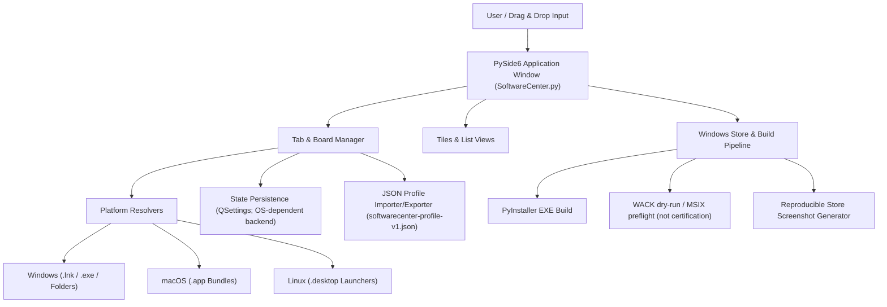
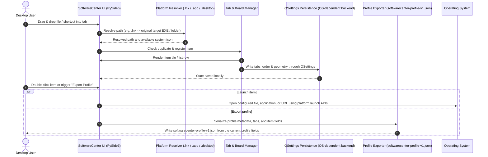

# SoftwareCenter

[](https://www.python.org/)
[](NOTICE)
[](https://docs.pytest.org/)
[](https://github.com/file-bricks/SoftwareCenter)
[](SECURITY.md)
[](SECURITY.md)
[](LICENSE)
[](https://doc.qt.io/qtforpython-6/)
[](https://github.com/file-bricks)
[](https://github.com/open-bricks)
[](llms.txt)

[English](README.md) · [Deutsch](README_de.md) · [Español](README.es.md) · [简体中文](README_zh.md) · [日本語](README_ja.md) · [Русский](README_ru.md) · [Français](README_fr.md) · [हिन्दी](README_hi.md) · [العربية](README_ar.md)

> 本页是简体中文文档译文。应用界面仍提供德语、英语、西班牙语、简体中文、日语和俄语六种运行时语言；文档语言与界面语言是两个不同范围。

SoftwareCenter 是一款轻量、跨平台的桌面整理工具，可通过标签页分类管理软件快捷方式。

> [!NOTE]
> **LLM / AI 集成与机器可读索引：** SoftwareCenter 在 [`llms.txt`](llms.txt) 中提供结构化、机器可读的元数据，并通过带版本的 JSON（`softwarecenter-profile-v1.json`）支持配置文件迁移。


## 快速导航

- [快速参考](#快速参考)
- [功能](#功能)
- [目标用户与搜索发现](#目标用户与搜索发现)
- [SoftwareCenter 的能力与边界](#与替代方案的对比矩阵)
- [系统架构](#系统架构)
- [生命周期顺序流程](#生命周期顺序流程)
- [核心能力与证据边界](#核心能力与安全不变量)
- [关联生态与姐妹产品](#关联生态与姐妹产品)
- [搜索发现背景](#搜索发现背景)
- [系统要求](#系统要求)
- [安装](#安装)
- [运行](#运行)
- [使用](#使用)
- [构建可执行文件](#构建可执行文件)
- [质量检查](#质量检查)
- [无头模式下的启动器目录维护](#无头模式下的启动器目录维护)
- [交换格式](#交换格式)
- [LaunchBoards](#launchboards)
- [姐妹产品边界](#姐妹产品边界)
- [Windows 应用商店资源](#windows-应用商店资源)
- [技术栈](#技术栈)
- [安全策略](#安全策略)
- [第三方许可证与治理](#第三方许可证与治理)
- [许可证](#许可证)
- [责任限制](#责任限制)

## 快速参考

| 属性 | 详情 |
|---|---|
| **技术栈** | Python 3.10+ / PySide6 (Qt) / QSettings |
| **许可证** | 项目源码：MIT；PySide6 和其他依赖有各自的许可条件（见 [THIRD_PARTY_LICENSES.md](THIRD_PARTY_LICENSES.md)） |
| **交换格式** | `softwarecenter-profile-v1.json`（详见 [EXPORTFORMAT.md](EXPORTFORMAT.md)） |
| **最后检查** | 2026-09-23（本地：完整 pytest 套件、平台 smoke、compileall、Ruff、依赖审计、文件管理器上下文菜单集成、NOTICE 署名和 CI 生命周期加固；WACK 仍仅为 dry-run） |

## 功能

- **标签页组织** - 将程序、文档和文件夹分组到可重命名、可移动的工作区中
- **拖放与通用整理** - 将任意应用、脚本、文档、文件夹或快捷方式直接拖到工作区；它在文件系统之上提供独立的整理层
- **空工作区引导** - 在空工作区中显示有帮助的占位提示，说明支持的拖放目标
- **两种视图模式** - 瓦片（大图标）和列表
- **自动保存** - 保存标签页、内容和窗口位置
- **上下文菜单** - 右键即可打开或移除条目
- **跨平台** - 支持 Windows、macOS 和 Linux
- **原生图标** - 自动显示系统应用图标
- **Windows 快捷方式解析** - 拖入指向 `.exe` 或文件夹目标的 `.lnk` 文件时，会将原始目标保存为条目
- **macOS 应用包** - 可将 `.app` 应用直接拖入整理器
- **Linux 桌面启动器** - `.desktop` 条目会显示应用名称，并通过其桌面命令启动
- **配置文件导出/导入** - 使用带版本的 `softwarecenter-profile-v1.json` 格式进行迁移和备份
- **多选** - 一次删除多个条目
- **本地优先运行** - 整理器代码未实现账号、遥测或云同步功能；HTTP(S) URL 和启动的程序通过平台打开，可能使用网络

## 目标用户与搜索发现

SoftwareCenter 面向四类具有明确工作流程需求的用户：

| 用户类型 | 主要特点与职责 | 核心痛点 | SoftwareCenter 的解决方式 |
|---|---|---|---|
| **用户类型 1：桌面高级用户与整理者** | 每天使用大量工具、工作区文件夹和实用程序的用户。 | Windows 桌面杂乱、开始菜单搜索缓慢、缺少可持续使用的自定义分组。 | 快速的标签式工作区、拖放式文件整理、自定义备注和即时切换。 |
| **用户类型 2：独立开发者与 DevOps 工程师** | 管理工具链、CLI 包装器、便携式应用和虚拟环境的开发者。 | 开发工具与普通开始菜单混杂；占用内存的启动器后台进程过重。 | SoftwareCenter 与 LaunchBoards 具有彼此独立的产品身份；在 Windows 上，启动文件时会在支持的情况下请求将目标目录设为工作目录。这不是项目环境管理器；实际行为取决于操作系统和目标程序。 |
| **用户类型 3：多工作站用户** | 在多台工作站之间手动迁移配置文件的用户。 | 绝对路径在另一台设备上可能无效；标签和可选备注可能包含私人信息。 | 使用带版本的 `softwarecenter-profile-v1.json` 导出/导入；分享前检查路径和备注。确认后，导入会替换当前配置文件；不会复制目标文件。 |
| **用户类型 4：重视隐私的用户** | 希望整理器设置保存在本地、且应用不内置账号或遥测功能的人。 | 保存的路径和备注可能泄露本地信息；打开 URL 或启动程序可能进行网络通信。 | 经审查的整理器代码未实现账号、遥测或云同步功能。它不保证数据保密、启动进程零外连或目标程序的权限行为。 |

### 高意图搜索词

- `SoftwareCenter Python desktop launcher`
- `PySide6 desktop shortcut manager`
- `local-first desktop organizer python`
- `portable shortcut launcher without cloud account`
- `SoftwareCenter vs LaunchBoards profile switcher`
- `privacy friendly Windows app launcher with tabs`

<a id="与替代方案的对比矩阵"></a>
## SoftwareCenter 的能力与边界

| 能力 | 已实现的行为 | 边界 |
|---|---|---|
| **标签页整理** | 将路径条目分组到可命名标签页，并提供平铺和列表视图。 | 标签页整理的是引用；它们不是按项目隔离的运行环境。 |
| **本地路径与 URL** | 可通过拖放登记受支持的本地路径和 HTTP(S) URL。 | 条目引用目标；整理器不会复制目标内容。 |
| **平台目标处理** | Windows 的 `.lnk` 解析接受现有 `.exe` 或文件夹目标；macOS 应用包通过 `open` 打开；Linux `.desktop` 条目会读取名称、图标和 `Exec`。 | 解析和启动方式因操作系统而异。Linux 会将 `Exec` 作为命令启动；这不是脚本沙箱。 |
| **工作目录** | 在 Windows 上，启动文件时会在支持的情况下请求将目标所在目录设为工作目录。 | 回退路径可能不会显式设置工作目录；不保证父进程 CWD 或跨平台工作目录。 |
| **本地设置** | Qt `QSettings` 在产品设置命名空间中保存标签页、条目、视图和窗口状态。 | 存储后端由 Qt 和操作系统提供；不保证原子写入或进程安全描述符。 |
| **配置文件导出** | `softwarecenter-profile-v1.json` 包含配置文件元数据、标签页、视图，以及带有 `label`、`path`、`kind` 和可选 `notes` 的条目。 | 路径、标签和备注可能泄露本地信息；不会复制目标文件。 |
| **配置文件导入** | 导入器会检查格式和版本、规范化条目，并在替换前请求确认。 | 确认后会替换当前配置文件；这不是合并，也不构成一般性的数据不丢失保证。 |
| **产品身份** | SoftwareCenter 与 LaunchBoards 共用实现，但使用独立的设置命名空间、单实例端点和 Store 身份。 | 这是两个产品之间的隔离，不是 SoftwareCenter 内供用户选择的配置文件。 |
| **网络边界** | 经审查的整理器代码未实现账号、遥测或云同步功能。 | 打开 HTTP(S) URL 和外部目标可能使用网络；不保证应用或其启动进程零外连。 |
| **验证范围** | 仓库测试覆盖明确列出的契约；CI 在 Ubuntu 上运行 Python 版本矩阵，并分别运行 Linux/macOS smoke 作业。 | 这不意味着有 Windows runner CI、WACK 认证、Store 发布或普遍运行时安全保证。 |

## 系统架构



## 生命周期顺序流程



<a id="核心能力与安全不变量"></a>
## 核心能力与证据边界

| 主题 | 经审查代码与测试中的证据 | 范围与限制 |
|---|---|---|
| **整理器的网络行为** | 经审查的应用代码未实现账号、遥测或云同步客户端；`open_file` 会将 HTTP(S) URL 交给 Qt 或系统浏览器。 | 源码审查无法测量 SoftwareCenter、浏览器或启动进程的运行时网络活动。 |
| **启动上下文** | 文件和 URL 通过平台 API 打开；在 Windows 上，启动代码会在支持时请求使用目标目录作为工作目录。 | 经审查的代码和测试未验证进程安全描述符，也不会强制子进程权限。 |
| **移除条目** | UI 会从列表和已保存的配置文件状态中移除条目，但不会删除所引用的文件。 | 这不约束外部程序打开或修改的目标。 |
| **平台解析** | Windows `.lnk` 目标解析通过 COM 执行，并以 PowerShell 作为回退；Linux `.desktop` 的 `Exec` 会被解析后启动。 | 这些处理程序不会隔离目标行为；它们可能启动配置的命令或外部程序。 |
| **QSettings 持久化** | `save_settings` 通过 Qt `QSettings` 写入标签页、条目、视图、窗口几何和语言设置。 | 代码没有承诺原子事务或崩溃安全写入。 |
| **配置文件数据** | `softwarecenter-profile-v1.json` 包含配置文件字段和带有 `label`、`path`、`kind`、可选 `notes` 的条目；确认后导入会替换当前配置文件。 | 字段值可能暴露本地信息；测试覆盖测试样例和往返流程，不能证明应用会自动识别或过滤用户输入中的敏感信息。见 `tests/test_export_contract.py`。 |
| **姐妹产品隔离** | `scripts/verify_product_boundaries.py` 和产品测试检查 SoftwareCenter 与 LaunchBoards 的设置命名空间和单实例端点是否分离。 | 这是产品隔离，不是用户或项目配置文件。见 `PRODUCT_BOUNDARIES.md` 和 `tests/test_product_boundaries.py`。 |
| **CI 与发布验证范围** | CI 在 Ubuntu 上运行 Python 版本矩阵，并分别运行 Linux/macOS smoke 作业。 | 这不代表 Windows runner CI、WACK 认证、Store 发布或普遍运行时安全。见 `CI_CONTRACT.md`。 |

## 关联生态与姐妹产品

SoftwareCenter 是更大的 **file-bricks** 桌面工具集合和 **open-bricks** 开源计划的一部分：

| 项目 | 生态 | 主要用途 | 集成 / 协同 |
|---|---|---|---|
| [`ProFiler`](https://github.com/file-bricks/ProFiler) | `file-bricks` | 文档与媒体检查 | 配套文件分类与文档取证分析应用 |
| [`ExplorerPro`](https://github.com/file-bricks/ExplorerPro) | `file-bricks` | 多标签页文件系统浏览器 | 为 SoftwareCenter 快捷方式提供互补的双窗格文件管理 |
| [`CloudLockFixer`](https://github.com/file-bricks/CloudLockFixer) | `file-bricks` | 云锁解锁与修复 | 解锁快捷方式所指向的冻结同步占位文件和 OneDrive 文件 |
| [`knowledgedigest`](https://github.com/file-bricks/knowledgedigest) | `file-bricks` | Markdown 与文档知识库 | 用于研究工作流程的本地优先文档摘要整理器 |
| [`FormularErstellen`](https://github.com/doc-bricks/FormularErstellen) | `doc-bricks` | 表单创建与模板 | 可通过 SoftwareCenter 磁贴启动的桌面文档生成器 |
| [`USR_PDFunlock`](https://github.com/doc-bricks/USR_PDFunlock) | `doc-bricks` | PDF 密码与解锁工具 | 非破坏性的本地 PDF 解锁实用程序 |
| [`safe-start-for-codex`](https://github.com/dev-bricks/safe-start-for-codex) | `dev-bricks` | 自动化启动闸门 | 保护桌面工作站环境，避免启动负载突增 |
| [`MethodenAnalyser`](https://github.com/dev-bricks/MethodenAnalyser) | `dev-bricks` | AST 源码分析器 | 面向 Python 桌面工具和模块的静态分析 |
| [`connectors`](https://github.com/ellmos-ai/connectors) | `ellmos-ai` | 代理通信桥接器 | 零依赖消息与传输适配器 |
| [`open-bricks`](https://github.com/open-bricks) | `open-bricks` | 桌面开源计划 | 标准、治理与打包计划 |

## 搜索发现背景

SoftwareCenter 最容易被描述为**本地优先的 PySide6 应用启动器**或**桌面快捷方式整理器**。它介于 Windows 开始菜单、桌面快捷方式文件夹和完整软件资产管理系统之间：它启动本机已有的内容，将快捷方式分组到标签页中，并支持配置文件的导入与导出。

可用的搜索词：

- `SoftwareCenter PySide6 desktop organizer`
- `local-first app launcher Python PySide6`
- `desktop shortcut organizer with tabs`
- `softwarecenter-profile-v1.json`
- `本地桌面整理器与配置文件导出`

它不是 Microsoft Configuration Manager Software Center、应用商店、软件包管理器或远程部署门户。

## 系统要求

- Python 3.10+
- PySide6

## 安装

```bash
pip install -r requirements.txt
```

## 运行

```bash
python SoftwareCenter.py
```

在 Windows 上，还可使用 `START.bat`，或从 [Releases](https://github.com/file-bricks/SoftwareCenter/releases) 下载预构建的 `SoftwareCenter.exe`。

## 使用

| 操作 | 说明 |
|--------|-------------|
| 添加程序 | 将文件、文件夹、快捷方式、macOS 上的 `.app` 包或 Linux 上的 `.desktop` 启动器拖入窗口；指向 `.exe` 文件或文件夹的 Windows `.lnk` 文件会解析为原始目标 |
| 整理标签页 | 工具栏 > “New Tab”，双击标签页可重命名 |
| 切换视图 | 工具栏 > Tiles / List |
| 启动程序 | 双击，或右键选择 Open/Start |
| 移除条目 | 右键 > Delete（只移除快捷方式条目） |
| 导出配置文件 | `File > Export Profile` 或工具栏操作 |
| 导入配置文件 | `File > Import Profile` 或工具栏操作；此操作会替换当前配置文件 |

## 构建可执行文件

```bash
pip install pyinstaller
python -m PyInstaller --noconfirm --clean SoftwareCenter.spec
```

生成的 EXE 位于 `dist/SoftwareCenter.exe`。在 Windows 上，`build_exe.bat` 还会将其复制到项目根目录，供本地使用。

## 质量检查

```bash
python -m compileall -q SoftwareCenter.py manage_translations.py translator.py
python -m json.tool locales/translations.json
python -m json.tool store_package.json
python -m pytest -q
python tests/macos_platform_smoke.py
python tests/linux_platform_smoke.py
python scripts/verify_product_boundaries.py
```

托管工作流及其明确的可选 Web 边界详见 [CI_CONTRACT.md](CI_CONTRACT.md)。

GitHub Actions 会运行这些 smoke 检查。macOS smoke 会在 `macos-latest` 上验证 `.app` 导入、`open` 启动、QSettings 持久化和配置导出；Linux smoke 会在 `ubuntu-latest` 上覆盖 `.desktop` 导入、`Exec` / `xdg-open` 启动、QSettings 持久化和配置导出。构建产物以及本地任务/测试文件均被忽略，不应提交。

对于 Windows Store 流程，运行 `python scripts/run_windows_wack.py --dry-run` 可检查本地 MSIX/AppCert 路径并输出可复现的 WACK 命令。正式认证检查应在提交前，针对新的已签名 MSIX，在提升权限的 PowerShell 中执行。
运行 `python generate_store_screenshots.py` 可为当前桌面界面生成可复现的 Store 截图，更新 `README/screenshots/store/` 中的四张 Store 截图和 `summary.json`。

## 无头模式下的启动器目录维护

可选的目录协调器以 Plan-D 运行时代码的形式提供于 `scripts/softwarecenter_sync.py` 中。同步目录及注册表文件必须作为 CLI 显式输入；除非提供 `--apply`，命令只读。
固定运行时的计划任务载荷、应用闸门、本地原生回读和回滚步骤见 [RUNTIME_DAILY_CARE.md](RUNTIME_DAILY_CARE.md)。

## 交换格式

配置文件可导出为 `softwarecenter-profile-v1.json`，之后再导入。该格式包含配置文件元数据、标签页、视图模式以及带有 `label`、`path`、`kind` 和可选 `notes` 的条目。应用不会复制所引用的本地文件，但路径、标签和备注可能包含敏感信息，应用不会自动识别或过滤其中的敏感信息。确认后，导入会替换当前配置文件。缺失路径仍会作为引用保留。详情请参阅 [EXPORTFORMAT.md](EXPORTFORMAT.md)。

## LaunchBoards


[LaunchBoards](https://github.com/file-bricks/SoftwareCenter) 是 SoftwareCenter 的姐妹产品：两者使用同一代码库，但采用独立品牌与身份，更强调可切换的工作区，而非通用快捷方式启动器。它与 SoftwareCenter 共用此仓库和发布流程——无需维护单独的 LaunchBoards 源码树。

## 姐妹产品边界

LaunchBoards 与 SoftwareCenter 共用实现，但拥有独立的 QSettings 命名空间、单实例端点、图标、可执行文件、Store 身份和发布路径。
可复现的静态检查、隔离的并行进程检查和产物检查详见 [PRODUCT_BOUNDARIES.md](PRODUCT_BOUNDARIES.md)。

## Windows 应用商店资源

Windows Store 流程现包含当前桌面界面的可复现截图生成器。运行 `python generate_store_screenshots.py` 可刷新 `README/screenshots/store/`。

## 技术栈

| 组件 | 技术 |
|-----------|-----------|
| 语言 | Python 3.10+ |
| GUI 框架 | PySide6 (Qt for Python) |
| 存储 | QSettings (Windows 注册表 / INI) |
| 代码规模 | 不再列固定行数 |

## 安全策略

[SECURITY.md](SECURITY.md) 说明受支持版本、漏洞报告渠道、声明的 48 小时首次响应时间和 5 个工作日的分流时限。策略文本不等同于运行时验证。

## 第三方许可证与治理

仓库的 MIT 许可证适用于项目源码。第三方依赖有各自的许可条件；[THIRD_PARTY_LICENSES.md](THIRD_PARTY_LICENSES.md) 记录组件元数据，但不表示所有依赖都采用宽松许可证，也不构成所有打包方式的合规保证。

- **署名：** [NOTICE](NOTICE)（Lukas Geiger、file-bricks 和 open-bricks 计划的规范开源版权署名）。
- **PySide6 与 shiboken6：** 清单记录了 LGPL-3.0-only 条款；请参阅 [LGPL-3.0 正文](https://www.gnu.org/licenses/lgpl-3.0.html) 和[组件元数据](THIRD_PARTY_LICENSES.md)。项目的 MIT 许可证不笼统适用于这些依赖。
- **Python 标准库：** [PSF-2.0](https://docs.python.org/3/license.html)。该许可证并不说明整理器或其启动的程序是否离线运行。
- **PyInstaller：** [GPL-2.0-or-later with PyInstaller-exception](https://pyinstaller.org/en/stable/license.html) 是构建工具；对于分发的打包程序，应查看上游许可证和分发声明，不应据此推断存在普遍豁免。
- **验证范围：** 测试检查明确列出的代码和文档契约；它们不能证明普遍运行时保证。

## 许可证

[MIT](LICENSE)

**注意：** MIT 是本仓库项目源码的许可证。本应用使用 [PySide6](https://doc.qt.io/qtforpython-6/)，其依赖许可证条件另行适用；见 [THIRD_PARTY_LICENSES.md](THIRD_PARTY_LICENSES.md)。

---

## 责任限制

本项目是无偿提供的开源捐赠。责任仅限于故意和重大过失（§ 521 German Civil Code）。使用风险由您自行承担。不提供任何保证、维护承诺，也不保证适用于特定用途。
